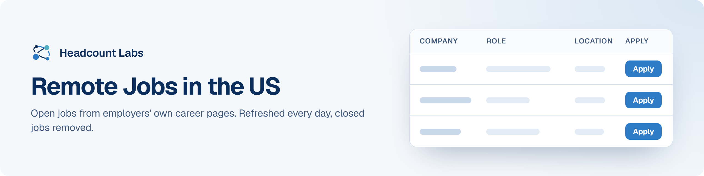

# Remote Jobs in the US

Fully remote jobs at US employers in every field, sorted by field.

**319 open jobs** · 311 new since the last update · 271 removed because they closed or left the employer's board · updated November 14, 2026 at 4:53 AM EST

This list is built and refreshed every day by [Headcount Labs](https://headcountlabs.com/?utm_source=github&utm_medium=job-list&utm_campaign=remote-jobs), which reads jobs straight from employers' own career pages and job boards. Every job here was still listed on its source board when we last read that board, within the past 3 days, and was posted in the past 30 days. Copies of the same job are merged into one row, and jobs that close are removed at the next update.

Want this data in your own app or agent? Use the [Headcount Labs jobs API](https://headcountlabs.com/docs/?utm_source=github&utm_medium=job-list&utm_campaign=remote-jobs) (free tier), the [MCP server](https://headcountlabs.com/mcp/?utm_source=github&utm_medium=job-list&utm_campaign=remote-jobs) for Claude, ChatGPT and other AI assistants, or the [public dataset subsets](https://huggingface.co/HeadcountLabs) on Hugging Face (the full dataset is coming soon).

**Full dataset.** A bigger, one-off snapshot dated 2026-10-19 (all matching jobs, not only the open jobs below) is on Hugging Face: [Remote jobs](https://huggingface.co/datasets/HeadcountLabs/remote-jobs). It loads with `datasets.load_dataset` and is under the Open Database License (ODbL) 1.0.

**Jump to:** [Software engineering (24)](#software-engineering) · [Data, AI and machine learning (13)](#data-ai-and-machine-learning) · [Product and design (11)](#product-and-design) · [Hardware and engineering (25)](#hardware-and-engineering) · [Business, finance and operations (93)](#business-finance-and-operations) · [Healthcare (22)](#healthcare) · [Other roles (131)](#other-roles)

**Columns.** *Apply* opens the original posting on the employer's site. *Details* opens the job on Headcount Labs, with every posting we found for it. *Remote* shows what the employer states; a dash means the posting doesn't say. *Pay* is the range the employer published.

## Software engineering

| Company | Role | Location | Remote | Pay | Posted | Apply | Details |
| --- | --- | --- | --- | --- | --- | :---: | :---: |
| **Seeq** | AI Software Engineer - Staff/Principal | United States | Remote | — | Nov 14 |  | <a href="https://headcountlabs.com/catalog/jobs/0537b1ce-a033-4235-9f4f-3a3bbdd0eab7?utm_source=github&utm_medium=job-list&utm_campaign=remote-jobs">via Headcount Labs</a> |
| **Cardinal Health** | Territory Account Manager, Pharmacy Front-End Specialist | 

2 locations
Swedesboro, NJ Philadelphia, PA
 | Remote | $97k–$115k/yr | Nov 14 |  | <a href="https://headcountlabs.com/catalog/jobs/004dff95-9ac1-44c1-abbe-499d44ddf4ca?utm_source=github&utm_medium=job-list&utm_campaign=remote-jobs">via Headcount Labs</a> |
| **SA Photonics** | HCM Analytics &amp; BI Developer | Reston, VA | Remote | $90k–$190k/yr | Nov 13 |  | <a href="https://headcountlabs.com/catalog/jobs/3a9dce4e-aa79-4369-916e-06ee87ccf5f0?utm_source=github&utm_medium=job-list&utm_campaign=remote-jobs">via Headcount Labs</a> |
| **Lynker Corporation** | Scientific Software Engineer - Meteorological Decoders for Observation Processing and Integration | College Park, MD | Remote | $75k–$120k/yr | Nov 13 |  | <a href="https://headcountlabs.com/catalog/jobs/e2360fc6-8262-4d50-87a7-67585199da07?utm_source=github&utm_medium=job-list&utm_campaign=remote-jobs">via Headcount Labs</a> |
| **Goldbelt, Inc.** | Cloud Engineer | Mechanicsburg, PA | Remote | — | Nov 13 |  | <a href="https://headcountlabs.com/catalog/jobs/c5e1b35b-8d95-42af-ad37-714369ed36af?utm_source=github&utm_medium=job-list&utm_campaign=remote-jobs">via Headcount Labs</a> |
| **GameChanger** | Software Engineer, Ads | GameChanger | Remote | $120k–$140k/yr | Nov 13 |  | <a href="https://headcountlabs.com/catalog/jobs/fbbbbb0d-c04b-442e-998a-b0693006a012?utm_source=github&utm_medium=job-list&utm_campaign=remote-jobs">via Headcount Labs</a> |
| **ewminds consulting Services** | Java Developer | Iowa City, IA | Remote | — | Nov 13 |  | <a href="https://headcountlabs.com/catalog/jobs/a069c58e-85ea-4447-8b2c-b2bca5789e16?utm_source=github&utm_medium=job-list&utm_campaign=remote-jobs">via Headcount Labs</a> |
| **Cherokee Federal** | Salesforce Developer | United States | Remote | $130k–$140k/yr | Nov 13 |  | <a href="https://headcountlabs.com/catalog/jobs/a6e7c587-0e90-42bf-a2b6-88e0c8271dd1?utm_source=github&utm_medium=job-list&utm_campaign=remote-jobs">via Headcount Labs</a> |
| **Birdi** | Senior Fullstack Engineer | Plymouth, MI | Remote | — | Nov 13 |  | <a href="https://headcountlabs.com/catalog/jobs/6acdc95e-17c4-4aa2-bdb4-20737f82744b?utm_source=github&utm_medium=job-list&utm_campaign=remote-jobs">via Headcount Labs</a> |
| **AG Consulting Partners, Inc.** | Senior .NET Application Developer - Enterprise Systems | Redmond, WA | Remote | — | Nov 13 |  | <a href="https://headcountlabs.com/catalog/jobs/3d6af477-173d-4efb-a6a1-b82b15c36a6d?utm_source=github&utm_medium=job-list&utm_campaign=remote-jobs">via Headcount Labs</a> |
| **Adaption** | Developer Community Manager (Contract) | United States | Remote | — | Nov 13 |  | <a href="https://headcountlabs.com/catalog/jobs/72e05f7e-2387-473d-a408-2f99cfc88b7a?utm_source=github&utm_medium=job-list&utm_campaign=remote-jobs">via Headcount Labs</a> |
| **003 Humana Inc.** | Senior DevOps Platform Engineer | 

11 locations
Louisville, KY Arlington, VA Atlanta Boston, MA Charlotte, NC Dallas, TX Frisco, TX Plano, TX Nashville, TN New York, NY Oak Brook, IL
 | Remote | $107k–$147k/yr | Nov 13 |  | <a href="https://headcountlabs.com/catalog/jobs/a89c5723-b989-4e67-85b5-1632e663ca3d?utm_source=github&utm_medium=job-list&utm_campaign=remote-jobs">via Headcount Labs</a> |
| **URUS Group** | AI Agent Developer (Microsoft Copilot) | Madison, WI | Remote | — | Nov 12 |  | <a href="https://headcountlabs.com/catalog/jobs/320f8279-306e-4cf1-9815-627fdd976be0?utm_source=github&utm_medium=job-list&utm_campaign=remote-jobs">via Headcount Labs</a> |
| **Granted** | Backend Engineer - Integrations | Continental US | Remote | $150k–$225k/yr | Nov 12 |  | <a href="https://headcountlabs.com/catalog/jobs/f952c11b-045f-4947-8f70-527f96df742a?utm_source=github&utm_medium=job-list&utm_campaign=remote-jobs">via Headcount Labs</a> |
| **EPAM Systems** | Technology Consultant, Cybersecurity and AI Security | 

2 locations
United States New York, NY
 | Remote | — | Nov 12 |  | <a href="https://headcountlabs.com/catalog/jobs/e22d2d73-5729-4de1-b3f3-68c2c24fa75b?utm_source=github&utm_medium=job-list&utm_campaign=remote-jobs">via Headcount Labs</a> |
| **Bjak** | Software Engineer, Internal AI Tools | United States | Remote | — | Nov 10 |  | <a href="https://headcountlabs.com/catalog/jobs/c515f750-1a76-4a69-ba8b-2dd87e347491?utm_source=github&utm_medium=job-list&utm_campaign=remote-jobs">via Headcount Labs</a> |
| **Bjak** | Software Engineer, AI Automation | United States | Remote | — | Nov 10 |  | <a href="https://headcountlabs.com/catalog/jobs/ba5f5511-093c-4bf1-b343-810e7e8d2a2e?utm_source=github&utm_medium=job-list&utm_campaign=remote-jobs">via Headcount Labs</a> |
| **Oracle** | Principal Site Reliability Engineer - Oracle Health (US REMOTE) | 

5 locations
United States Philadelphia, PA Atlanta, GA Miami, FL Portland, OR
 | Remote | $85k–$210k/yr | Nov 6 |  | <a href="https://headcountlabs.com/catalog/jobs/68b99594-2592-4814-88e1-76247d029636?utm_source=github&utm_medium=job-list&utm_campaign=remote-jobs">via Headcount Labs</a> |
| **Bjak** | Backend Engineer, AI Systems | United States | Remote | — | Nov 6 |  | <a href="https://headcountlabs.com/catalog/jobs/ef35e773-41d3-46ed-af14-34f9c1e8a818?utm_source=github&utm_medium=job-list&utm_campaign=remote-jobs">via Headcount Labs</a> |
| **Clinisys** | Senior Manager, Cyber Security | 

2 locations
Morrisville Tucson
 | Remote | $135k–$180k/yr | Oct 29 |  | <a href="https://headcountlabs.com/catalog/jobs/7e19aa9a-1ab7-46d4-a15b-1faf1ab7e9b0?utm_source=github&utm_medium=job-list&utm_campaign=remote-jobs">via Headcount Labs</a> |
| **UL, LLC** | Senior Sales Executive, Software, Industrial Sector | 

3 locations
Chicago, IL Austin, TX Latham, NY
 | Remote | $94k–$126k/yr | Oct 28 |  | <a href="https://headcountlabs.com/catalog/jobs/181ecaca-b5ca-4f66-85f4-d7d3b00c2ada?utm_source=github&utm_medium=job-list&utm_campaign=remote-jobs">via Headcount Labs</a> |
| **UL, LLC** | Senior Sales Executive, Software, Life Sciences | 

4 locations
Latham, NY Chicago, IL Northbrook, IL Austin, TX
 | Remote | $94k–$126k/yr | Oct 28 |  | <a href="https://headcountlabs.com/catalog/jobs/f65da476-a140-4b35-8f68-d280952df608?utm_source=github&utm_medium=job-list&utm_campaign=remote-jobs">via Headcount Labs</a> |
| **UL, LLC** | Senior Sales Executive, Software, Consumer Sector | 

4 locations
Chicago, IL Latham, NY Northbrook, IL Austin, TX
 | Remote | $94k–$126k/yr | Oct 28 |  | <a href="https://headcountlabs.com/catalog/jobs/d52b5528-573c-4ba8-97fc-c4abf97e39cc?utm_source=github&utm_medium=job-list&utm_campaign=remote-jobs">via Headcount Labs</a> |
| **Oracle** | Senior Site Reliability Engineer - Oracle Health | United States | Remote | $81k–$187k/yr | Oct 23 |  | <a href="https://headcountlabs.com/catalog/jobs/e1e1017c-53e0-4fda-9a79-5cedc8a56b1e?utm_source=github&utm_medium=job-list&utm_campaign=remote-jobs">via Headcount Labs</a> |

## Data, AI and machine learning

| Company | Role | Location | Remote | Pay | Posted | Apply | Details |
| --- | --- | --- | --- | --- | --- | :---: | :---: |
| **World Wide Technology** | Senior Analytics Architect Frontier Reporting &amp; Insights | Nationwide | Remote | $188k–$200k/yr | Nov 13 |  | <a href="https://headcountlabs.com/catalog/jobs/4c51e3af-0eb6-465d-aa65-8ffd076db021?utm_source=github&utm_medium=job-list&utm_campaign=remote-jobs">via Headcount Labs</a> |
| **World Wide Technology** | Principal Architect – HPC &amp; AI (NVidia Ecosystem) | Nationwide | Remote | $215k–$245k/yr | Nov 13 |  | <a href="https://headcountlabs.com/catalog/jobs/07fd97a7-af0a-4b85-bfe1-4b0136671b64?utm_source=github&utm_medium=job-list&utm_campaign=remote-jobs">via Headcount Labs</a> |
| **V4C.ai** | Lead Data Engineer, Databricks (Remote, US) | United States | Remote | — | Nov 13 |  | <a href="https://headcountlabs.com/catalog/jobs/eae8bd2d-b9d6-46c0-ba7d-09916616a93e?utm_source=github&utm_medium=job-list&utm_campaign=remote-jobs">via Headcount Labs</a> |
| **UNAVAILABLE** | Data Integrity Specialist | Centennial, CO | Remote | $19.96–$30.94/hr | Nov 13 |  | <a href="https://headcountlabs.com/catalog/jobs/3476eacb-6045-4284-bd75-c40c629695a9?utm_source=github&utm_medium=job-list&utm_campaign=remote-jobs">via Headcount Labs</a> |
| **SA Photonics** | Operations Intern (AI Tool Integration and Operational Testing - Summer 2027 | O'Fallon, IL | Remote | $39k–$64k/yr | Nov 13 |  | <a href="https://headcountlabs.com/catalog/jobs/990e8f1a-a440-4cdb-9b7b-a1ccc055d239?utm_source=github&utm_medium=job-list&utm_campaign=remote-jobs">via Headcount Labs</a> |
| **Lenmar Consulting Inc.** | Level 4 Data Center Installer (Max $36/hr W2) | Leesburg, VA | Remote | — | Nov 13 |  | <a href="https://headcountlabs.com/catalog/jobs/99e3e4e8-54fe-4095-a623-31975e6a249d?utm_source=github&utm_medium=job-list&utm_campaign=remote-jobs">via Headcount Labs</a> |
| **Deel** | Associate Director, Sales Analytics | United States | Remote | $86k–$230k/yr | Nov 13 |  | <a href="https://headcountlabs.com/catalog/jobs/27b4fe38-7fb7-4f85-9000-7cd4f2c598eb?utm_source=github&utm_medium=job-list&utm_campaign=remote-jobs">via Headcount Labs</a> |
| **BME Strategies** | Advisor, Data Privacy, Security, and Classification | United States | Remote | — | Nov 13 |  | <a href="https://headcountlabs.com/catalog/jobs/a7ce342c-bb74-47ed-ab21-440e6bb6f13e?utm_source=github&utm_medium=job-list&utm_campaign=remote-jobs">via Headcount Labs</a> |
| **EPAM Systems** | Principal, Technology Consulting (Applied AI) | United States | Remote | — | Nov 11 |  | <a href="https://headcountlabs.com/catalog/jobs/a46bf131-a758-446b-bdc5-48ba901c7be8?utm_source=github&utm_medium=job-list&utm_campaign=remote-jobs">via Headcount Labs</a> |
| **EPAM Systems** | Senior Manager, Technology Consulting, Applied AI | 

2 locations
United States New York, NY
 | Remote | — | Nov 11 |  | <a href="https://headcountlabs.com/catalog/jobs/4e51cf00-d720-470e-8a43-ef0eac912fd4?utm_source=github&utm_medium=job-list&utm_campaign=remote-jobs">via Headcount Labs</a> |
| **Granicus** | AI Solutions Advisor | United States | Remote | $128k–$158k/yr | Nov 10 |  | <a href="https://headcountlabs.com/catalog/jobs/98d73ee1-819d-48ea-81ea-df2b3dc609b4?utm_source=github&utm_medium=job-list&utm_campaign=remote-jobs">via Headcount Labs</a> |
| **Axon** | Data Analytics Support Engineer | Scottsdale, AZ | Remote | — | Nov 5 |  | <a href="https://headcountlabs.com/catalog/jobs/078606bd-dd3a-492d-98c2-7d14c1486ff9?utm_source=github&utm_medium=job-list&utm_campaign=remote-jobs">via Headcount Labs</a> |
| **Veeva Systems** | Global Data Science Lead | 

2 locations
New York City, NY Boston, MA
 | Remote | $120k–$250k/yr | Oct 15 |  | <a href="https://headcountlabs.com/catalog/jobs/754f8802-33f3-47f5-808b-bed4f558b791?utm_source=github&utm_medium=job-list&utm_campaign=remote-jobs">via Headcount Labs</a> |

## Product and design

| Company | Role | Location | Remote | Pay | Posted | Apply | Details |
| --- | --- | --- | --- | --- | --- | :---: | :---: |
| **Stantec** | Civil Designer | 

7 locations
Charlottesville, VA Baltimore, MD Annapolis, MD New Cumberland, PA San Diego, CA Jacksonville, FL Hampton, VA
 | Remote | $80k–$115k/yr | Nov 13 |  | <a href="https://headcountlabs.com/catalog/jobs/8953a1ec-0e0a-47f4-b07a-80440b995214?utm_source=github&utm_medium=job-list&utm_campaign=remote-jobs">via Headcount Labs</a> |
| **Revamp Engineering** | Associate Principal Electrical Engineer – BESS Design | United States | Remote | $168k–$187k/yr | Nov 13 |  | <a href="https://headcountlabs.com/catalog/jobs/4eb144e1-0ed5-4aca-959a-bebaab349eb9?utm_source=github&utm_medium=job-list&utm_campaign=remote-jobs">via Headcount Labs</a> |
| **Passion for Life, Inc.** | eLearning/Curriculum Design Specialist (Volunteer) | Atlanta, GA | Remote | — | Nov 13 |  | <a href="https://headcountlabs.com/catalog/jobs/26841517-c476-435d-a34e-c268954a74db?utm_source=github&utm_medium=job-list&utm_campaign=remote-jobs">via Headcount Labs</a> |
| **Navitus Health Solutions, LLC** | Product Owner, IT | United States | Remote | $96k–$118k/yr | Nov 13 |  | <a href="https://headcountlabs.com/catalog/jobs/35afa371-8874-4e74-81a5-98efde097c9a?utm_source=github&utm_medium=job-list&utm_campaign=remote-jobs">via Headcount Labs</a> |
| **KPI Solutions** | AutoCAD Designer - Warehouse Racking Systems (2D Design) | Kansas City, MO | Remote | — | Nov 13 |  | <a href="https://headcountlabs.com/catalog/jobs/45c359fc-9d4b-4acf-9c57-4bf85b967d04?utm_source=github&utm_medium=job-list&utm_campaign=remote-jobs">via Headcount Labs</a> |
| **Akamai** | Principal User Experience Designer | 

2 locations
United States Cambridge, MA
 | Remote | $139k–$251k/yr | Nov 13 |  | <a href="https://headcountlabs.com/catalog/jobs/38425063-a5d5-4ef3-acb0-22330f3ab9a3?utm_source=github&utm_medium=job-list&utm_campaign=remote-jobs">via Headcount Labs</a> |
| **Onit, Inc.** | Senior Product Designer | United States | Remote | $135k–$150k/yr | Nov 11 |  | <a href="https://headcountlabs.com/catalog/jobs/9f7d0d04-4b2b-4798-9501-f57bb8891593?utm_source=github&utm_medium=job-list&utm_campaign=remote-jobs">via Headcount Labs</a> |
| **Cayuse Holdings** | ServiceNow Experience Designer | 

54 locations
Jackson, MS Hagatna Sacramento, CA Austin, TX Montgomery, AL Juneau, AK Little Rock, AR Boise, ID Oklahoma City, OK Denver, CO St Thomas Concord, NH +42 more
 | Remote | $70–$80/hr | Nov 11 |  | <a href="https://headcountlabs.com/catalog/jobs/231c3774-58e1-42a9-b126-c486b786878d?utm_source=github&utm_medium=job-list&utm_campaign=remote-jobs">via Headcount Labs</a> |
| **Bjak** | Senior Brand Designer | United States | Remote | — | Nov 6 |  | <a href="https://headcountlabs.com/catalog/jobs/b2cbb390-163c-4772-9195-62a779a6af9b?utm_source=github&utm_medium=job-list&utm_campaign=remote-jobs">via Headcount Labs</a> |
| **Bjak** | Product Designer (UX), HCI | United States | Remote | — | Nov 6 |  | <a href="https://headcountlabs.com/catalog/jobs/a099cee0-0d6b-4143-a443-c6c1555cd21b?utm_source=github&utm_medium=job-list&utm_campaign=remote-jobs">via Headcount Labs</a> |
| **Counterpart Health** | Staff Product Manager, Longitudinal Patient Record | United States | Remote | $188k–$245k/yr | Nov 2 |  | <a href="https://headcountlabs.com/catalog/jobs/f6e9f9b2-2fcf-4eb6-a533-d6957106e437?utm_source=github&utm_medium=job-list&utm_campaign=remote-jobs">via Headcount Labs</a> |

## Hardware and engineering

| Company | Role | Location | Remote | Pay | Posted | Apply | Details |
| --- | --- | --- | --- | --- | --- | :---: | :---: |
| **Zscaler** | Senior Sales Engineer - Majors, NYC Financials | Connecticut | Remote | $155k–$221k/yr | Nov 13 |  | <a href="https://headcountlabs.com/catalog/jobs/5fe496d5-e35c-487f-89bd-c1f9c583f3fe?utm_source=github&utm_medium=job-list&utm_campaign=remote-jobs">via Headcount Labs</a> |
| **V4C.ai** | Databricks Engineer (Remote, US) | United States | Remote | — | Nov 13 |  | <a href="https://headcountlabs.com/catalog/jobs/94841618-23cd-4db9-a58f-b050d088dfd6?utm_source=github&utm_medium=job-list&utm_campaign=remote-jobs">via Headcount Labs</a> |
| **TMS LLC** | Senior Java + AS400 Engineer &#124; Remote &#124; 15+ Years &#124; Long Term | Oregon | Remote | — | Nov 13 |  | <a href="https://headcountlabs.com/catalog/jobs/0b335a7a-147d-45fb-8f64-3508b0e3436d?utm_source=github&utm_medium=job-list&utm_campaign=remote-jobs">via Headcount Labs</a> |
| **STERIS Corporation** | Manufacturing Systems Manager | Mentor, OH | Remote | $95k–$158k/yr | Nov 13 |  | <a href="https://headcountlabs.com/catalog/jobs/9e265074-7550-48ea-802a-e795a57caddc?utm_source=github&utm_medium=job-list&utm_campaign=remote-jobs">via Headcount Labs</a> |
| **Stantec** | Mechanical Engineer | 

5 locations
Charlottesville, VA Hampton, VA New Cumberland, PA Jacksonville, FL Baltimore, MD
 | Remote | $110k–$166k/yr | Nov 13 |  | <a href="https://headcountlabs.com/catalog/jobs/5a58e2f7-8d72-4756-9b71-e462fc4b4ee5?utm_source=github&utm_medium=job-list&utm_campaign=remote-jobs">via Headcount Labs</a> |
| **Nutrient** | Internal Tools Engineer | United States | Remote | — | Nov 13 |  | <a href="https://headcountlabs.com/catalog/jobs/11006914-2bd5-4f00-91c0-fd33675d3a5b?utm_source=github&utm_medium=job-list&utm_campaign=remote-jobs">via Headcount Labs</a> |
| **Lumin Digital** | Value Engineer | United States | Remote | $145k–$165k/yr | Nov 13 |  | <a href="https://headcountlabs.com/catalog/jobs/6a2331e6-4b7f-44e5-9995-69dc2b7f755e?utm_source=github&utm_medium=job-list&utm_campaign=remote-jobs">via Headcount Labs</a> |
| **Legrand Group** | Sr. Field Sales Engineer, Optics | 

2 locations
New London, CT United States
 | Remote | — | Nov 13 |  | <a href="https://headcountlabs.com/catalog/jobs/edf40f1d-0b33-4c1c-a6b2-54a4b3eb3267?utm_source=github&utm_medium=job-list&utm_campaign=remote-jobs">via Headcount Labs</a> |
| **CSC** | Windows Team Lead Engineer | 

2 locations
United States Dover, DE
 | Remote | — | Nov 13 |  | <a href="https://headcountlabs.com/catalog/jobs/2346e1c4-bf1b-4158-83be-676eb3ffc0f9?utm_source=github&utm_medium=job-list&utm_campaign=remote-jobs">via Headcount Labs</a> |
| **Chamber Cardio** | Staff Product Engineer | 

4 locations
New York, NY Boston, MA Washington Nashville, TN
 | Remote | — | Nov 13 |  | <a href="https://headcountlabs.com/catalog/jobs/26100162-4eb4-47ba-a200-921c87eae823?utm_source=github&utm_medium=job-list&utm_campaign=remote-jobs">via Headcount Labs</a> |
| **Cattron** | Director of Sales Industrial Markets | 

2 locations
Update, OH Georgetown, KY
 | Remote | — | Nov 13 |  | <a href="https://headcountlabs.com/catalog/jobs/6abd65ec-8311-44c3-9a95-1df55a29693f?utm_source=github&utm_medium=job-list&utm_campaign=remote-jobs">via Headcount Labs</a> |
| **003 Humana Inc.** | Senior Business Intelligence Engineer | United States | Remote | $89k–$121k/yr | Nov 13 |  | <a href="https://headcountlabs.com/catalog/jobs/2cf346e1-82d5-411e-b1d8-d89c3033c513?utm_source=github&utm_medium=job-list&utm_campaign=remote-jobs">via Headcount Labs</a> |
| **EPAM Systems** | Lead Security Forward Deployed Engineer | United States | Remote | — | Nov 12 |  | <a href="https://headcountlabs.com/catalog/jobs/d57d3399-db8d-440b-bf86-74bf0fbbda2b?utm_source=github&utm_medium=job-list&utm_campaign=remote-jobs">via Headcount Labs</a> |
| **Chemours** | Non-Metallic Materials Engineer | 

2 locations
Topeka, KS Newark, DE
 | Remote | $111k–$173k/yr | Nov 9 |  | <a href="https://headcountlabs.com/catalog/jobs/85fe0e00-e865-4187-b10b-a1cf7e9bba2f?utm_source=github&utm_medium=job-list&utm_campaign=remote-jobs">via Headcount Labs</a> |
| **Bjak** | Desktop Engineer (Electron) | United States | Remote | — | Nov 6 |  | <a href="https://headcountlabs.com/catalog/jobs/d57aaacb-36d9-40cf-99f3-18427ace6aed?utm_source=github&utm_medium=job-list&utm_campaign=remote-jobs">via Headcount Labs</a> |
| **Copeland** | Senior Customer Success Engineer | 

2 locations
Topeka, KS United States
 | Remote | $95k–$171k/yr | Oct 30 |  | <a href="https://headcountlabs.com/catalog/jobs/2d50f119-5892-4c6d-bb3d-f2a1b4858fbf?utm_source=github&utm_medium=job-list&utm_campaign=remote-jobs">via Headcount Labs</a> |
| **Hadrian** | Senior Sales Engineer - US East | United States | Remote | $230k–$255k/yr | Oct 29 |  | <a href="https://headcountlabs.com/catalog/jobs/48ddb5bd-b046-47d7-9d8f-c0c94ba76aa4?utm_source=github&utm_medium=job-list&utm_campaign=remote-jobs">via Headcount Labs</a> |
| **Fiserv** | Account Executive, Card Manufacturing and Personalization | New York | Remote | $54k–$116k/yr | Oct 26 |  | <a href="https://headcountlabs.com/catalog/jobs/abb0c25a-3a62-4ab7-9a37-05aaf8182b32?utm_source=github&utm_medium=job-list&utm_campaign=remote-jobs">via Headcount Labs</a> |
| **Fiserv** | Sales Executive, Card Manufacturing and Personalization | 

2 locations
Omaha, NE Nebraska
 | Remote | $78k–$167k/yr | Oct 26 |  | <a href="https://headcountlabs.com/catalog/jobs/476a5e9c-93f5-438a-8181-e18b9cfa1d71?utm_source=github&utm_medium=job-list&utm_campaign=remote-jobs">via Headcount Labs</a> |
| **Cargill** | Packaging Manufacturing Technology Advisor | Wayzata, MN | Remote | $160k–$200k/yr | Oct 26 |  | <a href="https://headcountlabs.com/catalog/jobs/ac4510a9-e498-4a45-8e2e-adac02af46b2?utm_source=github&utm_medium=job-list&utm_campaign=remote-jobs">via Headcount Labs</a> |
| **UL, LLC** | Field Engineer Fire Equipment - North Carolina | 

3 locations
Raleigh, NC Northbrook, IL Charlotte, NC
 | Remote | $75k–$88k/yr | Oct 25 |  | <a href="https://headcountlabs.com/catalog/jobs/a621775b-d2cc-46d0-a711-9050f654018a?utm_source=github&utm_medium=job-list&utm_campaign=remote-jobs">via Headcount Labs</a> |
| **GAI Consultants** | Electrical Engineer | Cranberry, PA | Remote | — | Oct 22 |  | <a href="https://headcountlabs.com/catalog/jobs/a118f8dd-1842-4f8b-ab10-8e97065b256b?utm_source=github&utm_medium=job-list&utm_campaign=remote-jobs">via Headcount Labs</a> |
| **Cargill** | Advisor, Manufacturing Technology Engineer - Packaging (Open to Remote) | Wayzata, MN | Remote | $150k–$174k/yr | Oct 21 |  | <a href="https://headcountlabs.com/catalog/jobs/bcf78814-3d34-4506-a2b2-e977037c998f?utm_source=github&utm_medium=job-list&utm_campaign=remote-jobs">via Headcount Labs</a> |
| **Omnicell (temp)** | Field Services Engineer | Baton Rouge, LA | Remote | $29.90/hr | Oct 20 |  | <a href="https://headcountlabs.com/catalog/jobs/c2b35017-bd58-4ccd-bc2d-0a062162365f?utm_source=github&utm_medium=job-list&utm_campaign=remote-jobs">via Headcount Labs</a> |
| **ArchWell Health** | IT - Analyst, Network Engineer (Jr. Network Engineer) | Nashville, TN | Remote | — | Oct 16 |  | <a href="https://headcountlabs.com/catalog/jobs/29cb48b7-2a40-4421-a058-d69681a533e2?utm_source=github&utm_medium=job-list&utm_campaign=remote-jobs">via Headcount Labs</a> |

## Business, finance and operations

| Company | Role | Location | Remote | Pay | Posted | Apply | Details |
| --- | --- | --- | --- | --- | --- | :---: | :---: |
| **Elevations Credit Union** | Event Marketing Manager (FinTech) | Denver, CO | Remote | — | Nov 14 |  | <a href="https://headcountlabs.com/catalog/jobs/b60a3e85-78fe-4c73-8ae8-4627d360d593?utm_source=github&utm_medium=job-list&utm_campaign=remote-jobs">via Headcount Labs</a> |
| **World Wide Technology** | Associate Sales Ops Advisor (SLED West) | Nationwide | Remote | $48k–$60k/yr | Nov 13 |  | <a href="https://headcountlabs.com/catalog/jobs/5a174914-58dd-4163-9f37-800dc24f91fd?utm_source=github&utm_medium=job-list&utm_campaign=remote-jobs">via Headcount Labs</a> |
| **World Wide Technology** | Associate Sales Ops Advisor (Army) | Nationwide | Remote | $48k–$60k/yr | Nov 13 |  | <a href="https://headcountlabs.com/catalog/jobs/29dd7c61-ca41-49ee-bfa5-5bce77965045?utm_source=github&utm_medium=job-list&utm_campaign=remote-jobs">via Headcount Labs</a> |
| **World Wide Technology** | Associate Sales Ops Advisor (SLED East) | Nationwide | Remote | $48k–$60k/yr | Nov 13 |  | <a href="https://headcountlabs.com/catalog/jobs/c2de24d3-f8d0-410b-900b-b797c3938073?utm_source=github&utm_medium=job-list&utm_campaign=remote-jobs">via Headcount Labs</a> |
| **Wesco** | Manager - Business Intelligence | Pittsburgh, PA | Remote | $108k–$184k/yr | Nov 13 |  | <a href="https://headcountlabs.com/catalog/jobs/ad4d4986-72a3-4e8e-9ab2-1ce97ce98514?utm_source=github&utm_medium=job-list&utm_campaign=remote-jobs">via Headcount Labs</a> |
| **V4C.ai** | Business Analyst/Domain Specialist | United States | Remote | — | Nov 13 |  | <a href="https://headcountlabs.com/catalog/jobs/0aabc9da-32c8-4620-a77b-da2ef5debadb?utm_source=github&utm_medium=job-list&utm_campaign=remote-jobs">via Headcount Labs</a> |
| **TwelveLabs** | Partner Operations Manager | 

5 locations
United States US- CA US– IL US- WA US- NY
 | Remote | $160k–$210k/yr | Nov 13 |  | <a href="https://headcountlabs.com/catalog/jobs/e0730235-efb8-4972-b0e4-1eaa8c65751f?utm_source=github&utm_medium=job-list&utm_campaign=remote-jobs">via Headcount Labs</a> |
| **STERIS Instrument Management Services, Inc.** | Associate Sales Representative | Chicago, IL | Remote | $45k–$75k/yr | Nov 13 |  | <a href="https://headcountlabs.com/catalog/jobs/85a05a0d-bc13-4622-b0e9-482bea52b410?utm_source=github&utm_medium=job-list&utm_campaign=remote-jobs">via Headcount Labs</a> |
| **SBH** | SR Director Full-Service Sales | United States | Remote | — | Nov 13 |  | <a href="https://headcountlabs.com/catalog/jobs/f15ac663-3d3d-4850-88c3-0af29f2b648d?utm_source=github&utm_medium=job-list&utm_campaign=remote-jobs">via Headcount Labs</a> |
| **SA Photonics** | SAP Financial Management Functional Process Lead | Scott AFB, IL | Remote | $90k–$190k/yr | Nov 13 |  | <a href="https://headcountlabs.com/catalog/jobs/c199cd5f-4472-4a23-a4c5-08fb5cf228a5?utm_source=github&utm_medium=job-list&utm_campaign=remote-jobs">via Headcount Labs</a> |
| **RBGlobal** | Inside Sales Representative | Austin, TX | Remote | $24.04/hr | Nov 13 |  | <a href="https://headcountlabs.com/catalog/jobs/cb786fd2-4d9a-4515-9e36-5324fd616ef3?utm_source=github&utm_medium=job-list&utm_campaign=remote-jobs">via Headcount Labs</a> |
| **Quest Diagnostics** | Senior Epic Resolute Professional Billing (PB) Analyst (Remote) | Marlborough, MA | Remote | — | Nov 13 |  | <a href="https://headcountlabs.com/catalog/jobs/c41b2021-fc65-42de-bf1f-2681e990f3e0?utm_source=github&utm_medium=job-list&utm_campaign=remote-jobs">via Headcount Labs</a> |
| **Quest Diagnostics** | Analyst, National Supply Chain - SCOR | Norristown, PA | Remote | — | Nov 13 |  | <a href="https://headcountlabs.com/catalog/jobs/04aadc42-dcab-4786-8ee6-61781d2a6fb9?utm_source=github&utm_medium=job-list&utm_campaign=remote-jobs">via Headcount Labs</a> |
| **Prosci** | Portfolio Marketing Specialist (12-Month Fixed Term, Maternity Cover) | United States | Remote | — | Nov 13 |  | <a href="https://headcountlabs.com/catalog/jobs/84a1b7d5-d085-4558-be48-988e399c9179?utm_source=github&utm_medium=job-list&utm_campaign=remote-jobs">via Headcount Labs</a> |
| **PrePass** | Senior Manager, Public Policy &amp; Member Communications | 

2 locations
Washington, DC United States
 | Remote | — | Nov 13 |  | <a href="https://headcountlabs.com/catalog/jobs/51da6717-e60f-4b7f-8654-7a0c5a02b39b?utm_source=github&utm_medium=job-list&utm_campaign=remote-jobs">via Headcount Labs</a> |
| **PeopleScout &#124; PeopleScout** | Recruiting Coordinator | United States | Remote | $18–$23/hr | Nov 13 |  | <a href="https://headcountlabs.com/catalog/jobs/d9b47a21-350b-4fc6-97ae-f9d3fa1650a4?utm_source=github&utm_medium=job-list&utm_campaign=remote-jobs">via Headcount Labs</a> |
| **Ottimate** | Product Marketing Manager | United States | Remote | — | Nov 13 |  | <a href="https://headcountlabs.com/catalog/jobs/971ac9b0-314e-47d0-b369-354b36952d5d?utm_source=github&utm_medium=job-list&utm_campaign=remote-jobs">via Headcount Labs</a> |
| **Navitus Health Solutions, LLC** | Formulary Lead, Formulary Operations | United States | Remote | $57k–$68k/yr | Nov 13 |  | <a href="https://headcountlabs.com/catalog/jobs/479f2786-64cc-4f55-a471-08e42a2fac77?utm_source=github&utm_medium=job-list&utm_campaign=remote-jobs">via Headcount Labs</a> |
| **Navitus Health Solutions, LLC** | Sr. Director, Product Operations &amp; Governance | United States | Remote | $174k–$218k/yr | Nov 13 |  | <a href="https://headcountlabs.com/catalog/jobs/61b7bc35-65b1-4001-a007-d71fd6eebae9?utm_source=github&utm_medium=job-list&utm_campaign=remote-jobs">via Headcount Labs</a> |
| **Mercer Advisors** | Portfolio Consultant | United States | Remote | $76k–$90k/yr | Nov 13 |  | <a href="https://headcountlabs.com/catalog/jobs/d3f3138d-386e-4d46-b88f-c773f0ce82ae?utm_source=github&utm_medium=job-list&utm_campaign=remote-jobs">via Headcount Labs</a> |
| **Medical Guardian** | Sales Representative | United States | Remote | — | Nov 13 |  | <a href="https://headcountlabs.com/catalog/jobs/6076a3b8-0a03-43ea-a79b-4a3e1d8ed2b6?utm_source=github&utm_medium=job-list&utm_campaign=remote-jobs">via Headcount Labs</a> |
| **MCKESSON** | Healthcare Sales Account Executive - Northern Utah | Utah | Remote | $70k–$75k/yr | Nov 13 |  | <a href="https://headcountlabs.com/catalog/jobs/083ea89a-1970-44f9-b365-dc3773878956?utm_source=github&utm_medium=job-list&utm_campaign=remote-jobs">via Headcount Labs</a> |
| **Manulife** | Business Consultant | Work At Home, NY | Remote | — | Nov 13 |  | <a href="https://headcountlabs.com/catalog/jobs/018b0a3d-b68e-4ca7-8c54-2de95cd4559f?utm_source=github&utm_medium=job-list&utm_campaign=remote-jobs">via Headcount Labs</a> |
| **Loancrate** | Implementation Consultant | United States | Remote | $130k–$180k/yr | Nov 13 |  | <a href="https://headcountlabs.com/catalog/jobs/95b739c7-9bb1-4f15-acf7-82dcb1d72b09?utm_source=github&utm_medium=job-list&utm_campaign=remote-jobs">via Headcount Labs</a> |
| **Intertek USA** | HR Coordinator | 

2 locations
Grand Rapids, MI Kentwood, MI
 | Remote | — | Nov 13 |  | <a href="https://headcountlabs.com/catalog/jobs/07a5f0b4-5a00-40ca-9ca9-db4e1041aaf8?utm_source=github&utm_medium=job-list&utm_campaign=remote-jobs">via Headcount Labs</a> |
| **Intertek Global** | HR Coordinator | Grand Rapids, MI | Remote | — | Nov 13 |  | <a href="https://headcountlabs.com/catalog/jobs/f45a2df4-0cb0-4657-8eb7-2ec863442f8e?utm_source=github&utm_medium=job-list&utm_campaign=remote-jobs">via Headcount Labs</a> |
| **IMGアカデミー** | Vice President of Marketing | United States | Remote | — | Nov 13 |  | <a href="https://headcountlabs.com/catalog/jobs/3aab48e6-06c7-4514-b556-0310f6e06197?utm_source=github&utm_medium=job-list&utm_campaign=remote-jobs">via Headcount Labs</a> |
| **Humana** | Medicare Field Sales-Milwaukee | Milwaukee, WI | Remote | $32k–$124k/yr | Nov 13 |  | <a href="https://headcountlabs.com/catalog/jobs/e59517c9-31dd-4b4c-a417-796cb1d990ab?utm_source=github&utm_medium=job-list&utm_campaign=remote-jobs">via Headcount Labs</a> |
| **Humana** | Medicare Field Sales-Austin TX | Austin, TX | Remote | $35k–$128k/yr | Nov 13 |  | <a href="https://headcountlabs.com/catalog/jobs/e58689a5-58a4-4bd7-a806-9626b2a07a2a?utm_source=github&utm_medium=job-list&utm_campaign=remote-jobs">via Headcount Labs</a> |
| **Humana** | Medicare Field Sales-Orange County | 

6 locations
Irvine, CA Huntington Beach, CA Lake Forest, CA Mission Viejo, CA Newport Beach, CA Santa Ana, CA
 | Remote | $35k–$128k/yr | Nov 13 |  | <a href="https://headcountlabs.com/catalog/jobs/e2cb9c0e-72af-428c-85eb-a7861e1c6631?utm_source=github&utm_medium=job-list&utm_campaign=remote-jobs">via Headcount Labs</a> |
| **Humana** | Medicare Field Sales-Waukegan IL | Waukegan, IL | Remote | $35k–$128k/yr | Nov 13 |  | <a href="https://headcountlabs.com/catalog/jobs/e2bba0fc-35db-442a-9b6e-666dc26ecfa5?utm_source=github&utm_medium=job-list&utm_campaign=remote-jobs">via Headcount Labs</a> |
| **Humana** | Bilingual Medicare Field Sales | 

4 locations
El Paso, TX Milwaukee, WI Crystal Lake, IL Waukegan, IL
 | Remote | $32k–$124k/yr | Nov 13 |  | <a href="https://headcountlabs.com/catalog/jobs/ef4ed42c-6086-4af3-943d-cf76f84cb7c5?utm_source=github&utm_medium=job-list&utm_campaign=remote-jobs">via Headcount Labs</a> |
| **Humana** | Medicare Field Sales-Mesa AZ | Mesa, AZ | Remote | $32k–$124k/yr | Nov 13 |  | <a href="https://headcountlabs.com/catalog/jobs/dce8f11a-6e2d-4bff-a7e7-9a9390d9606f?utm_source=github&utm_medium=job-list&utm_campaign=remote-jobs">via Headcount Labs</a> |
| **Humana** | Medicare Field Sales-San Antonio TX | San Antonio, TX | Remote | $32k–$124k/yr | Nov 13 |  | <a href="https://headcountlabs.com/catalog/jobs/d784ba96-32de-4700-bcdd-214cfc53b244?utm_source=github&utm_medium=job-list&utm_campaign=remote-jobs">via Headcount Labs</a> |
| **Hospitable** | Sales Development Representative (USA - Remote) | Oregon | Remote | — | Nov 13 |  | <a href="https://headcountlabs.com/catalog/jobs/b6165345-6f72-468f-b3c8-8fa311deceaa?utm_source=github&utm_medium=job-list&utm_campaign=remote-jobs">via Headcount Labs</a> |
| **Experian** | Senior Director, Healthcare Revenue Cycle Consulting | United States | Remote | $155k–$210k/yr | Nov 13 |  | <a href="https://headcountlabs.com/catalog/jobs/7f6eb61e-856d-4abb-96ee-9ca0b148e2d9?utm_source=github&utm_medium=job-list&utm_campaign=remote-jobs">via Headcount Labs</a> |
| **EPAM Systems** | Global Marketing Campaign Manager | 

2 locations
United States New York, NY
 | Remote | — | Nov 13 |  | <a href="https://headcountlabs.com/catalog/jobs/4b27474e-fe8e-4d45-82f6-e2a489e3293f?utm_source=github&utm_medium=job-list&utm_campaign=remote-jobs">via Headcount Labs</a> |
| **Entrada Therapeutics** | Senior Manager, Clinical Supply Chain | Boston, MA | Remote | $157k–$183k/yr | Nov 13 |  | <a href="https://headcountlabs.com/catalog/jobs/949a031b-efdc-42c3-b4f8-ceabc62e1b82?utm_source=github&utm_medium=job-list&utm_campaign=remote-jobs">via Headcount Labs</a> |
| **Decentralized Masters** | Group Chief Marketing Officer | 

4 locations
London Miami, FL New York, NY Maryland
 | Remote | — | Nov 13 |  | <a href="https://headcountlabs.com/catalog/jobs/84fa12b5-987a-4cb8-95d0-39b2cb89d3a5?utm_source=github&utm_medium=job-list&utm_campaign=remote-jobs">via Headcount Labs</a> |
| **Crawford Job Listings - Global** | Workers Compensation Auditor - California | Fresno, CA | Remote | $54k–$98k/yr | Nov 13 |  | <a href="https://headcountlabs.com/catalog/jobs/d9b6afe5-fdf5-4dab-9c55-4716bffc27ff?utm_source=github&utm_medium=job-list&utm_campaign=remote-jobs">via Headcount Labs</a> |
| **CORE** | K12 Sales Team | Tampa, FL | Remote | $73k–$85k/yr | Nov 13 |  | <a href="https://headcountlabs.com/catalog/jobs/d8cae9a8-e371-4145-a13f-57268b39caba?utm_source=github&utm_medium=job-list&utm_campaign=remote-jobs">via Headcount Labs</a> |
| **Conduent State &amp; Local Solutions, Inc** | Fraud Support Analyst | United States | Remote | $58k–$75k/yr | Nov 13 |  | <a href="https://headcountlabs.com/catalog/jobs/dfe75d27-c4e9-450d-af25-dfaefc1eaa9c?utm_source=github&utm_medium=job-list&utm_campaign=remote-jobs">via Headcount Labs</a> |
| **Cherokee Federal** | Part-time Program Analyst-Fully Remote | United States | Remote | $35k–$40k/yr | Nov 13 |  | <a href="https://headcountlabs.com/catalog/jobs/21eb5217-600c-4ac1-bfaa-a0491fbfbf6c?utm_source=github&utm_medium=job-list&utm_campaign=remote-jobs">via Headcount Labs</a> |
| **Cedar** | VP, Sales | United States | Remote | $190k/yr | Nov 13 |  | <a href="https://headcountlabs.com/catalog/jobs/8eb01097-96b0-4c8f-9eac-a14c54c28e8d?utm_source=github&utm_medium=job-list&utm_campaign=remote-jobs">via Headcount Labs</a> |
| **Cayuse Holdings** | Business Development Capture Manager, National Security | Rosslyn, VA | Remote | $160k–$200k/yr | Nov 13 |  | <a href="https://headcountlabs.com/catalog/jobs/f73c6aa9-3cdd-45c9-af4f-e50f1fd1a041?utm_source=github&utm_medium=job-list&utm_campaign=remote-jobs">via Headcount Labs</a> |
| **Cattron** | Commercial Sales Manager | 

2 locations
Update, OH Georgetown, KY
 | Remote | — | Nov 13 |  | <a href="https://headcountlabs.com/catalog/jobs/eb6981cb-45fc-413b-9865-74300385ef1a?utm_source=github&utm_medium=job-list&utm_campaign=remote-jobs">via Headcount Labs</a> |
| **Builders FirstSource** | Lead Analyst, IT - Training | United States | Remote | — | Nov 13 |  | <a href="https://headcountlabs.com/catalog/jobs/d065fa06-d481-408b-b577-3d0e965085dd?utm_source=github&utm_medium=job-list&utm_campaign=remote-jobs">via Headcount Labs</a> |
| **Builders FirstSource** | Senior Analyst - SAP Financials | United States | Remote | — | Nov 13 |  | <a href="https://headcountlabs.com/catalog/jobs/ccbd573c-546f-4a3f-8110-883715e7904b?utm_source=github&utm_medium=job-list&utm_campaign=remote-jobs">via Headcount Labs</a> |
| **Builders FirstSource** | Senior Analyst, IT - Training | United States | Remote | — | Nov 13 |  | <a href="https://headcountlabs.com/catalog/jobs/bc785227-2032-4ea5-b5a0-b5250fce5351?utm_source=github&utm_medium=job-list&utm_campaign=remote-jobs">via Headcount Labs</a> |
| **Builders FirstSource** | Lead Analyst, IT - Business Process Management (OTC) | United States | Remote | — | Nov 13 |  | <a href="https://headcountlabs.com/catalog/jobs/b911aa1c-9016-4b70-9aea-137603621621?utm_source=github&utm_medium=job-list&utm_campaign=remote-jobs">via Headcount Labs</a> |
| **Builders FirstSource** | Analyst, IT - Training | United States | Remote | — | Nov 13 |  | <a href="https://headcountlabs.com/catalog/jobs/4e5fcc4b-d66a-4db0-953f-46ef8cc56bd1?utm_source=github&utm_medium=job-list&utm_campaign=remote-jobs">via Headcount Labs</a> |
| **Blacksmith Agency** | Director of Performance Marketing | United States | Remote | — | Nov 13 |  | <a href="https://headcountlabs.com/catalog/jobs/1740df16-0d0c-4db8-a6b5-cd567cd44ab2?utm_source=github&utm_medium=job-list&utm_campaign=remote-jobs">via Headcount Labs</a> |
| **Benjamin Moore &amp; Co** | Area Sales Manager | 

2 locations
St. Louis, MO Dallas, TX
 | Remote | $120k–$145k/yr | Nov 13 |  | <a href="https://headcountlabs.com/catalog/jobs/4985380e-72ab-4320-932a-d0856318717c?utm_source=github&utm_medium=job-list&utm_campaign=remote-jobs">via Headcount Labs</a> |
| **Auris Partners, LLC** | Partner Operations Manager | OKLAHOMA CITY, OK | Remote | — | Nov 13 |  | <a href="https://headcountlabs.com/catalog/jobs/755b72d0-178e-4820-a261-61bfc2765fa4?utm_source=github&utm_medium=job-list&utm_campaign=remote-jobs">via Headcount Labs</a> |
| **Atomic** | Head of Sales, SMB | United States | Remote | $320k–$360k/yr | Nov 13 |  | <a href="https://headcountlabs.com/catalog/jobs/6d6e14c6-50d9-4989-b812-a39459971d2d?utm_source=github&utm_medium=job-list&utm_campaign=remote-jobs">via Headcount Labs</a> |
| **Ascension** | Senior Director of Strategy and Service Lines | 

2 locations
United States Saint Louis, MO
 | Remote | $174k–$394k/yr | Nov 13 |  | <a href="https://headcountlabs.com/catalog/jobs/eb72cdeb-98dd-48a3-823c-8c396bc2a1bf?utm_source=github&utm_medium=job-list&utm_campaign=remote-jobs">via Headcount Labs</a> |
| **Ascension** | Technology Analyst - Research Support Services | 

2 locations
Austin, TX Saint Louis, MO
 | Remote | $72k–$133k/yr | Nov 13 |  | <a href="https://headcountlabs.com/catalog/jobs/ccafde31-4c41-4950-988a-42fa50133348?utm_source=github&utm_medium=job-list&utm_campaign=remote-jobs">via Headcount Labs</a> |
| **Ascension** | Outreach Provider Recruiter | 

2 locations
United States Saint Louis, MO
 | Remote | $72k–$133k/yr | Nov 13 |  | <a href="https://headcountlabs.com/catalog/jobs/947d595f-8fef-41dc-89cf-207464fa2f9e?utm_source=github&utm_medium=job-list&utm_campaign=remote-jobs">via Headcount Labs</a> |
| **Anywhere** | Cartus EVIP Relocation Consultant - US Remote | 

2 locations
United States US City
 | Remote | — | Nov 13 |  | <a href="https://headcountlabs.com/catalog/jobs/67c3ccad-21ce-4672-95ff-dffbc24b9f56?utm_source=github&utm_medium=job-list&utm_campaign=remote-jobs">via Headcount Labs</a> |
| **Acosta Group** | NonCom Sales Team FT | Yukon, OK | Remote | $65k–$82k/yr | Nov 13 |  | <a href="https://headcountlabs.com/catalog/jobs/bf5dfd0f-40cc-481d-86ab-e455cbe8c051?utm_source=github&utm_medium=job-list&utm_campaign=remote-jobs">via Headcount Labs</a> |
| **AbbVie** | Regional Sales Director - Urology | Irvine, CA | Remote | $178k–$322k/yr | Nov 13 |  | <a href="https://headcountlabs.com/catalog/jobs/3441a3c7-6224-424e-9f17-b5ac3d6b1daf?utm_source=github&utm_medium=job-list&utm_campaign=remote-jobs">via Headcount Labs</a> |
| **043 Humana MarketPOINT, Inc.** | Sr Business Systems Analysis Professional | United States | Remote | $81k–$110k/yr | Nov 13 |  | <a href="https://headcountlabs.com/catalog/jobs/94f233e6-bac0-4ad5-9c0c-a49fae014a48?utm_source=github&utm_medium=job-list&utm_campaign=remote-jobs">via Headcount Labs</a> |
| **043 Humana MarketPOINT, Inc.** | Medicare Field Sales-Washington | St. George, UT | Remote | $32k–$124k/yr | Nov 13 |  | <a href="https://headcountlabs.com/catalog/jobs/596dbb50-c2ab-464f-be06-f19d97556187?utm_source=github&utm_medium=job-list&utm_campaign=remote-jobs">via Headcount Labs</a> |
| **UNAVAILABLE** | Business Development Manager (Power Systems Solutions/Equip. Modernization) | United States | Remote | $150k–$190k/yr | Nov 12 |  | <a href="https://headcountlabs.com/catalog/jobs/5dd028cb-a9cd-4c1f-8ff4-e8a4d68c1d25?utm_source=github&utm_medium=job-list&utm_campaign=remote-jobs">via Headcount Labs</a> |
| **NeuroPace** | Regional Sales Manager - Texas | Dallas, TX | Remote | — | Nov 12 |  | <a href="https://headcountlabs.com/catalog/jobs/5c946b26-d810-422a-a28c-765557566999?utm_source=github&utm_medium=job-list&utm_campaign=remote-jobs">via Headcount Labs</a> |
| **EPAM Systems** | Senior Partner Sales Manager - Content (Adobe &amp; Sitecore) | 

8 locations
Dallas, TX San Diego, CA Los Angeles, CA Seattle, WA Portland, OR Denver, CO San Francisco, CA Austin, TX
 | Remote | — | Nov 12 |  | <a href="https://headcountlabs.com/catalog/jobs/6e8e30b7-d41d-4b1b-b25a-fbbd57abe27d?utm_source=github&utm_medium=job-list&utm_campaign=remote-jobs">via Headcount Labs</a> |
| **Auris Partners, LLC** | Growth Marketing Manager | 

2 locations
Denver, CO OKLAHOMA CITY, OK
 | Remote | $1–$2/hr | Nov 12 |  | <a href="https://headcountlabs.com/catalog/jobs/0cb7fb5e-bdd7-4f01-9f0d-ee5c5fa35051?utm_source=github&utm_medium=job-list&utm_campaign=remote-jobs">via Headcount Labs</a> |
| **EPAM Systems** | Business Development Director - New Business Development | Dallas, TX | Remote | — | Nov 11 |  | <a href="https://headcountlabs.com/catalog/jobs/36cca87b-fd81-445e-b5f7-01a10ef0c90f?utm_source=github&utm_medium=job-list&utm_campaign=remote-jobs">via Headcount Labs</a> |
| **Cayuse Holdings** | ServiceNow Lead, Business Analyst | 

54 locations
Jackson, MS Raleigh, NC Montgomery, AL Pierre, SD Austin, TX Washington, DC Olympia, WA Springfield, IL Salem, OR Trenton, NJ Boston, MA Juneau, AK +42 more
 | Remote | $70–$80/hr | Nov 11 |  | <a href="https://headcountlabs.com/catalog/jobs/ccf5dbab-666f-4a0f-b3ea-56d70036f27b?utm_source=github&utm_medium=job-list&utm_campaign=remote-jobs">via Headcount Labs</a> |
| **MCKESSON** | Field Sales Development Representative - Northwest &amp; South Central US | California | Remote | — | Nov 9 |  | <a href="https://headcountlabs.com/catalog/jobs/2e0f4d1d-177d-4411-b858-0e6fbf98b2a0?utm_source=github&utm_medium=job-list&utm_campaign=remote-jobs">via Headcount Labs</a> |
| **Lean Layer** | Consultant, Special Projects | United States | Remote | $120k–$165k/yr | Nov 9 |  | <a href="https://headcountlabs.com/catalog/jobs/ac31232a-586a-48b1-9f76-3b3f28068b25?utm_source=github&utm_medium=job-list&utm_campaign=remote-jobs">via Headcount Labs</a> |
| **UL, LLC** | Sales Executive, Testing Services - Consumer Medical Technologies | 

3 locations
Vancouver, WA Brea, CA Fremont, CA
 | Remote | $132k–$163k/yr | Nov 7 |  | <a href="https://headcountlabs.com/catalog/jobs/37d22449-99cf-4661-9d51-b9a760a2f298?utm_source=github&utm_medium=job-list&utm_campaign=remote-jobs">via Headcount Labs</a> |
| **The Mortgage Law Firm** | Hawaii Paralegal | 

2 locations
Temecula, CA Honolulu, HI
 | Remote | — | Nov 6 |  | <a href="https://headcountlabs.com/catalog/jobs/2bb8004d-0951-42b0-8005-1e56c6cf743f?utm_source=github&utm_medium=job-list&utm_campaign=remote-jobs">via Headcount Labs</a> |
| **Bjak** | Strategy &amp; Operations Associate | United States | Remote | — | Nov 6 |  | <a href="https://headcountlabs.com/catalog/jobs/be5b38b5-4806-41c3-a38a-35dabd56819d?utm_source=github&utm_medium=job-list&utm_campaign=remote-jobs">via Headcount Labs</a> |
| **Bjak** | Lead, Strategy &amp; Ops | United States | Remote | — | Nov 6 |  | <a href="https://headcountlabs.com/catalog/jobs/b869f2a6-564b-4ab5-a581-3fad1a4973fa?utm_source=github&utm_medium=job-list&utm_campaign=remote-jobs">via Headcount Labs</a> |
| **UL, LLC** | Sales Executive, Battery Testing | 

3 locations
Austin, TX Atlanta, GA Durham, NC
 | Remote | $108k/yr | Nov 4 |  | <a href="https://headcountlabs.com/catalog/jobs/827e8c6f-cea0-4d71-8eb2-b3a71b89f2e3?utm_source=github&utm_medium=job-list&utm_campaign=remote-jobs">via Headcount Labs</a> |
| **UL, LLC** | Sales Executive, TIC, Energy | 

3 locations
Durham, NC Austin, TX Atlanta, GA
 | Remote | $108k/yr | Nov 4 |  | <a href="https://headcountlabs.com/catalog/jobs/70db5b03-1849-46bf-8164-a1f4a3d97f72?utm_source=github&utm_medium=job-list&utm_campaign=remote-jobs">via Headcount Labs</a> |
| **Oracle Health** | Principal Consultant- Integrated Technologies | United States | Remote | $71k–$166k/yr | Nov 4 |  | <a href="https://headcountlabs.com/catalog/jobs/c2355185-6d83-45a1-879c-2610eb8a3512?utm_source=github&utm_medium=job-list&utm_campaign=remote-jobs">via Headcount Labs</a> |
| **LCS** | Regional Marketing &amp; Sales Director | 

2 locations
United States Des Moines, IA
 | Remote | $115k–$144k/yr | Nov 4 |  | <a href="https://headcountlabs.com/catalog/jobs/063a236b-bb27-409a-8995-57b714140575?utm_source=github&utm_medium=job-list&utm_campaign=remote-jobs">via Headcount Labs</a> |
| **UMB Bank** | Fund Accountant - CLO | 

52 locations
Salt Lake City, UT Sacramento, CA Jefferson City, MO Washington, DC Bismarck, ND Austin, TX Phoenix, AZ Baton Rouge, LA Carson City, NV Lincoln, NE Topeka, KS Augusta, ME +40 more
 | Remote | $68k–$100k/yr | Nov 3 |  | <a href="https://headcountlabs.com/catalog/jobs/5312ad7c-a42d-44e5-bdec-fced5254f5f9?utm_source=github&utm_medium=job-list&utm_campaign=remote-jobs">via Headcount Labs</a> |
| **STERIS Corporation** | Senior Project Manager, Global Operations | Mentor, OH | Remote | $95k–$158k/yr | Nov 3 |  | <a href="https://headcountlabs.com/catalog/jobs/4ae52f30-3d82-428e-b3cd-e60b17847226?utm_source=github&utm_medium=job-list&utm_campaign=remote-jobs">via Headcount Labs</a> |
| **Medius** | Functional Consultant | United States | Remote | $110k–$120k/yr | Nov 3 |  | <a href="https://headcountlabs.com/catalog/jobs/c6c848db-c41c-4d97-a01f-faa2f3eed794?utm_source=github&utm_medium=job-list&utm_campaign=remote-jobs">via Headcount Labs</a> |
| **Intertek** | Food Safety Auditor-Full Time | 

2 locations
United States Boxborough, MA
 | Remote | — | Oct 30 |  | <a href="https://headcountlabs.com/catalog/jobs/c342a3a5-3489-4667-be81-4fb2994fa9c8?utm_source=github&utm_medium=job-list&utm_campaign=remote-jobs">via Headcount Labs</a> |
| **GAF** | Retail Sales Representative I | Detroit, MI | Remote | $60k–$82k/yr | Oct 29 |  | <a href="https://headcountlabs.com/catalog/jobs/5ce0fe3c-7c15-48e1-9b20-f5f97a7e0b33?utm_source=github&utm_medium=job-list&utm_campaign=remote-jobs">via Headcount Labs</a> |
| **Bounce** | Business Development Specialist | United States | Remote | — | Oct 29 |  | <a href="https://headcountlabs.com/catalog/jobs/9bd17c74-bb12-49ad-8967-021aed71a46d?utm_source=github&utm_medium=job-list&utm_campaign=remote-jobs">via Headcount Labs</a> |
| **UMB Bank** | Sr. Commercial Relationship Manager - Food, Beverage &amp; Agribusiness | 

52 locations
Lansing, MI Baton Rouge, LA Providence, RI Jefferson City, MO Richmond, VA Madison, WI Honolulu, HI Annapolis, MD Charleston, WV Indianapolis, IN Columbus, OH Columbia, SC +40 more
 | Remote | $170k–$257k/yr | Oct 27 |  | <a href="https://headcountlabs.com/catalog/jobs/56d65a36-95ab-4d5f-b7a7-def179704ef9?utm_source=github&utm_medium=job-list&utm_campaign=remote-jobs">via Headcount Labs</a> |
| **UL, LLC** | Sales Executive, Advisory - Medical Market Access | 

5 locations
Melville, NY Brea, CA Austin, TX Chicago, IL Canton, MA
 | Remote | $131k–$166k/yr | Oct 27 |  | <a href="https://headcountlabs.com/catalog/jobs/ff30f3d9-1fe6-4388-91cf-f4ca3e5491ce?utm_source=github&utm_medium=job-list&utm_campaign=remote-jobs">via Headcount Labs</a> |
| **EXL Talent Acquisition Team** | Sr. Actuary Valuation &amp; Financial Reporting | United States | Remote | — | Oct 23 |  | <a href="https://headcountlabs.com/catalog/jobs/bfc9ab2d-7b72-46bd-b0e4-d195f532e930?utm_source=github&utm_medium=job-list&utm_campaign=remote-jobs">via Headcount Labs</a> |
| **TD Bank** | Business Insights Analyst II (US) | New York, NY | Remote | $76k–$125k/yr | Oct 20 |  | <a href="https://headcountlabs.com/catalog/jobs/bf4d0c6e-307d-41b8-94b9-c2ae5ea4e692?utm_source=github&utm_medium=job-list&utm_campaign=remote-jobs">via Headcount Labs</a> |
| **Securly** | Sales Development Representative - EdTech/K-12 | United States | Remote | — | Oct 20 |  | <a href="https://headcountlabs.com/catalog/jobs/1413ef44-4ac6-4b8a-aedc-1fe8aeb91302?utm_source=github&utm_medium=job-list&utm_campaign=remote-jobs">via Headcount Labs</a> |
| **All Opportunities at EOS** | Accounting Manager | Conway, SC | Remote | — | Oct 20 |  | <a href="https://headcountlabs.com/catalog/jobs/1ca01eab-5ce2-4c25-a65f-d4c211cbd5a3?utm_source=github&utm_medium=job-list&utm_campaign=remote-jobs">via Headcount Labs</a> |
| **Medius** | Professional Services Operations Manager | United States | Remote | $115k/yr | Oct 19 |  | <a href="https://headcountlabs.com/catalog/jobs/a42efbdc-3c06-4333-8472-c17287855d45?utm_source=github&utm_medium=job-list&utm_campaign=remote-jobs">via Headcount Labs</a> |
| **Fiserv** | Sales Executive - Transactional Print | 

5 locations
New Jersey Alpharetta New York, NJ Omaha, NJ Alpharetta, NJ
 | Remote | $86k–$182k/yr | Oct 16 |  | <a href="https://headcountlabs.com/catalog/jobs/9a361f2e-1479-46ca-be21-c804760808f2?utm_source=github&utm_medium=job-list&utm_campaign=remote-jobs">via Headcount Labs</a> |

## Healthcare

| Company | Role | Location | Remote | Pay | Posted | Apply | Details |
| --- | --- | --- | --- | --- | --- | :---: | :---: |
| **UNAVAILABLE** | Pharmacy Coordinator Ambulatory Clinic | VENTURA, CA | Remote | $26.06–$36.81/hr | Nov 13 |  | <a href="https://headcountlabs.com/catalog/jobs/0add0c1f-e40a-4e6f-9731-0a34acb82e9b?utm_source=github&utm_medium=job-list&utm_campaign=remote-jobs">via Headcount Labs</a> |
| **UNAVAILABLE** | Patient Account Trainer | Centennial, CO | Remote | $21.48–$33.30/hr | Nov 13 |  | <a href="https://headcountlabs.com/catalog/jobs/a01cf4e4-75f6-4af1-a4a6-1a079e0bd489?utm_source=github&utm_medium=job-list&utm_campaign=remote-jobs">via Headcount Labs</a> |
| **UNAVAILABLE** | Patient Services Rep | PHOENIX, AZ | Remote | $18–$21.71/hr | Nov 13 |  | <a href="https://headcountlabs.com/catalog/jobs/91f5e0d9-7789-4fcb-94c0-f8c1db3c7652?utm_source=github&utm_medium=job-list&utm_campaign=remote-jobs">via Headcount Labs</a> |
| **TridentCare** | Remote Medical Coder | Hunt Valley, MD | Remote | — | Nov 13 |  | <a href="https://headcountlabs.com/catalog/jobs/f4318bf3-8885-4ebd-8204-0dc6568d1c44?utm_source=github&utm_medium=job-list&utm_campaign=remote-jobs">via Headcount Labs</a> |
| **TridentCare** | Medical Records &amp; Privacy Specialist | 

5 locations
Horsham Twp, PA Clearwater, FL Columbus, OH Carrollton, TX Hunt Valley, MD
 | Remote | — | Nov 13 |  | <a href="https://headcountlabs.com/catalog/jobs/d5a912ae-4b4b-4ab0-9849-f0979ec80e42?utm_source=github&utm_medium=job-list&utm_campaign=remote-jobs">via Headcount Labs</a> |
| **STERIS Corporation** | Medical Equipment Installer | Tinley Park, IL | Remote | $54k–$90k/yr | Nov 13 |  | <a href="https://headcountlabs.com/catalog/jobs/8a390886-d999-422f-a5a0-a07ee8a18cf8?utm_source=github&utm_medium=job-list&utm_campaign=remote-jobs">via Headcount Labs</a> |
| **REGENXBIO** | Senior Medical Science Liaison - DMD/Neuromuscular (Southeast) | United States | Remote | $175k–$238k/yr | Nov 13 |  | <a href="https://headcountlabs.com/catalog/jobs/16e99a44-6bc3-4fe1-ba1b-7019bc9c985e?utm_source=github&utm_medium=job-list&utm_campaign=remote-jobs">via Headcount Labs</a> |
| **Monte Nido &amp; Affiliates, LLC** | Traveling Mental Health Therapist | West Linn, OR | Remote | $80k–$110k/yr | Nov 13 |  | <a href="https://headcountlabs.com/catalog/jobs/04224cbb-4f5c-4f56-b016-575f00bef48d?utm_source=github&utm_medium=job-list&utm_campaign=remote-jobs">via Headcount Labs</a> |
| **EXL Talent Acquisition Team** | VP of Client Success, Program Director - Healthcare | United States | Remote | $180k–$250k/yr | Nov 13 |  | <a href="https://headcountlabs.com/catalog/jobs/66f78164-435a-4eb2-9529-2f8bc9156591?utm_source=github&utm_medium=job-list&utm_campaign=remote-jobs">via Headcount Labs</a> |
| **Ascension** | National Director of Nursing Practice | Saint Louis, MO | Remote | $124k–$234k/yr | Nov 13 |  | <a href="https://headcountlabs.com/catalog/jobs/cdaa62a1-a451-447c-abed-0f2d28ec9c8d?utm_source=github&utm_medium=job-list&utm_campaign=remote-jobs">via Headcount Labs</a> |
| **Ascension** | Registered Nurse Utilization Review NE | Nashville, TN | Remote | $36.37–$68.46/hr | Nov 13 |  | <a href="https://headcountlabs.com/catalog/jobs/be3bfb5f-da73-4270-9141-d44bf11cb4c4?utm_source=github&utm_medium=job-list&utm_campaign=remote-jobs">via Headcount Labs</a> |
| **AbbVie** | Sr. Training Manager, Patient Engagement | Chicago, IL | Remote | $124k–$236k/yr | Nov 13 |  | <a href="https://headcountlabs.com/catalog/jobs/6fc7e544-6cff-4be8-bb48-cf0664fd2c22?utm_source=github&utm_medium=job-list&utm_campaign=remote-jobs">via Headcount Labs</a> |
| **AbbVie** | Clinical Account Executive, Multiple Myeloma - Cleveland, OH | Cleveland, OH | Remote | $132k–$238k/yr | Nov 13 |  | <a href="https://headcountlabs.com/catalog/jobs/599f6444-b46d-410f-a7cd-ea612306b5d0?utm_source=github&utm_medium=job-list&utm_campaign=remote-jobs">via Headcount Labs</a> |
| **AbbVie** | Oncology Nurse Educator- Manchester/Boston/Hartford | Manchester, NH | Remote | $110k–$208k/yr | Nov 13 |  | <a href="https://headcountlabs.com/catalog/jobs/5657df04-f7d1-4f60-b663-826e2948e448?utm_source=github&utm_medium=job-list&utm_campaign=remote-jobs">via Headcount Labs</a> |
| **309 Humana Pharmacy Solutions, Inc.** | Clinical Programs Pharm Technician | United States | Remote | $40k–$52k/yr | Nov 13 |  | <a href="https://headcountlabs.com/catalog/jobs/7207d46c-d69e-4d15-82af-834025e612fb?utm_source=github&utm_medium=job-list&utm_campaign=remote-jobs">via Headcount Labs</a> |
| **004 Humana Insurance Company** | RN Care Manager | 

4 locations
Racine, WI Kenosha, WI Sheboygan, WI Waukesha, WI
 | Remote | $71k–$98k/yr | Nov 13 |  | <a href="https://headcountlabs.com/catalog/jobs/ee46d3e0-e1a7-4c53-8aa4-6ef89acb6d2f?utm_source=github&utm_medium=job-list&utm_campaign=remote-jobs">via Headcount Labs</a> |
| **Impireum** | Medical Administrative Assistant – Billing &amp; Revenue Cycle | Katy, TX | Remote | — | Nov 12 |  | <a href="https://headcountlabs.com/catalog/jobs/0bada5ad-e82d-4a3a-9ca5-f2d09f432a6b?utm_source=github&utm_medium=job-list&utm_campaign=remote-jobs">via Headcount Labs</a> |
| **Global University Systems (GUS)** | Assistant Director of Admissions (Medical) | United States | Remote | $80k–$95k/yr | Nov 11 |  | <a href="https://headcountlabs.com/catalog/jobs/09fe9719-88ce-458c-a6d2-c038cd86e0f4?utm_source=github&utm_medium=job-list&utm_campaign=remote-jobs">via Headcount Labs</a> |
| **Tenet Healthcare** | TRA Interim Modesto RN Trauma Coordinator | Modesto, CA | Remote | — | Nov 5 |  | <a href="https://headcountlabs.com/catalog/jobs/738dc510-175d-41e4-a03e-61fb5684674a?utm_source=github&utm_medium=job-list&utm_campaign=remote-jobs">via Headcount Labs</a> |
| **Tenet Healthcare Corporation** | TPR Market Physician Clinical Systems Specialist - Hybrid based in Detroit, MI | Detroit, MI | Remote | $22.80–$36.40/hr | Nov 3 |  | <a href="https://headcountlabs.com/catalog/jobs/d3da37c3-7fbc-451a-9aab-1e05b55e489f?utm_source=github&utm_medium=job-list&utm_campaign=remote-jobs">via Headcount Labs</a> |
| **Capitol Hill Consortium for Counseling &amp; Consultation** | Community Clinical Psychology Development Program | Washington, DC | Remote | — | Oct 28 |  | <a href="https://headcountlabs.com/catalog/jobs/8f4eabc4-c869-40de-8060-b275ecafb44e?utm_source=github&utm_medium=job-list&utm_campaign=remote-jobs">via Headcount Labs</a> |
| **Copeland** | Healthcare Market Manager | 

2 locations
Topeka, KS United States
 | Remote | $140k–$170k/yr | Oct 27 |  | <a href="https://headcountlabs.com/catalog/jobs/d62a0a27-9b59-4850-a08a-ffbb7c7048cb?utm_source=github&utm_medium=job-list&utm_campaign=remote-jobs">via Headcount Labs</a> |

## Other roles

| Company | Role | Location | Remote | Pay | Posted | Apply | Details |
| --- | --- | --- | --- | --- | --- | :---: | :---: |
| **Swimply** | Regulatory Affairs Manager | 

6 locations
Arlington, VA Austin, TX Los Angeles, CA New York, NY San Francisco, CA Washington, DC
 | Remote | — | Nov 14 |  | <a href="https://headcountlabs.com/catalog/jobs/00517ada-0acd-49bb-9acf-c89976480260?utm_source=github&utm_medium=job-list&utm_campaign=remote-jobs">via Headcount Labs</a> |
| **Mindset Care, Inc.** | Social Security Disability Case Manager, Spanish-Speaking | United States | Remote | — | Nov 14 |  | <a href="https://headcountlabs.com/catalog/jobs/d31c8e16-5c83-4617-8e21-4d168bead496?utm_source=github&utm_medium=job-list&utm_campaign=remote-jobs">via Headcount Labs</a> |
| **Legrand Group** | IT Program Manager – Enterprise Digital Platforms | 

2 locations
West Hartford, CT United States
 | Remote | — | Nov 14 |  | <a href="https://headcountlabs.com/catalog/jobs/3c50eefb-41da-44d1-afb3-4996504dec19?utm_source=github&utm_medium=job-list&utm_campaign=remote-jobs">via Headcount Labs</a> |
| **512Financial** | Controller | Dallas, TX | Remote | $150k–$170k/yr | Nov 14 |  | <a href="https://headcountlabs.com/catalog/jobs/dbd921d4-c110-4a41-8b2a-ca3c9e7d01fa?utm_source=github&utm_medium=job-list&utm_campaign=remote-jobs">via Headcount Labs</a> |
| **Zscaler** | Senior Staff Security Researcher | Santa Clara, CA | Remote | $180k–$225k/yr | Nov 13 |  | <a href="https://headcountlabs.com/catalog/jobs/b6f0563b-1fb6-469b-ac6d-58d522090b00?utm_source=github&utm_medium=job-list&utm_campaign=remote-jobs">via Headcount Labs</a> |
| **World Wide Technology** | Microsoft ATC Portfolio Manager | Nationwide | Remote | — | Nov 13 |  | <a href="https://headcountlabs.com/catalog/jobs/29d85473-c783-4501-bb91-f9f3029f3a47?utm_source=github&utm_medium=job-list&utm_campaign=remote-jobs">via Headcount Labs</a> |
| **World Wide Technology** | Microsoft Customer Engagement Portfolio Manager: | Nationwide | Remote | $188k–$200k/yr | Nov 13 |  | <a href="https://headcountlabs.com/catalog/jobs/0e9d90a6-6162-41f9-833f-c5d22149d178?utm_source=github&utm_medium=job-list&utm_campaign=remote-jobs">via Headcount Labs</a> |
| **World Wide Technology** | Portfolio Manager Frontier Activation | Nationwide | Remote | $188k–$200k/yr | Nov 13 |  | <a href="https://headcountlabs.com/catalog/jobs/c39627cc-b996-4274-b50c-61fa01cba7fb?utm_source=github&utm_medium=job-list&utm_campaign=remote-jobs">via Headcount Labs</a> |
| **UNAVAILABLE** | National Internal Traveler Staffing Program Manager | CHICAGO, IL | Remote | $20–$80/hr | Nov 13 |  | <a href="https://headcountlabs.com/catalog/jobs/1649cae4-1a8d-46d3-b764-a4564898909b?utm_source=github&utm_medium=job-list&utm_campaign=remote-jobs">via Headcount Labs</a> |
| **UNAVAILABLE** | Revenue Cycle Coordinator | Loveland, OH | Remote | $15.71–$22.19/hr | Nov 13 |  | <a href="https://headcountlabs.com/catalog/jobs/cbde0c23-f5e0-4907-a29f-9b2b3f11a74b?utm_source=github&utm_medium=job-list&utm_campaign=remote-jobs">via Headcount Labs</a> |
| **The Shipyard** | Programmatic Director | United States | Remote | — | Nov 13 |  | <a href="https://headcountlabs.com/catalog/jobs/7b8108fc-0eaf-4c9f-86e7-adb2d4800def?utm_source=github&utm_medium=job-list&utm_campaign=remote-jobs">via Headcount Labs</a> |
| **The Shipyard** | Paid Social Director | United States | Remote | — | Nov 13 |  | <a href="https://headcountlabs.com/catalog/jobs/493597e7-27ed-4d2a-bc11-3a6f95f2110f?utm_source=github&utm_medium=job-list&utm_campaign=remote-jobs">via Headcount Labs</a> |
| **The Boyd Group** | Collision Manager In Training | United States | Remote | $83k–$100k/yr | Nov 13 |  | <a href="https://headcountlabs.com/catalog/jobs/ebee9603-f5dd-43e8-87eb-c2dc03fe7862?utm_source=github&utm_medium=job-list&utm_campaign=remote-jobs">via Headcount Labs</a> |
| **STERIS Instrument Management Services, Inc.** | Traveling Repair Specialist | Chicago, IL | Remote | $29.33–$48.80/hr | Nov 13 |  | <a href="https://headcountlabs.com/catalog/jobs/94e7b542-fb80-4eec-975d-1f087a337c3f?utm_source=github&utm_medium=job-list&utm_campaign=remote-jobs">via Headcount Labs</a> |
| **STERIS Instrument Management Services, Inc.** | Technician | Raleigh, NC | Remote | $16.71–$27.76/hr | Nov 13 |  | <a href="https://headcountlabs.com/catalog/jobs/8cecd63f-0702-402e-a503-6b714da9fa1b?utm_source=github&utm_medium=job-list&utm_campaign=remote-jobs">via Headcount Labs</a> |
| **STERIS Instrument Management Services, Inc.** | Repair Technician | 

6 locations
Charleston, WV Roanoke, VA Oklahoma City, OK Tulsa, OK Pleasanton, CA Richmond, VA
 | Remote | $15.26–$25.60/hr | Nov 13 |  | <a href="https://headcountlabs.com/catalog/jobs/520fc81e-bfdc-4c88-94e7-f016ddf723ac?utm_source=github&utm_medium=job-list&utm_campaign=remote-jobs">via Headcount Labs</a> |
| **STERIS Instrument Management Services, Inc.** | Field Service Repair Technician | 

2 locations
Albany, NY Omaha, NE
 | Remote | $16.71–$27.76/hr | Nov 13 |  | <a href="https://headcountlabs.com/catalog/jobs/0dbb65ad-f46d-419c-b6af-09788ee696b8?utm_source=github&utm_medium=job-list&utm_campaign=remote-jobs">via Headcount Labs</a> |
| **STERIS Corporation** | Corporate Accounts Director | Mentor, OH | Remote | $119k–$221k/yr | Nov 13 |  | <a href="https://headcountlabs.com/catalog/jobs/a7b6b28a-2aeb-4985-a93d-441a8142625a?utm_source=github&utm_medium=job-list&utm_campaign=remote-jobs">via Headcount Labs</a> |
| **STERIS Corporation** | Area Service Manager | Denver, CO | Remote | $95k–$158k/yr | Nov 13 |  | <a href="https://headcountlabs.com/catalog/jobs/9f51f676-5f6b-4392-a421-980f061b43ec?utm_source=github&utm_medium=job-list&utm_campaign=remote-jobs">via Headcount Labs</a> |
| **STERIS Corporation** | Equipment Service Technician | 

4 locations
Boston, MA Seattle, WA Bend, OR San Antonio, TX
 | Remote | $54k–$90k/yr | Nov 13 |  | <a href="https://headcountlabs.com/catalog/jobs/9820a003-40de-41d1-838d-b8d1d102c249?utm_source=github&utm_medium=job-list&utm_campaign=remote-jobs">via Headcount Labs</a> |
| **STERIS Corporation** | Audio Visual Technician | 

3 locations
Redwood City, CA San Leandro, CA Oakland, CA
 | Remote | $49k–$81k/yr | Nov 13 |  | <a href="https://headcountlabs.com/catalog/jobs/26d1b597-1813-4691-a3ca-3c7d1f45cabc?utm_source=github&utm_medium=job-list&utm_campaign=remote-jobs">via Headcount Labs</a> |
| **STERIS Corporation** | Procedural Service Technician I | Philadelphia, PA | Remote | $49k–$81k/yr | Nov 13 |  | <a href="https://headcountlabs.com/catalog/jobs/acc88767-4189-4f08-b057-191a845d6c3b?utm_source=github&utm_medium=job-list&utm_campaign=remote-jobs">via Headcount Labs</a> |
| **Stanford University** | Faculty Talent Acquisition Manager (Remote Opportunity) | 

2 locations
United States Palo Alto, CA
 | Remote | $125k–$234k/yr | Nov 13 |  | <a href="https://headcountlabs.com/catalog/jobs/45db88e7-e806-493f-a8fb-1f4a273c4f54?utm_source=github&utm_medium=job-list&utm_campaign=remote-jobs">via Headcount Labs</a> |
| **Southcoast Health System, Inc.** | Social Worker-Counselor-Lic Indep | New Bedford, MA | Remote | $36.06–$50.74/hr | Nov 13 |  | <a href="https://headcountlabs.com/catalog/jobs/4d87d1ac-3fa9-4c1d-bb31-101f5812c993?utm_source=github&utm_medium=job-list&utm_campaign=remote-jobs">via Headcount Labs</a> |
| **SmartRent** | Access Control Manager | United States | Remote | — | Nov 13 |  | <a href="https://headcountlabs.com/catalog/jobs/af9944ab-8061-44a4-9f94-2bbe9590faba?utm_source=github&utm_medium=job-list&utm_campaign=remote-jobs">via Headcount Labs</a> |
| **Pebl (Velocity Global, LLC)** | JazzHR ATS Sync | Somecity, CA | Remote | — | Nov 13 |  | <a href="https://headcountlabs.com/catalog/jobs/d7fd5267-a398-4453-ae86-824846460ba6?utm_source=github&utm_medium=job-list&utm_campaign=remote-jobs">via Headcount Labs</a> |
| **Pearson** | Advanced Associate, Content Quality Assurance - Hourly | 

2 locations
United States Hadley, MA
 | Remote | $23.50/hr | Nov 13 |  | <a href="https://headcountlabs.com/catalog/jobs/88574963-ac4c-4a69-ac13-c19ca678650d?utm_source=github&utm_medium=job-list&utm_campaign=remote-jobs">via Headcount Labs</a> |
| **Pearson** | Lead, People Enablement | 

2 locations
United States Hoboken, NJ
 | Remote | $175k–$200k/yr | Nov 13 |  | <a href="https://headcountlabs.com/catalog/jobs/6c9a608e-3118-4999-b5cb-d52b11cc19d5?utm_source=github&utm_medium=job-list&utm_campaign=remote-jobs">via Headcount Labs</a> |
| **Passport** | Director of Customer Experience | United States | Remote | — | Nov 13 |  | <a href="https://headcountlabs.com/catalog/jobs/847c59e7-e8f2-4433-b2b0-49f8c6ec2efc?utm_source=github&utm_medium=job-list&utm_campaign=remote-jobs">via Headcount Labs</a> |
| **Passion for Life, Inc.** | eLearning/ Training Specialist Internship (Volunteer, Atlanta, GA) | Atlanta, GA | Remote | — | Nov 13 |  | <a href="https://headcountlabs.com/catalog/jobs/e7f68e8b-8ad2-4f4e-b5c1-cba4e86b3dfe?utm_source=github&utm_medium=job-list&utm_campaign=remote-jobs">via Headcount Labs</a> |
| **Optimum Performance Institute** | Psychiatrist | Houston, TX | Remote | $275/hr | Nov 13 |  | <a href="https://headcountlabs.com/catalog/jobs/b9f3e472-5fcd-4cc3-8108-75ec8fbff1c9?utm_source=github&utm_medium=job-list&utm_campaign=remote-jobs">via Headcount Labs</a> |
| **Nitro** | Enterprise Account Executive (Remote) | United States | Remote | — | Nov 13 |  | <a href="https://headcountlabs.com/catalog/jobs/24a6ea1c-90bb-40c7-bb9c-7847e2d1b62d?utm_source=github&utm_medium=job-list&utm_campaign=remote-jobs">via Headcount Labs</a> |
| **Navitus Health Solutions, LLC** | Wholesaler Relations &amp; Contracting Manager | United States | Remote | $101k–$127k/yr | Nov 13 |  | <a href="https://headcountlabs.com/catalog/jobs/433c4edf-5bf3-40ae-8757-7d4c93281164?utm_source=github&utm_medium=job-list&utm_campaign=remote-jobs">via Headcount Labs</a> |
| **Navitus Health Solutions, LLC** | Clinic Services Executive | United States | Remote | — | Nov 13 |  | <a href="https://headcountlabs.com/catalog/jobs/8b39a069-be94-40fb-8556-71fa8f2913e8?utm_source=github&utm_medium=job-list&utm_campaign=remote-jobs">via Headcount Labs</a> |
| **Mindset Care, Inc.** | SSD Eligibility Specialist (11am - 8pm EST) | United States | Remote | — | Nov 13 |  | <a href="https://headcountlabs.com/catalog/jobs/85de8bc2-4ede-48dc-9205-1022a9bcc81d?utm_source=github&utm_medium=job-list&utm_campaign=remote-jobs">via Headcount Labs</a> |
| **Milestone** | Distribution Channel Manager | United States | Remote | $150k–$190k/yr | Nov 13 |  | <a href="https://headcountlabs.com/catalog/jobs/8c7c78d6-c0fa-45d1-ac12-2f2635bff791?utm_source=github&utm_medium=job-list&utm_campaign=remote-jobs">via Headcount Labs</a> |
| **MCKESSON** | Senior Quality Specialist | Pennsylvania | Remote | $135k–$140k/yr | Nov 13 |  | <a href="https://headcountlabs.com/catalog/jobs/f5669385-b8d7-4619-ac3f-eebf24365032?utm_source=github&utm_medium=job-list&utm_campaign=remote-jobs">via Headcount Labs</a> |
| **MCKESSON** | Field Reimbursement Manager | 

3 locations
Illinois Minnesota Tennessee
 | Remote | $88k–$147k/yr | Nov 13 |  | <a href="https://headcountlabs.com/catalog/jobs/8017822b-de1c-4c5e-97d5-4ed767bb0c69?utm_source=github&utm_medium=job-list&utm_campaign=remote-jobs">via Headcount Labs</a> |
| **MCKESSON** | Senior Manager, Quality Investigation/CAPA | Pennsylvania | Remote | $140k–$145k/yr | Nov 13 |  | <a href="https://headcountlabs.com/catalog/jobs/7a28fd51-ac97-4313-a10a-a0b5ac5b7409?utm_source=github&utm_medium=job-list&utm_campaign=remote-jobs">via Headcount Labs</a> |
| **MCKESSON** | Quality Specialist | Pennsylvania | Remote | $110k–$112k/yr | Nov 13 |  | <a href="https://headcountlabs.com/catalog/jobs/26a19144-d9d5-4557-8651-9214c095f348?utm_source=github&utm_medium=job-list&utm_campaign=remote-jobs">via Headcount Labs</a> |
| **MCKESSON** | Account Executive - Northern New Jersey | New Jersey | Remote | $174k–$695k/yr | Nov 13 |  | <a href="https://headcountlabs.com/catalog/jobs/bcc2f066-e133-48c9-8f73-81bd98a13626?utm_source=github&utm_medium=job-list&utm_campaign=remote-jobs">via Headcount Labs</a> |
| **Loancrate** | Implementation Lead | United States | Remote | $130k–$180k/yr | Nov 13 |  | <a href="https://headcountlabs.com/catalog/jobs/0b8e855c-7626-4eaa-810f-7ae95f366220?utm_source=github&utm_medium=job-list&utm_campaign=remote-jobs">via Headcount Labs</a> |
| **Legrand Group** | Director, New Market Development | Syracuse, NY | Remote | — | Nov 13 |  | <a href="https://headcountlabs.com/catalog/jobs/46618edc-fb1b-494a-aba0-8db44e002368?utm_source=github&utm_medium=job-list&utm_campaign=remote-jobs">via Headcount Labs</a> |
| **IntelliPro Group Inc.** | Learning &amp; Development Partner | Austin, TX | Remote | $40–$50/hr | Nov 13 |  | <a href="https://headcountlabs.com/catalog/jobs/975eaf44-80c1-4779-a1d9-3d795b6bd5c3?utm_source=github&utm_medium=job-list&utm_campaign=remote-jobs">via Headcount Labs</a> |
| **IntelliPro Group Inc.** | Change Management Lead | United States | Remote | $130–$135/hr | Nov 13 |  | <a href="https://headcountlabs.com/catalog/jobs/e4628c13-9a6d-4fb4-a61a-419d7f4c72f4?utm_source=github&utm_medium=job-list&utm_campaign=remote-jobs">via Headcount Labs</a> |
| **IntelliPro Group Inc.** | Learning and Development Partner | Austin, TX | Remote | $50/hr | Nov 13 |  | <a href="https://headcountlabs.com/catalog/jobs/dbbdbce5-461d-458c-945c-60edd10ba0de?utm_source=github&utm_medium=job-list&utm_campaign=remote-jobs">via Headcount Labs</a> |
| **Humana** | Lead Solutions Architect | United States | Remote | $142k–$196k/yr | Nov 13 |  | <a href="https://headcountlabs.com/catalog/jobs/c9188ffd-e3d1-472e-b68b-de69cf6b296d?utm_source=github&utm_medium=job-list&utm_campaign=remote-jobs">via Headcount Labs</a> |
| **Hospitable** | Customer Success Manager (North America - Remote) | Oregon | Remote | — | Nov 13 |  | <a href="https://headcountlabs.com/catalog/jobs/2ee34255-d394-4bfe-8f9e-1d3ade397d07?utm_source=github&utm_medium=job-list&utm_campaign=remote-jobs">via Headcount Labs</a> |
| **Hilton Grand Vacations** | Collector Inbound - Remote (Metro Orlando, FL area only) | Orlando, FL | Remote | — | Nov 13 |  | <a href="https://headcountlabs.com/catalog/jobs/6f377f05-2c92-473e-8064-31cb7a287e7d?utm_source=github&utm_medium=job-list&utm_campaign=remote-jobs">via Headcount Labs</a> |
| **Granicus** | Account Executive - New Logo - Midwest | United States | Remote | $75k–$85k/yr | Nov 13 |  | <a href="https://headcountlabs.com/catalog/jobs/2920b556-cae7-4ef8-a82a-a6ef09dbadc0?utm_source=github&utm_medium=job-list&utm_campaign=remote-jobs">via Headcount Labs</a> |
| **First Resonance** | Account Executive: Emerging Hardtech (SMB/MM) | 

3 locations
Boston, MA Denver, CO Austin, TX
 | Remote | $80k–$100k/yr | Nov 13 |  | <a href="https://headcountlabs.com/catalog/jobs/452ad944-febc-4d9f-a258-e24680904880?utm_source=github&utm_medium=job-list&utm_campaign=remote-jobs">via Headcount Labs</a> |
| **ExtensisHR** | Go-To-Market Associate (MRA) | Iselin, NJ | Remote | — | Nov 13 |  | <a href="https://headcountlabs.com/catalog/jobs/2d1b4c40-1eac-4387-9fc9-5a40f2706582?utm_source=github&utm_medium=job-list&utm_campaign=remote-jobs">via Headcount Labs</a> |
| **Experian** | Senior Director, Client Relationship Management (Preferred candidates will reside in the Northeast) | United States | Remote | $140k–$189k/yr | Nov 13 |  | <a href="https://headcountlabs.com/catalog/jobs/8a67ccdf-392f-42d4-9b10-5dd98e6cbfe0?utm_source=github&utm_medium=job-list&utm_campaign=remote-jobs">via Headcount Labs</a> |
| **Embark Behavioral Health** | Admissions Support Coordinator | Chandler, AZ | Remote | $24/hr | Nov 13 |  | <a href="https://headcountlabs.com/catalog/jobs/c9c4625d-28d0-4a7c-9218-b4ce65082b7d?utm_source=github&utm_medium=job-list&utm_campaign=remote-jobs">via Headcount Labs</a> |
| **Duetto Research** | Senior Manager, Order-to-Cash | United States | Remote | — | Nov 13 |  | <a href="https://headcountlabs.com/catalog/jobs/10d10cbf-bef9-4c46-8d1d-349f76d0549c?utm_source=github&utm_medium=job-list&utm_campaign=remote-jobs">via Headcount Labs</a> |
| **Dave** | Lead GRC &amp; Security Governance | United States | Remote | $174k–$224k/yr | Nov 13 |  | <a href="https://headcountlabs.com/catalog/jobs/7b0a0a15-6bbc-498e-b1f3-c2d611656e0c?utm_source=github&utm_medium=job-list&utm_campaign=remote-jobs">via Headcount Labs</a> |
| **Crawford Job Listings - Global** | Sr Claim Examiner-WC (CA) | 

2 locations
Brea, CA Fresno, CA
 | Remote | $25.65–$46.91/hr | Nov 13 |  | <a href="https://headcountlabs.com/catalog/jobs/b00b1e83-8575-4131-b4bf-ed24a2443898?utm_source=github&utm_medium=job-list&utm_campaign=remote-jobs">via Headcount Labs</a> |
| **Crawford Job Listings - Global** | Sr Claim Examiner-Liability | 

2 locations
New Orleans, LA United States
 | Remote | $49k–$90k/yr | Nov 13 |  | <a href="https://headcountlabs.com/catalog/jobs/818a7a6a-37b6-4822-b138-b3970a00e34d?utm_source=github&utm_medium=job-list&utm_campaign=remote-jobs">via Headcount Labs</a> |
| **Crawford Job Listings - Global** | Property General Adj. Non-Driver | United States | Remote | $49k–$90k/yr | Nov 13 |  | <a href="https://headcountlabs.com/catalog/jobs/1702bc0e-49ea-4006-b4c5-15ad9d07237f?utm_source=github&utm_medium=job-list&utm_campaign=remote-jobs">via Headcount Labs</a> |
| **Cornerstone Building Brands** | Builder Services Project Manager 3 | Houston, TX | Remote | — | Nov 13 |  | <a href="https://headcountlabs.com/catalog/jobs/0a2df406-fe00-44c8-b506-c146abfe6707?utm_source=github&utm_medium=job-list&utm_campaign=remote-jobs">via Headcount Labs</a> |
| **Cornerstone Building Brands** | Fork Lift Operator 3rd Shift | Rocky Mount, VA | Remote | $18/hr | Nov 13 |  | <a href="https://headcountlabs.com/catalog/jobs/e25c975e-6197-49bd-b12d-f52fb253419a?utm_source=github&utm_medium=job-list&utm_campaign=remote-jobs">via Headcount Labs</a> |
| **Conduent State Healthcare, LLC** | Medicaid Rebate Analysis Services Specialist | United States | Remote | $30/hr | Nov 13 |  | <a href="https://headcountlabs.com/catalog/jobs/471514d7-18db-4920-89d5-db6e5792b71b?utm_source=github&utm_medium=job-list&utm_campaign=remote-jobs">via Headcount Labs</a> |
| **Clearstory** | Customer Success Manager w/ Commercial Construction Experience | United States | Remote | — | Nov 13 |  | <a href="https://headcountlabs.com/catalog/jobs/693f7d0d-f023-4c5c-9ec8-c648d7c260b1?utm_source=github&utm_medium=job-list&utm_campaign=remote-jobs">via Headcount Labs</a> |
| **Bromium** | Account Executive (AE) - Corporate | All Cities, WI | Remote | $195k–$308k/yr | Nov 13 |  | <a href="https://headcountlabs.com/catalog/jobs/deabca9c-f995-4440-a1e1-fe45d339180e?utm_source=github&utm_medium=job-list&utm_campaign=remote-jobs">via Headcount Labs</a> |
| **Bristlecone** | Enterprise Account Executive | Dallas, TX | Remote | — | Nov 13 |  | <a href="https://headcountlabs.com/catalog/jobs/462e84f3-7bf1-46c1-ac04-0c26aff21024?utm_source=github&utm_medium=job-list&utm_campaign=remote-jobs">via Headcount Labs</a> |
| **Brentwood Service Administrators, Inc.** | Senior Workers Compensation Claims Examiner | 

3 locations
Chandler, AZ Arizona Tempe, AZ
 | Remote | — | Nov 13 |  | <a href="https://headcountlabs.com/catalog/jobs/81bcccf1-7153-474f-bcd8-58316fc52aa1?utm_source=github&utm_medium=job-list&utm_campaign=remote-jobs">via Headcount Labs</a> |
| **BlueCloud Services, Inc.** | Senior Enterprise Account Executive (Bay Area, acquisition-focused) | Onshore | Remote | — | Nov 13 |  | <a href="https://headcountlabs.com/catalog/jobs/15ca0def-e067-4178-894f-bcb278a513ac?utm_source=github&utm_medium=job-list&utm_campaign=remote-jobs">via Headcount Labs</a> |
| **Black Box** | Senior EHS Manager | United States | Remote | — | Nov 13 |  | <a href="https://headcountlabs.com/catalog/jobs/1a96202f-2fb6-4214-a7b6-1b1b42c5b06b?utm_source=github&utm_medium=job-list&utm_campaign=remote-jobs">via Headcount Labs</a> |
| **Baptist Health** | Credentialing Specialist | HOMEWOOD, AL | Remote | — | Nov 13 |  | <a href="https://headcountlabs.com/catalog/jobs/b15810b5-4be4-4ed4-88f3-003b1352b89d?utm_source=github&utm_medium=job-list&utm_campaign=remote-jobs">via Headcount Labs</a> |
| **Auris Partners, LLC** | Payroll Client Advisor | Oklahoma City, OK | Remote | — | Nov 13 |  | <a href="https://headcountlabs.com/catalog/jobs/e2fbca43-4c84-42ab-b71a-f9e20df83204?utm_source=github&utm_medium=job-list&utm_campaign=remote-jobs">via Headcount Labs</a> |
| **Ascension** | Coding Lead- Certified | 

2 locations
United States Glendale, WI
 | Remote | $24.18–$43.61/hr | Nov 13 |  | <a href="https://headcountlabs.com/catalog/jobs/dfe025e4-fc4a-44e9-980e-e780f63fb6f9?utm_source=github&utm_medium=job-list&utm_campaign=remote-jobs">via Headcount Labs</a> |
| **Ascension** | Advocacy Manager | 

2 locations
United States Saint Louis, MO
 | Remote | $95k–$177k/yr | Nov 13 |  | <a href="https://headcountlabs.com/catalog/jobs/26a8a0df-873c-4eff-b44e-227ce678d24d?utm_source=github&utm_medium=job-list&utm_campaign=remote-jobs">via Headcount Labs</a> |
| **Ascension** | Senior Vice President Medicare and Medicare Advantage | Saint Louis, MO | Remote | $377k–$518k/yr | Nov 13 |  | <a href="https://headcountlabs.com/catalog/jobs/0da0a342-288b-4de3-9a7d-b132867e47da?utm_source=github&utm_medium=job-list&utm_campaign=remote-jobs">via Headcount Labs</a> |
| **Akamai** | Commodity Manager - Remote | 

2 locations
United States Cambridge, MA
 | Remote | $89k–$160k/yr | Nov 13 |  | <a href="https://headcountlabs.com/catalog/jobs/39677a8b-db75-4122-badf-881f308b6298?utm_source=github&utm_medium=job-list&utm_campaign=remote-jobs">via Headcount Labs</a> |
| **ACSC Management Services Inc** | Claims Team Manager - Property | Los Angeles, CA | Remote | $100k–$133k/yr | Nov 13 |  | <a href="https://headcountlabs.com/catalog/jobs/67324b6f-6040-41e5-b318-2d888d3087ce?utm_source=github&utm_medium=job-list&utm_campaign=remote-jobs">via Headcount Labs</a> |
| **AbbVie** | Specialty Representative, Psychiatry - North Tampa, FL | Tampa, FL | Remote | $78k–$192k/yr | Nov 13 |  | <a href="https://headcountlabs.com/catalog/jobs/5a11198d-6449-436d-985a-4fc73bf1103e?utm_source=github&utm_medium=job-list&utm_campaign=remote-jobs">via Headcount Labs</a> |
| **AbbVie** | Specialty Representative, Gastroenterology - St. Louis, MO | St. Louis, MO | Remote | $78k–$192k/yr | Nov 13 |  | <a href="https://headcountlabs.com/catalog/jobs/32664dbc-288e-4166-be89-b0b8ac15620e?utm_source=github&utm_medium=job-list&utm_campaign=remote-jobs">via Headcount Labs</a> |
| **AbbVie** | Specialty Representative, Migraine - Cullman, AL | Cullman, AL | Remote | $78k–$192k/yr | Nov 13 |  | <a href="https://headcountlabs.com/catalog/jobs/2e15b397-e38f-4bc3-a119-fd995ed48656?utm_source=github&utm_medium=job-list&utm_campaign=remote-jobs">via Headcount Labs</a> |
| **AbbVie** | Specialty Representative, Migraine - Charlotte West, NC | Charlotte, NC | Remote | $78k–$192k/yr | Nov 13 |  | <a href="https://headcountlabs.com/catalog/jobs/2196166b-13b0-4732-a0e8-990841a06ec5?utm_source=github&utm_medium=job-list&utm_campaign=remote-jobs">via Headcount Labs</a> |
| **427 CDO 2, LLC** | Care Management Assistant | United States | Remote | $43k–$56k/yr | Nov 13 |  | <a href="https://headcountlabs.com/catalog/jobs/a1f3da63-6f04-4afa-9e55-d06b1e93f64a?utm_source=github&utm_medium=job-list&utm_campaign=remote-jobs">via Headcount Labs</a> |
| **426 CDO 1, LLC** | Senior Vendor Management Professional | 

2 locations
Florida Orlando, FL
 | Remote | $78k–$108k/yr | Nov 13 |  | <a href="https://headcountlabs.com/catalog/jobs/537a7c9b-bfe4-4501-adfc-fb6fe11c4370?utm_source=github&utm_medium=job-list&utm_campaign=remote-jobs">via Headcount Labs</a> |
| **309 Humana Pharmacy Solutions, Inc.** | Campaign Delivery &amp; Readiness Professional | United States | Remote | $86k–$119k/yr | Nov 13 |  | <a href="https://headcountlabs.com/catalog/jobs/3353e1d0-da0a-4e95-ac26-3f8dbd644fe8?utm_source=github&utm_medium=job-list&utm_campaign=remote-jobs">via Headcount Labs</a> |
| **004 Humana Insurance Company** | Quality Assurance Professional | Michigan | Remote | $65k–$89k/yr | Nov 13 |  | <a href="https://headcountlabs.com/catalog/jobs/568b03a5-8fe3-4bcc-a5c0-674b21b6ba22?utm_source=github&utm_medium=job-list&utm_campaign=remote-jobs">via Headcount Labs</a> |
| **004 Humana Insurance Company** | Senior Coding Educator | 

5 locations
Washington Idaho Montana Oregon Utah
 | Remote | $71k–$98k/yr | Nov 13 |  | <a href="https://headcountlabs.com/catalog/jobs/08fe850b-b2d2-4388-b5a6-59c1a8fc3c5f?utm_source=github&utm_medium=job-list&utm_campaign=remote-jobs">via Headcount Labs</a> |
| **Oatly AB** | Manager, Supply Planner | United States | Remote | $115k/yr | Nov 12 |  | <a href="https://headcountlabs.com/catalog/jobs/6b845b80-a2ac-4354-aab7-38795683c2d7?utm_source=github&utm_medium=job-list&utm_campaign=remote-jobs">via Headcount Labs</a> |
| **Lean Layer** | Strategic Engagement Manager | United States | Remote | $120k–$165k/yr | Nov 12 |  | <a href="https://headcountlabs.com/catalog/jobs/79197705-7583-479f-801f-3feb10277b46?utm_source=github&utm_medium=job-list&utm_campaign=remote-jobs">via Headcount Labs</a> |
| **GAF** | Supervisor, Field Services | New York, NY | Remote | $99k–$126k/yr | Nov 12 |  | <a href="https://headcountlabs.com/catalog/jobs/f4900a70-4ab9-42a5-9323-8375cd24f376?utm_source=github&utm_medium=job-list&utm_campaign=remote-jobs">via Headcount Labs</a> |
| **Stitch Consulting Services, Inc.** | Manager, Email Development | United States | Remote | — | Nov 11 |  | <a href="https://headcountlabs.com/catalog/jobs/4a88209f-cd36-43b7-8cf9-ce4f0eeba0b8?utm_source=github&utm_medium=job-list&utm_campaign=remote-jobs">via Headcount Labs</a> |
| **Magic** | Member of Technical Staff, Evals | San Francisco, CA | Remote | $200k–$550k/yr | Nov 11 |  | <a href="https://headcountlabs.com/catalog/jobs/d55fab71-d557-4160-a9b5-0b5845f29ab4?utm_source=github&utm_medium=job-list&utm_campaign=remote-jobs">via Headcount Labs</a> |
| **Isomedix Operations Inc. (US)** | Territory Account Manager | New Brunswick, NJ | Remote | $95k–$158k/yr | Nov 11 |  | <a href="https://headcountlabs.com/catalog/jobs/905c7b7c-b701-4497-a74d-226057e637fa?utm_source=github&utm_medium=job-list&utm_campaign=remote-jobs">via Headcount Labs</a> |
| **Ragnar Benson, LLC** | Construction Project Manager | Rockford, IL | Remote | $125k–$160k/yr | Nov 10 |  | <a href="https://headcountlabs.com/catalog/jobs/65aedeb4-00c1-41b2-a1c5-45babc1dd134?utm_source=github&utm_medium=job-list&utm_campaign=remote-jobs">via Headcount Labs</a> |
| **EPAM Systems** | Cloud Engagement Lead - Google Cloud | 

2 locations
United States New York, NY
 | Remote | — | Nov 10 |  | <a href="https://headcountlabs.com/catalog/jobs/f2bed31c-37ca-4805-b616-6cf4ca88056b?utm_source=github&utm_medium=job-list&utm_campaign=remote-jobs">via Headcount Labs</a> |
| **Cargo** | Account Executive | United States | Remote | $100k–$160k/yr | Nov 10 |  | <a href="https://headcountlabs.com/catalog/jobs/be7d7477-6499-45e6-8385-ec579fc8b535?utm_source=github&utm_medium=job-list&utm_campaign=remote-jobs">via Headcount Labs</a> |
| **Adaption** | Founding Growth Marketer | 

4 locations
United States New York San Francisco, CA Bay Area
 | Remote | — | Nov 10 |  | <a href="https://headcountlabs.com/catalog/jobs/67558050-b28e-4b44-9306-72d96d309b23?utm_source=github&utm_medium=job-list&utm_campaign=remote-jobs">via Headcount Labs</a> |
| **Tenet Healthcare Corporation** | Billing Lead | Southfield, MI | Remote | $19.29–$28.54/hr | Nov 9 |  | <a href="https://headcountlabs.com/catalog/jobs/fd2d05be-bc0a-4fb1-831b-b5f90785d232?utm_source=github&utm_medium=job-list&utm_campaign=remote-jobs">via Headcount Labs</a> |
| **Tenet Healthcare** | Compliance Associate – TN, SC, MA | United States | Remote | $64k–$102k/yr | Nov 9 |  | <a href="https://headcountlabs.com/catalog/jobs/71ad4dcd-3032-44de-8041-51e48c1e9740?utm_source=github&utm_medium=job-list&utm_campaign=remote-jobs">via Headcount Labs</a> |
| **UMB Bank** | EFT Risk Specialist (Remote) | 

53 locations
Carson City, NV Madison, WI Honolulu, HI Denver, CO Saint Paul, MN Columbus, OH Pierre, SD Dover, DE Boise, ID Frankfort, KY Jefferson City, MO Phoenix, AZ +41 more
 | Remote | $51k–$75k/yr | Nov 6 |  | <a href="https://headcountlabs.com/catalog/jobs/6cccefe0-f02c-4ef9-9716-efb18a7f6c8d?utm_source=github&utm_medium=job-list&utm_campaign=remote-jobs">via Headcount Labs</a> |
| **Salem Media Group, Inc** | Brand Partnership Manager | United States | Remote | $36–$41/hr | Nov 6 |  | <a href="https://headcountlabs.com/catalog/jobs/5018f3b3-05f1-4923-ada8-f476e50d5757?utm_source=github&utm_medium=job-list&utm_campaign=remote-jobs">via Headcount Labs</a> |
| **Mitek Systems** | Sr. Manager, Model Governance | United States | Remote | $160k–$200k/yr | Nov 6 |  | <a href="https://headcountlabs.com/catalog/jobs/4b840239-9049-4e3e-bf77-a9ec253d9047?utm_source=github&utm_medium=job-list&utm_campaign=remote-jobs">via Headcount Labs</a> |
| **Axon** | Strategic Account Executive, Air Majors | 

2 locations
United States Minnesota
 | Remote | — | Nov 6 |  | <a href="https://headcountlabs.com/catalog/jobs/e3727b2a-5e9a-4d3e-bef3-b0a3717ce167?utm_source=github&utm_medium=job-list&utm_campaign=remote-jobs">via Headcount Labs</a> |
| **Axon** | Sr. Technical Program Manager I | Georgia | Remote | $103k–$165k/yr | Nov 5 |  | <a href="https://headcountlabs.com/catalog/jobs/b618312f-9442-4d95-8f06-0e70b9470b5e?utm_source=github&utm_medium=job-list&utm_campaign=remote-jobs">via Headcount Labs</a> |
| **Medius** | Partner Technical Manager North America | United States | Remote | $120k–$130k/yr | Nov 4 |  | <a href="https://headcountlabs.com/catalog/jobs/0109746e-2d3c-4dd5-8dde-eeee9101fef6?utm_source=github&utm_medium=job-list&utm_campaign=remote-jobs">via Headcount Labs</a> |
| **UMB Bank** | Corporate Trust Relationship Manager II | 

52 locations
Springfield, IL Concord, NH Topeka, KS Cheyenne, WY Dover, DE Pierre, SD Boston, MA Raleigh, NC Lansing, MI Trenton, NJ Boise, ID Madison, WI +40 more
 | Remote | $82k–$120k/yr | Nov 3 |  | <a href="https://headcountlabs.com/catalog/jobs/4728ba44-8409-4aea-a16b-fc375e359991?utm_source=github&utm_medium=job-list&utm_campaign=remote-jobs">via Headcount Labs</a> |
| **Supermetrics** | Commercial Account Executive - Latam (US Remote) | United States | Remote | $146k–$170k/yr | Nov 3 |  | <a href="https://headcountlabs.com/catalog/jobs/54d526e0-d716-4600-9bca-766a2313957b?utm_source=github&utm_medium=job-list&utm_campaign=remote-jobs">via Headcount Labs</a> |
| **Next Level Administrators, LLC** | Sr. Workers Compensation Claims Adjuster | Delaware | Remote | $85k–$100k/yr | Nov 2 |  | <a href="https://headcountlabs.com/catalog/jobs/4313912e-89e6-4c0f-a889-c2c861f1e6b9?utm_source=github&utm_medium=job-list&utm_campaign=remote-jobs">via Headcount Labs</a> |
| **GAF** | Territory Manager Steep Slope | 

2 locations
Newburgh, NY White Plains, NY
 | Remote | $128k–$176k/yr | Oct 31 |  | <a href="https://headcountlabs.com/catalog/jobs/ce085837-af8a-4b9c-b633-4f380fc28853?utm_source=github&utm_medium=job-list&utm_campaign=remote-jobs">via Headcount Labs</a> |
| **UMB Bank** | Unique Asset Administrator II | Overland Park, KS | Remote | $68k–$100k/yr | Oct 30 |  | <a href="https://headcountlabs.com/catalog/jobs/428dcdff-8307-4e7c-bc23-b43a8c5d67e8?utm_source=github&utm_medium=job-list&utm_campaign=remote-jobs">via Headcount Labs</a> |
| **RBC Bearings Incorporated** | Distribution Account Manager | United States | Remote | — | Oct 30 |  | <a href="https://headcountlabs.com/catalog/jobs/3f40f9b2-c010-44b3-84de-5600f7994edf?utm_source=github&utm_medium=job-list&utm_campaign=remote-jobs">via Headcount Labs</a> |
| **GAF** | Field Services Rotational Associate | 

196 locations
Saint Paul, MN United States North Charleston, SC Walpole, MA Trenton, NJ Virginia Beach, VA Lansing, MI Los Angeles, CA Aurora, IL West Valley City, UT Newport News, VA Jersey City, NJ +184 more
 | Remote | $65k–$83k/yr | Oct 29 |  | <a href="https://headcountlabs.com/catalog/jobs/ff7e001d-94f1-4c4f-af6f-87453d447e9a?utm_source=github&utm_medium=job-list&utm_campaign=remote-jobs">via Headcount Labs</a> |
| **Velsera** | Global Controller | United States | Remote | — | Oct 28 |  | <a href="https://headcountlabs.com/catalog/jobs/744f71fe-107a-4951-8831-20b89f17e3ae?utm_source=github&utm_medium=job-list&utm_campaign=remote-jobs">via Headcount Labs</a> |
| **UMB Bank** | Corporate Trust Relationship Manager III | 

52 locations
Augusta, ME Boston, MA Salem, OR Jefferson City, MO Tallahassee, FL San Juan Indianapolis, IN Columbia, SC Juneau, AK Honolulu, HI Albany, NY Boise, ID +40 more
 | Remote | $98k–$145k/yr | Oct 28 |  | <a href="https://headcountlabs.com/catalog/jobs/a0cb8f60-a8e6-4083-9fb6-7d8c1bad89c6?utm_source=github&utm_medium=job-list&utm_campaign=remote-jobs">via Headcount Labs</a> |
| **Kerry** | Sr Account Manager | Beloit, WI | Remote | $129k–$184k/yr | Oct 28 |  | <a href="https://headcountlabs.com/catalog/jobs/c77beb2b-8c3c-4e18-a221-d0ce48c6381d?utm_source=github&utm_medium=job-list&utm_campaign=remote-jobs">via Headcount Labs</a> |
| **Clinisys** | Renewals Specialist | Tucson | Remote | $51k–$64k/yr | Oct 28 |  | <a href="https://headcountlabs.com/catalog/jobs/019bab02-93e9-4f86-b00c-777c2d822f5b?utm_source=github&utm_medium=job-list&utm_campaign=remote-jobs">via Headcount Labs</a> |
| **Cargill** | Advisor, Poultry Nutrition | Wayzata, MN | Remote | $165k–$200k/yr | Oct 28 |  | <a href="https://headcountlabs.com/catalog/jobs/8f399d5c-702d-49fd-8df2-6b7b6f33b69a?utm_source=github&utm_medium=job-list&utm_campaign=remote-jobs">via Headcount Labs</a> |
| **Acosta Group** | Retail Supervisor - Field | 

5 locations
Bridgewater, MA Providence, RI Warwick, RI Worcester, MA Hartford, CT
 | Remote | $41k–$52k/yr | Oct 28 |  | <a href="https://headcountlabs.com/catalog/jobs/7b4ca1e0-2047-4abf-9acc-bc6f58a38b5d?utm_source=github&utm_medium=job-list&utm_campaign=remote-jobs">via Headcount Labs</a> |
| **Lumin Digital** | Senior Account Executive | United States | Remote | $145k–$165k/yr | Oct 27 |  | <a href="https://headcountlabs.com/catalog/jobs/eb459993-dce3-4f38-919d-00fd5de6dc52?utm_source=github&utm_medium=job-list&utm_campaign=remote-jobs">via Headcount Labs</a> |
| **GAF** | SAP Vistex Lead | 

196 locations
Philadelphia, PA United States Albany, NY Myerstown, PA Dover, DE Jersey City, NJ Chicago, IL Durham, NC Cumming, GA Concord, NH Manchester, NH Birmingham, AL +184 more
 | Remote | $162k–$207k/yr | Oct 24 |  | <a href="https://headcountlabs.com/catalog/jobs/0a81ca65-eeab-481d-8a7b-596f5b45d50a?utm_source=github&utm_medium=job-list&utm_campaign=remote-jobs">via Headcount Labs</a> |
| **Notabene** | GTM Partnerships Lead | United States | Remote | — | Oct 22 |  | <a href="https://headcountlabs.com/catalog/jobs/f3eb2007-ef4f-4c28-8b55-bfc567733421?utm_source=github&utm_medium=job-list&utm_campaign=remote-jobs">via Headcount Labs</a> |
| **Clinisys** | Program Manager, Strategic Customer Delivery | Tucson | Remote | $108k–$156k/yr | Oct 22 |  | <a href="https://headcountlabs.com/catalog/jobs/3d386149-5174-4a37-8a44-9df146eb235c?utm_source=github&utm_medium=job-list&utm_campaign=remote-jobs">via Headcount Labs</a> |
| **US Tech Solutions** | Utilization Management Specialist # 26-26425 | Canton, MA | Remote | $25–$32/hr | Oct 21 |  | <a href="https://headcountlabs.com/catalog/jobs/b76d49ee-15b8-4ff5-9af6-ac129789f94d?utm_source=github&utm_medium=job-list&utm_campaign=remote-jobs">via Headcount Labs</a> |
| **Providence** | Director Coding - Remote | Renton, OR | Remote | $65.83–$103.93/hr | Oct 21 |  | <a href="https://headcountlabs.com/catalog/jobs/c3a327fe-5081-4a99-8eb4-a9439c24354e?utm_source=github&utm_medium=job-list&utm_campaign=remote-jobs">via Headcount Labs</a> |
| **TD Bank** | Loan Review Commercial Examiner II | Mount Laurel, NJ | Remote | $100k–$150k/yr | Oct 20 |  | <a href="https://headcountlabs.com/catalog/jobs/33f764c7-b42c-4c93-aaf9-b7721f8e6673?utm_source=github&utm_medium=job-list&utm_campaign=remote-jobs">via Headcount Labs</a> |
| **Ragnar Benson, LLC** | Estimator | Rockford, IL | Remote | — | Oct 20 |  | <a href="https://headcountlabs.com/catalog/jobs/a000584a-937e-4d19-8f20-0f7df1c1fa3d?utm_source=github&utm_medium=job-list&utm_campaign=remote-jobs">via Headcount Labs</a> |
| **TeamViewer Germany GmbH** | Enterprise Account Executive - (Remote in Columbus, Ohio) | Columbus | Remote | $125k–$150k/yr | Oct 19 |  | <a href="https://headcountlabs.com/catalog/jobs/c782e6fb-8dbb-4d04-8e7f-b00aea2a54ca?utm_source=github&utm_medium=job-list&utm_campaign=remote-jobs">via Headcount Labs</a> |
| **TeamViewer Germany GmbH** | Enterprise Account Executive - (Remote in Minneapolis, MN) | Minneapolis | Remote | $125k–$150k/yr | Oct 19 |  | <a href="https://headcountlabs.com/catalog/jobs/b0c7c031-95b5-434a-9504-3276a4555336?utm_source=github&utm_medium=job-list&utm_campaign=remote-jobs">via Headcount Labs</a> |
| **TeamViewer Germany GmbH** | Enterprise Account Executive - (Remote in Detroit, MI) | Detroit | Remote | $125k–$150k/yr | Oct 19 |  | <a href="https://headcountlabs.com/catalog/jobs/4e5a9efc-3e92-4142-b431-d3cb744e7100?utm_source=github&utm_medium=job-list&utm_campaign=remote-jobs">via Headcount Labs</a> |
| **Copeland** | Controls Trainer | 

2 locations
Topeka, KS United States
 | Remote | $110k–$125k/yr | Oct 19 |  | <a href="https://headcountlabs.com/catalog/jobs/d6c96f6d-b8cd-41c1-b5cc-ffe0b422e5a1?utm_source=github&utm_medium=job-list&utm_campaign=remote-jobs">via Headcount Labs</a> |
| **TD Bank** | Contact Center Representative - Credit Card MT. Laurel, NJ | Mount Laurel, NJ | Remote | $22–$27.75/hr | Oct 16 |  | <a href="https://headcountlabs.com/catalog/jobs/fc63acfb-e3a7-451d-9735-d167ec9c12ba?utm_source=github&utm_medium=job-list&utm_campaign=remote-jobs">via Headcount Labs</a> |
| **Blackhawk Network** | Retail Merchandiser - Gift Cards - Jackson, MS | Jackson, MS | Remote | $14–$14.50/hr | Oct 16 |  | <a href="https://headcountlabs.com/catalog/jobs/875285a2-ff1d-4b74-b18e-ef52baeeca76?utm_source=github&utm_medium=job-list&utm_campaign=remote-jobs">via Headcount Labs</a> |
| **BARBRI** | Contract Author - NextGen Bar Exam - REMOTE | United States | Remote | $60/hr | Oct 16 |  | <a href="https://headcountlabs.com/catalog/jobs/6b7a5349-417f-483f-ac4f-ba39524b1b55?utm_source=github&utm_medium=job-list&utm_campaign=remote-jobs">via Headcount Labs</a> |
| **Axon** | Sr Technical Program Manager - Adoption and Enablement | 

3 locations
Los Angeles, CA San Diego, CA Scottsdale, AZ
 | Remote | $131k–$210k/yr | Oct 16 |  | <a href="https://headcountlabs.com/catalog/jobs/d6ff5231-67fb-48e8-911f-a63a95438445?utm_source=github&utm_medium=job-list&utm_campaign=remote-jobs">via Headcount Labs</a> |

## Related data on Headcount Labs

- [Remote share of US jobs, by work arrangement](https://headcountlabs.com/reports/us-job-market/#remote)
- [US job market report: open jobs by state, top employers, pay and remote share](https://headcountlabs.com/reports/us-job-market/)

## More lists from Headcount Labs

[Software Engineering Internships](https://github.com/HeadcountLabs/software-engineering-internships) · [Data Science, AI and Machine Learning Internships](https://github.com/HeadcountLabs/data-science-ai-internships) · [Engineering Internships](https://github.com/HeadcountLabs/engineering-internships) · [Business, Finance and Marketing Internships](https://github.com/HeadcountLabs/business-finance-internships) · [Internships in the US](https://github.com/HeadcountLabs/internships) · [New Grad Software Engineer Jobs](https://github.com/HeadcountLabs/new-grad-software-engineer-jobs) · [Entry-Level and New Grad Jobs](https://github.com/HeadcountLabs/entry-level-jobs) · [Entry-Level Data Analyst Jobs](https://github.com/HeadcountLabs/entry-level-data-analyst-jobs) · [Remote Software Engineer Jobs](https://github.com/HeadcountLabs/remote-software-engineer-jobs) · [Remote Data, AI and Machine Learning Jobs](https://github.com/HeadcountLabs/remote-data-jobs) · [Remote Product Manager Jobs](https://github.com/HeadcountLabs/remote-product-manager-jobs) · [Remote Marketing Jobs](https://github.com/HeadcountLabs/remote-marketing-jobs) · [Remote Sales Jobs](https://github.com/HeadcountLabs/remote-sales-jobs) · [Remote Customer Support and Success Jobs](https://github.com/HeadcountLabs/remote-customer-support-jobs) · [Remote Healthcare Jobs](https://github.com/HeadcountLabs/remote-healthcare-jobs) · [Remote Finance and Accounting Jobs](https://github.com/HeadcountLabs/remote-finance-accounting-jobs) · [AI and Machine Learning Engineer Jobs](https://github.com/HeadcountLabs/ai-ml-engineer-jobs) · [Data Engineer Jobs](https://github.com/HeadcountLabs/data-engineer-jobs) · [Cybersecurity Jobs](https://github.com/HeadcountLabs/cybersecurity-jobs) · [Product Manager Jobs](https://github.com/HeadcountLabs/product-manager-jobs) · [Registered Nurse Jobs](https://github.com/HeadcountLabs/registered-nurse-jobs) · [Software Jobs Paying $200k+](https://github.com/HeadcountLabs/high-paying-software-jobs) · [Tech and Software Jobs in the US](https://github.com/HeadcountLabs/tech-jobs) · [Jobs with Salary Listed in the US](https://github.com/HeadcountLabs/pay-transparency-jobs) · [San Francisco Bay Area Tech Jobs](https://github.com/HeadcountLabs/bay-area-tech-jobs) · [New York City Tech Jobs](https://github.com/HeadcountLabs/new-york-tech-jobs) · [Seattle Tech Jobs](https://github.com/HeadcountLabs/seattle-tech-jobs) · [Austin Tech Jobs](https://github.com/HeadcountLabs/austin-tech-jobs) · [Boston Tech Jobs](https://github.com/HeadcountLabs/boston-tech-jobs) · [Los Angeles Tech Jobs](https://github.com/HeadcountLabs/los-angeles-tech-jobs) · [Washington, DC Tech Jobs](https://github.com/HeadcountLabs/washington-dc-tech-jobs)

## Contributing

This README is generated, so edits to it are overwritten at the next update. If a job is closed, a link is broken or a detail is wrong, [open an issue](../../issues/new) with the link and we'll fix it in the data, which fixes it everywhere. Requests for new lists are welcome too.

## License

The list data is under the [Open Database License (ODbL) 1.0](LICENSE). Our own values in it are under the [Database Contents License (DbCL) 1.0](https://opendatacommons.org/licenses/dbcl/1-0/). Credit "Headcount Labs (https://headcountlabs.com)" when you reuse it. Job description text is the employer's own text and is not licensed by us. Takedown requests: [https://headcountlabs.com/remove/](https://headcountlabs.com/remove/). Location data includes data from OpenStreetMap contributors (ODbL) and Overture Maps. The same rows are in [`data/jobs.csv`](data/jobs.csv).

Generated by Headcount Labs from the jobs API on November 14, 2026 at 4:53 AM EST. At most 8 jobs per employer are shown in each list.
