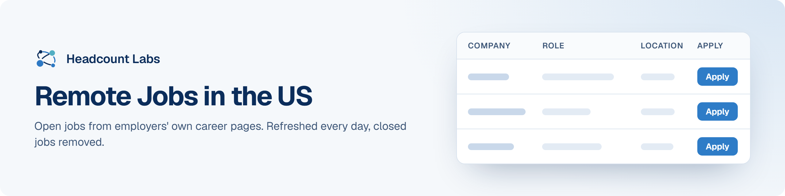

# Remote Jobs in the US

Fully remote jobs at US employers in every field, sorted by field.

**400 open jobs** · 383 new since the last update · 383 removed because they closed or left the employer's board · updated November 3, 2026 at 4:52 AM EST

This list is built and refreshed every day by [Headcount Labs](https://headcountlabs.com/?utm_source=github&utm_medium=job-list&utm_campaign=remote-jobs), which reads jobs straight from employers' own career pages and job boards. Every job here was still listed on its source board when we last read that board, within the past 3 days, and was posted in the past 30 days. Copies of the same job are merged into one row, and jobs that close are removed at the next update.

Want this data in your own app or agent? Use the [Headcount Labs jobs API](https://headcountlabs.com/docs/?utm_source=github&utm_medium=job-list&utm_campaign=remote-jobs) (free tier), the [MCP server](https://headcountlabs.com/mcp/?utm_source=github&utm_medium=job-list&utm_campaign=remote-jobs) for Claude, ChatGPT and other AI assistants, or the [public dataset subsets](https://huggingface.co/HeadcountLabs) on Hugging Face (the full dataset is coming soon).

**Full dataset.** A bigger, one-off snapshot dated 2026-10-19 (all matching jobs, not only the open jobs below) is on Hugging Face: [Remote jobs](https://huggingface.co/datasets/HeadcountLabs/remote-jobs). It loads with `datasets.load_dataset` and is under the Open Database License (ODbL) 1.0.

**Jump to:** [Software engineering (33)](#software-engineering) · [Data, AI and machine learning (35)](#data-ai-and-machine-learning) · [Product and design (20)](#product-and-design) · [Hardware and engineering (13)](#hardware-and-engineering) · [Business, finance and operations (105)](#business-finance-and-operations) · [Healthcare (31)](#healthcare) · [Other roles (163)](#other-roles)

**Columns.** *Apply* opens the original posting on the employer's site. *Details* opens the job on Headcount Labs, with every posting we found for it. *Remote* shows what the employer states; a dash means the posting doesn't say. *Pay* is the range the employer published.

## Software engineering

| Company | Role | Location | Remote | Pay | Posted | Apply | Details |
| --- | --- | --- | --- | --- | --- | :---: | :---: |
| **SitusAMC** | Technical Program - Software Delivery - 6 Month Contract | 

44 locations
Harrisburg, PA Providence, RI Baton Rouge, LA Montgomery, AL Frankfort, KY Raleigh, NC Washington, DC Carson City, NV Columbia, SC Lansing, MI Nashville, TN Indianapolis, IN +32 more
 | Remote | $120k–$160k/yr | Nov 3 |  | <a href="https://headcountlabs.com/catalog/jobs/78556a81-3e05-40d4-a6f9-b7fa8370d15d?utm_source=github&utm_medium=job-list&utm_campaign=remote-jobs">via Headcount Labs</a> |
| **General Motors** | Staff Software Engineer - Robotics (Simulation) | 

2 locations
Boston, MA United States
 | Remote | $160k–$291k/yr | Nov 3 |  | <a href="https://headcountlabs.com/catalog/jobs/7a07813d-db28-4c6b-a8a3-714f6d4af971?utm_source=github&utm_medium=job-list&utm_campaign=remote-jobs">via Headcount Labs</a> |
| **Verdantas LLC** | Software Asset Management Specialist II | Orlando, FL | Remote | — | Nov 2 |  | <a href="https://headcountlabs.com/catalog/jobs/83518a0c-c5f0-4d13-ac5d-efb0b24aa0fe?utm_source=github&utm_medium=job-list&utm_campaign=remote-jobs">via Headcount Labs</a> |
| **Uvation** | Linux Infrastructure Engineer (Bare Metal, Storage &amp; AI Factory Infrastructure) | Las Vegas, NV | Remote | — | Nov 2 |  | <a href="https://headcountlabs.com/catalog/jobs/4be372bd-7c95-4f21-a749-38cc4dfbc39f?utm_source=github&utm_medium=job-list&utm_campaign=remote-jobs">via Headcount Labs</a> |
| **Throne Labs** | Software Quality Assurance Engineer | 

2 locations
North Brentwood, MD Seattle, WA
 | Remote | $100k–$135k/yr | Nov 2 |  | <a href="https://headcountlabs.com/catalog/jobs/6ddac594-490e-490f-b71f-7e9e23ed86dd?utm_source=github&utm_medium=job-list&utm_campaign=remote-jobs">via Headcount Labs</a> |
| **Secur-Serv** | Cloud Security Engineer | Dallas-Fort Worth, TX | Remote | — | Nov 2 |  | <a href="https://headcountlabs.com/catalog/jobs/eda04136-ae79-453f-afac-62b52771aed4?utm_source=github&utm_medium=job-list&utm_campaign=remote-jobs">via Headcount Labs</a> |
| **Opportunities at Command Holdings** | Senior Software Engineer | N/A, NM | Remote | $130k–$170k/yr | Nov 2 |  | <a href="https://headcountlabs.com/catalog/jobs/543f772c-c7a8-43ff-8886-ea8034f7716b?utm_source=github&utm_medium=job-list&utm_campaign=remote-jobs">via Headcount Labs</a> |
| **DRT Strategies, Inc.** | GIS Application Developer | Atlanta, GA | Remote | $45–$65/hr | Nov 2 |  | <a href="https://headcountlabs.com/catalog/jobs/1dc9da17-c016-4eb4-b982-5b1a16d73645?utm_source=github&utm_medium=job-list&utm_campaign=remote-jobs">via Headcount Labs</a> |
| **ClearlyAgile** | DevOps Engineer | Tampa, FL | Remote | — | Nov 2 |  | <a href="https://headcountlabs.com/catalog/jobs/f6b6d73c-fe07-40ae-a42f-e8635e9217ad?utm_source=github&utm_medium=job-list&utm_campaign=remote-jobs">via Headcount Labs</a> |
| **ClearlyAgile** | Lead .NET Developer / Architect | Tampa, FL | Remote | — | Nov 2 |  | <a href="https://headcountlabs.com/catalog/jobs/d3bf2553-72d4-455c-964d-3f9fc2c50170?utm_source=github&utm_medium=job-list&utm_campaign=remote-jobs">via Headcount Labs</a> |
| **ClearlyAgile** | Angular Developer | Tampa, FL | Remote | — | Nov 2 |  | <a href="https://headcountlabs.com/catalog/jobs/bfa5ba40-3d99-4826-8cb8-da7f48b7941d?utm_source=github&utm_medium=job-list&utm_campaign=remote-jobs">via Headcount Labs</a> |
| **ClearlyAgile** | Agile DevOps Coach | Tampa, FL | Remote | — | Nov 2 |  | <a href="https://headcountlabs.com/catalog/jobs/675f0bc9-175e-4e30-a70f-c8238bf2ce87?utm_source=github&utm_medium=job-list&utm_campaign=remote-jobs">via Headcount Labs</a> |
| **Brookdale** | IT Security Engineer | Brentwood, TN | Remote | — | Nov 2 |  | <a href="https://headcountlabs.com/catalog/jobs/27e21725-6a89-42e9-aa04-84920ba43200?utm_source=github&utm_medium=job-list&utm_campaign=remote-jobs">via Headcount Labs</a> |
| **Allstate Insurance Co.** | Software Engineer Senior Consultant I (Remote, U.S.) | USA -, IL | Remote | — | Nov 2 |  | <a href="https://headcountlabs.com/catalog/jobs/5aeaf561-0c17-4842-bd01-d92de975aead?utm_source=github&utm_medium=job-list&utm_campaign=remote-jobs">via Headcount Labs</a> |
| **Akima** | Cyber Risk and Vulnerability Lead (Remote) | Washington, DC | Remote | $155k–$165k/yr | Nov 2 |  | <a href="https://headcountlabs.com/catalog/jobs/b9fe0ffe-0891-4d48-a92d-50c256e3b531?utm_source=github&utm_medium=job-list&utm_campaign=remote-jobs">via Headcount Labs</a> |
| **Akima** | Cybersecurity Subject Matter Expert (SME) | Washington, DC | Remote | $160k–$170k/yr | Nov 2 |  | <a href="https://headcountlabs.com/catalog/jobs/8c5e1da1-4dd2-4674-b938-13715f4c7773?utm_source=github&utm_medium=job-list&utm_campaign=remote-jobs">via Headcount Labs</a> |
| **ASRC Federal Holding Company** | Web (UI/UX) Developer | 

51 locations
Virginia Louisiana Minnesota Rhode Island Nevada Washington, DC Indiana North Carolina New Jersey Iowa Florida Kentucky +39 more
 | Remote | — | Oct 31 |  | <a href="https://headcountlabs.com/catalog/jobs/69d21f5f-222c-4b7c-ad6a-d5c60b4bcd51?utm_source=github&utm_medium=job-list&utm_campaign=remote-jobs">via Headcount Labs</a> |
| **ASRC Federal Holding Company** | Microsoft .NET Software Engineer | 

52 locations
South Carolina Missouri Arkansas Indiana United States North Carolina Louisiana Montana Kansas Idaho Connecticut West Virginia +40 more
 | Remote | — | Oct 31 |  | <a href="https://headcountlabs.com/catalog/jobs/b219d6b6-68cb-4ca4-bba4-726651deee51?utm_source=github&utm_medium=job-list&utm_campaign=remote-jobs">via Headcount Labs</a> |
| **Principal Financial Group** | Experienced Info Security Engineer (AI Automation) | United States | Remote | $85k–$187k/yr | Oct 30 |  | <a href="https://headcountlabs.com/catalog/jobs/3301a105-8a31-496c-b2e2-85c425ae9af4?utm_source=github&utm_medium=job-list&utm_campaign=remote-jobs">via Headcount Labs</a> |
| **Principal Financial Group** | Experienced Info Security Engineer (Product Owner Role) | Des Moines, IA | Remote | $104k–$191k/yr | Oct 30 |  | <a href="https://headcountlabs.com/catalog/jobs/1af5d3ec-4c38-40c9-826a-5b8b412e758c?utm_source=github&utm_medium=job-list&utm_campaign=remote-jobs">via Headcount Labs</a> |
| **Prime Therapeutics** | SQL Programmer-Health Data Analyst Senior - Remote | 

41 locations
Topeka, KS Raleigh, NC Boston, MA Little Rock, AR Santa Fe, NM Helena, MT Atlanta, GA Washington, DC Saint Paul, MN Des Moines, IA Salt Lake City, UT Columbus, OH +29 more
 | Remote | $81k–$138k/yr | Oct 30 |  | <a href="https://headcountlabs.com/catalog/jobs/8b992d76-eadc-4b91-b2b0-05fbd4990fcb?utm_source=github&utm_medium=job-list&utm_campaign=remote-jobs">via Headcount Labs</a> |
| **Oregon State University** | Analyst Programmer | Corvallis, OR | Remote | $31.79–$59.01/hr | Oct 30 |  | <a href="https://headcountlabs.com/catalog/jobs/23ac5345-4b3b-4514-92bd-c4e607004095?utm_source=github&utm_medium=job-list&utm_campaign=remote-jobs">via Headcount Labs</a> |
| **Nelnet** | Sr Manager - Software Engineering | 

2 locations
United States Nebraska
 | Remote | $150k–$165k/yr | Oct 30 |  | <a href="https://headcountlabs.com/catalog/jobs/d526b2dc-f11d-4da0-b196-26e1aeb4f1eb?utm_source=github&utm_medium=job-list&utm_campaign=remote-jobs">via Headcount Labs</a> |
| **Johns Hopkins University** | Enterprise Web and DevOps Architect (IT@JH Cloud &amp; Virtualization Services) - #Staff | Baltimore, MD | Remote | $120k–$209k/yr | Oct 30 |  | <a href="https://headcountlabs.com/catalog/jobs/c3d80da1-f5d8-4711-b770-66c52e4f79c9?utm_source=github&utm_medium=job-list&utm_campaign=remote-jobs">via Headcount Labs</a> |
| **Carson Group** | Lead Web Producer | Omaha, NE | Remote | $65k–$85k/yr | Oct 30 |  | <a href="https://headcountlabs.com/catalog/jobs/60cee481-78ce-4ed7-9448-d0e4c921b476?utm_source=github&utm_medium=job-list&utm_campaign=remote-jobs">via Headcount Labs</a> |
| **Wesco** | Senior Developer (WMS Development) | Pittsburgh, PA | Remote | $82k–$139k/yr | Oct 29 |  | <a href="https://headcountlabs.com/catalog/jobs/6107adb5-2c53-421d-ab8a-b5f39fb1892a?utm_source=github&utm_medium=job-list&utm_campaign=remote-jobs">via Headcount Labs</a> |
| **Rezilient Health** | Senior Security Engineer | United States | Remote | — | Oct 29 |  | <a href="https://headcountlabs.com/catalog/jobs/acbfb418-3dd9-48de-a0bb-99fb805e5ad9?utm_source=github&utm_medium=job-list&utm_campaign=remote-jobs">via Headcount Labs</a> |
| **USA Solventum Health Information Systems, Inc.** | Data science software developer | Murray, UT | Remote | $124k–$170k/yr | Oct 28 |  | <a href="https://headcountlabs.com/catalog/jobs/11ab1caa-faac-468c-ada9-85006455943a?utm_source=github&utm_medium=job-list&utm_campaign=remote-jobs">via Headcount Labs</a> |
| **Robert Half Inc.** | Software Engineer IV NA | 

2 locations
Nebraska OMAHA
 | Remote | $119k–$180k/yr | Oct 28 |  | <a href="https://headcountlabs.com/catalog/jobs/668992f2-35a8-4cb2-828b-1d4921d87df1?utm_source=github&utm_medium=job-list&utm_campaign=remote-jobs">via Headcount Labs</a> |
| **Principal Financial Group** | Director of Engineering, Cyber GRC Data, AI &amp; Automation | United States | Remote | $160k–$210k/yr | Oct 28 |  | <a href="https://headcountlabs.com/catalog/jobs/9a71fb49-2ae2-4181-a7c2-233d533573ce?utm_source=github&utm_medium=job-list&utm_campaign=remote-jobs">via Headcount Labs</a> |
| **GE Aerospace** | Director - DevOps, Support, and Operations | 

2 locations
Boston, MA Lynn, MA
 | Remote | $152k–$230k/yr | Oct 28 |  | <a href="https://headcountlabs.com/catalog/jobs/36140d31-880e-430e-b9ff-a5684b6efc48?utm_source=github&utm_medium=job-list&utm_campaign=remote-jobs">via Headcount Labs</a> |
| **Conduent State Healthcare, LLC** | ETL Developer | United States | Remote | $80k–$104k/yr | Oct 28 |  | <a href="https://headcountlabs.com/catalog/jobs/f5818683-6c67-4576-b9b2-bb7a20c420c2?utm_source=github&utm_medium=job-list&utm_campaign=remote-jobs">via Headcount Labs</a> |
| **Blackbaud** | Manager, Software Engineering - AI and Data Platform | United States | Remote | $134k–$174k/yr | Oct 28 |  | <a href="https://headcountlabs.com/catalog/jobs/4d0cb3e1-0222-4f36-a94b-a64138907c4c?utm_source=github&utm_medium=job-list&utm_campaign=remote-jobs">via Headcount Labs</a> |

## Data, AI and machine learning

| Company | Role | Location | Remote | Pay | Posted | Apply | Details |
| --- | --- | --- | --- | --- | --- | :---: | :---: |
| **Wesco** | Director - Sales (Global Enterprise, Data Center AI) | Lewisville, TX | Remote | $120k–$156k/yr | Nov 2 |  | <a href="https://headcountlabs.com/catalog/jobs/8002f8f9-81dd-4b41-9002-00114174a648?utm_source=github&utm_medium=job-list&utm_campaign=remote-jobs">via Headcount Labs</a> |
| **SupplyHouse.com** | Technical Product Manager - AI | United States | Remote | $122k–$152k/yr | Nov 2 |  | <a href="https://headcountlabs.com/catalog/jobs/dd7daf68-8e57-49e3-ae7a-1799c48fd78b?utm_source=github&utm_medium=job-list&utm_campaign=remote-jobs">via Headcount Labs</a> |
| **Rearc** | Senior AI Engineer | United States | Remote | $191k–$209k/yr | Nov 2 |  | <a href="https://headcountlabs.com/catalog/jobs/30453a33-405b-4f4a-a590-645d3d4e18f0?utm_source=github&utm_medium=job-list&utm_campaign=remote-jobs">via Headcount Labs</a> |
| **JBT MAREL CORPORATION** | Senior Workday HR Reporting &amp; Analytics Analyst | 

16 locations
Boxmeer Coimbra Barcelona Madrid Murcia Navarra San Fernando de Henares Baud La Voulte Sur Rhone Pontoise Souffelweyersheim Taverny +4 more
 | Remote | — | Nov 2 |  | <a href="https://headcountlabs.com/catalog/jobs/0cee19f0-e76c-4896-bc17-5f7a7caf41f0?utm_source=github&utm_medium=job-list&utm_campaign=remote-jobs">via Headcount Labs</a> |
| **itD Tech** | Data Scientist IV (6367) | United States | Remote | — | Nov 2 |  | <a href="https://headcountlabs.com/catalog/jobs/06d60794-f76d-4462-9e8f-7d836b05c802?utm_source=github&utm_medium=job-list&utm_campaign=remote-jobs">via Headcount Labs</a> |
| **Dynatrace** | Sr Director, Enterprise AI | 

2 locations
Massachusetts Boston
 | Remote | $224k–$280k/yr | Nov 2 |  | <a href="https://headcountlabs.com/catalog/jobs/6b3b9c5e-4d46-4279-bf5f-6bc7bb9974c0?utm_source=github&utm_medium=job-list&utm_campaign=remote-jobs">via Headcount Labs</a> |
| **Brunel** | AI Trainer: Mechanical Engineers CAD | Toronto | Remote | $40–$125/hr | Nov 2 |  | <a href="https://headcountlabs.com/catalog/jobs/499fe9f4-0530-4faf-9c7b-e3897e20ba9d?utm_source=github&utm_medium=job-list&utm_campaign=remote-jobs">via Headcount Labs</a> |
| **Brunel** | AI Trainer: Electrical Engineering CAD | Toronto | Remote | $40–$125/hr | Nov 2 |  | <a href="https://headcountlabs.com/catalog/jobs/0b0947c4-ffd0-4a9f-9f1e-ce38d624a733?utm_source=github&utm_medium=job-list&utm_campaign=remote-jobs">via Headcount Labs</a> |
| **Humana Inc.** | Associate Actuarial - Analytics/Forecasting | 

2 locations
United States Kentucky
 | Remote | $107k–$147k/yr | Nov 1 |  | <a href="https://headcountlabs.com/catalog/jobs/5efd90bf-15b0-480b-849c-01e27c511606?utm_source=github&utm_medium=job-list&utm_campaign=remote-jobs">via Headcount Labs</a> |
| **Volga Partners** | Legal &amp; Regulatory Subject Matter Expert (SME) - AI Evaluator &#124; USA | United States | Remote | — | Oct 31 |  | <a href="https://headcountlabs.com/catalog/jobs/ffa5d0d7-2679-4ebe-9672-cdbeb68ad175?utm_source=github&utm_medium=job-list&utm_campaign=remote-jobs">via Headcount Labs</a> |
| **Volga Partners** | Finance - Fixed Income Subject Matter Expert (SME) - AI Evaluator &#124; USA | United States | Remote | — | Oct 31 |  | <a href="https://headcountlabs.com/catalog/jobs/334e44ac-ad6e-441e-b012-4709bf2d842d?utm_source=github&utm_medium=job-list&utm_campaign=remote-jobs">via Headcount Labs</a> |
| **Maximus** | Senior Project Manager - AI Strategy (KH) | Boston, MA | Remote | $150k–$180k/yr | Oct 31 |  | <a href="https://headcountlabs.com/catalog/jobs/e901f515-1ea6-4845-b12e-7a9ae3f4d75f?utm_source=github&utm_medium=job-list&utm_campaign=remote-jobs">via Headcount Labs</a> |
| **Johns Hopkins University** | Research Data Analyst (Department of Health Policy and Management) - #Staff | Baltimore, MD | Remote | $49k–$86k/yr | Oct 31 |  | <a href="https://headcountlabs.com/catalog/jobs/23e21388-dee3-4880-814f-3c82cda5881a?utm_source=github&utm_medium=job-list&utm_campaign=remote-jobs">via Headcount Labs</a> |
| **Humana** | Senior Data Manager (DATABRICKS) | Boston, MA | Remote | $98k–$134k/yr | Oct 31 |  | <a href="https://headcountlabs.com/catalog/jobs/724cbcdd-372a-4303-ba63-43a534f17684?utm_source=github&utm_medium=job-list&utm_campaign=remote-jobs">via Headcount Labs</a> |
| **Volga Partners** | Regulatory Compliance Auditor Subject Matter Expert -AI Model Evaluation | United States | Remote | — | Oct 30 |  | <a href="https://headcountlabs.com/catalog/jobs/95326f07-a002-4067-9736-49d8bd27207c?utm_source=github&utm_medium=job-list&utm_campaign=remote-jobs">via Headcount Labs</a> |
| **Volga Partners** | Regulatory CMC Submission Writer Subject Matter Expert -AI Model Evaluation | United States | Remote | — | Oct 30 |  | <a href="https://headcountlabs.com/catalog/jobs/93ce714c-0e65-4e52-998e-b50fae1f97aa?utm_source=github&utm_medium=job-list&utm_campaign=remote-jobs">via Headcount Labs</a> |
| **Volga Partners** | QA/Analytical Development Subject Matter Expert -AI Model Evaluation | United States | Remote | — | Oct 30 |  | <a href="https://headcountlabs.com/catalog/jobs/ca5cf3c9-c58c-4fdb-98e3-7f4c2b267839?utm_source=github&utm_medium=job-list&utm_campaign=remote-jobs">via Headcount Labs</a> |
| **Volga Partners** | Senior Market Research Analyst - International Development &amp; AI | United States | Remote | — | Oct 30 |  | <a href="https://headcountlabs.com/catalog/jobs/705fc78e-f94c-4a63-84ba-579d616ef49c?utm_source=github&utm_medium=job-list&utm_campaign=remote-jobs">via Headcount Labs</a> |
| **Tiger Analytics Inc.** | Senior Consultant / Manager Analytics Consulting - Real Estate | United States | Remote | — | Oct 30 |  | <a href="https://headcountlabs.com/catalog/jobs/ca4f92e9-4c8e-4782-86b3-d522a39b74f8?utm_source=github&utm_medium=job-list&utm_campaign=remote-jobs">via Headcount Labs</a> |
| **Tiger Analytics Inc.** | Azure Data Engineer | Chicago, IL | Remote | — | Oct 30 |  | <a href="https://headcountlabs.com/catalog/jobs/d28cda49-9166-49fb-8471-9109f38d30d3?utm_source=github&utm_medium=job-list&utm_campaign=remote-jobs">via Headcount Labs</a> |
| **The Cigna Group** | DataOps - Lead Data Analyst | United States | Remote | $82k–$137k/yr | Oct 30 |  | <a href="https://headcountlabs.com/catalog/jobs/62e1f56d-2271-4f82-a4d7-cf4441611607?utm_source=github&utm_medium=job-list&utm_campaign=remote-jobs">via Headcount Labs</a> |
| **Team Member Services** | Oncology Data Specialist Certified | United States | Remote | $23.94–$44.53/hr | Oct 30 |  | <a href="https://headcountlabs.com/catalog/jobs/efe02e59-34c4-49fd-9be3-da598562f337?utm_source=github&utm_medium=job-list&utm_campaign=remote-jobs">via Headcount Labs</a> |
| **Robert Half Inc.** | Manager AI | 

2 locations
United States California
 | Remote | $123k–$190k/yr | Oct 30 |  | <a href="https://headcountlabs.com/catalog/jobs/b37d739d-835c-4cb8-9011-3c9079a7fec2?utm_source=github&utm_medium=job-list&utm_campaign=remote-jobs">via Headcount Labs</a> |
| **Public Consulting Group** | Business Data Analyst 1 | United States | Remote | $60k–$75k/yr | Oct 30 |  | <a href="https://headcountlabs.com/catalog/jobs/9ef7d865-ee08-4382-8225-c7704dbcc86c?utm_source=github&utm_medium=job-list&utm_campaign=remote-jobs">via Headcount Labs</a> |
| **Eliassen Group** | AI Strategy Director | Boston, MA | Remote | $160k–$257k/yr | Oct 30 |  | <a href="https://headcountlabs.com/catalog/jobs/e663fbfb-7481-4ed4-a17f-8d7150f572f8?utm_source=github&utm_medium=job-list&utm_campaign=remote-jobs">via Headcount Labs</a> |
| **AutoNation** | Senior Data Platform Administrator | Fort Lauderdale, FL | Remote | — | Oct 30 |  | <a href="https://headcountlabs.com/catalog/jobs/1ad95f52-093a-4b68-a377-6b6e360734cc?utm_source=github&utm_medium=job-list&utm_campaign=remote-jobs">via Headcount Labs</a> |
| **Volga Partners** | GMP Compliance &amp; Validation Subject Matter Expert -AI Model Evaluation | United States | Remote | — | Oct 29 |  | <a href="https://headcountlabs.com/catalog/jobs/51bccfef-8c7d-47fe-bbbc-1e3387fc7e78?utm_source=github&utm_medium=job-list&utm_campaign=remote-jobs">via Headcount Labs</a> |
| **Volga Partners** | Pharmaceutical Quality Assurance Subject Matter Expert - AI Model Evaluation | United States | Remote | — | Oct 29 |  | <a href="https://headcountlabs.com/catalog/jobs/d74f8ffe-3cb9-4982-9d91-137ca04cf8fe?utm_source=github&utm_medium=job-list&utm_campaign=remote-jobs">via Headcount Labs</a> |
| **Mapbox** | Product Manager II, Maps AI | Mapbox US | Remote | — | Oct 29 |  | <a href="https://headcountlabs.com/catalog/jobs/03097740-1ff8-4e8e-9baa-03e2d0eda1ed?utm_source=github&utm_medium=job-list&utm_campaign=remote-jobs">via Headcount Labs</a> |
| **Greenshades Software** | Data Engineer I | Jacksonville, FL | Remote | — | Oct 29 |  | <a href="https://headcountlabs.com/catalog/jobs/c1f30350-a891-4f44-b77b-75c044992a91?utm_source=github&utm_medium=job-list&utm_campaign=remote-jobs">via Headcount Labs</a> |
| **C01 Carrier Corporation** | Strategic Account Manager, Data Center &amp; Industrial | 

2 locations
Florida City, FL
 | Remote | $118k–$234k/yr | Oct 29 |  | <a href="https://headcountlabs.com/catalog/jobs/f8b004c4-2ed5-42ef-9de8-258eb62ee8f5?utm_source=github&utm_medium=job-list&utm_campaign=remote-jobs">via Headcount Labs</a> |
| **Barnes - US** | Enterprise Data Products &amp; AI Analytics Architect | United States | Remote | $110k–$172k/yr | Oct 29 |  | <a href="https://headcountlabs.com/catalog/jobs/fb1faa3a-9c7c-4bc8-9b25-2d8e4958b268?utm_source=github&utm_medium=job-list&utm_campaign=remote-jobs">via Headcount Labs</a> |
| **SitusAMC** | AVP, Hedge Advisory &amp; Analytics | 

44 locations
Santa Fe, NM Lansing, MI Lincoln, NE Columbia, SC Carson City, NV Boise, ID Topeka, KS Nashville, TN Tallahassee, FL Phoenix, AZ Baton Rouge, LA Dover, DE +32 more
 | Remote | $100k–$150k/yr | Oct 28 |  | <a href="https://headcountlabs.com/catalog/jobs/451421c1-13ef-4824-8ea0-582f6db25ff5?utm_source=github&utm_medium=job-list&utm_campaign=remote-jobs">via Headcount Labs</a> |
| **SitusAMC** | AVP, Legal Operations - Data Governance | 

44 locations
Helena, MT Harrisburg, PA Providence, RI Jackson, MS Raleigh, NC Augusta, ME Madison, WI Trenton, NJ Oklahoma City, OK Columbus, OH Des Moines, IA Carson City, NV +32 more
 | Remote | $95k–$130k/yr | Oct 28 |  | <a href="https://headcountlabs.com/catalog/jobs/f272174d-eb36-425f-9bc3-eb9b1f5030fb?utm_source=github&utm_medium=job-list&utm_campaign=remote-jobs">via Headcount Labs</a> |
| **OnTrac** | Industrial Engineer Consultant - Planning &amp; Analytics | Chantilly, VA | Remote | $126k–$157k/yr | Oct 28 |  | <a href="https://headcountlabs.com/catalog/jobs/5def55e4-99fd-4279-ba9a-8a8b5b100c6b?utm_source=github&utm_medium=job-list&utm_campaign=remote-jobs">via Headcount Labs</a> |

## Product and design

| Company | Role | Location | Remote | Pay | Posted | Apply | Details |
| --- | --- | --- | --- | --- | --- | :---: | :---: |
| **Hempel (USA), Inc.** | Architectural Specification &amp; Design Consultant | Los Angeles | Remote | $115k–$135k/yr | Nov 2 |  | <a href="https://headcountlabs.com/catalog/jobs/67a1e30f-9afe-44b1-8489-9f93e7baaa32?utm_source=github&utm_medium=job-list&utm_campaign=remote-jobs">via Headcount Labs</a> |
| **Everon** | System Designer II | Irving, TX | Remote | $67k–$115k/yr | Nov 2 |  | <a href="https://headcountlabs.com/catalog/jobs/c7e59260-cd95-4b81-87a7-9378a9476830?utm_source=github&utm_medium=job-list&utm_campaign=remote-jobs">via Headcount Labs</a> |
| **ClearlyAgile** | Sr. UI/UX Designer | Tampa, FL | Remote | — | Nov 2 |  | <a href="https://headcountlabs.com/catalog/jobs/c7e3e141-a593-4bbc-9099-68da92542d33?utm_source=github&utm_medium=job-list&utm_campaign=remote-jobs">via Headcount Labs</a> |
| **ClearlyAgile** | Product Owner | Tampa, FL | Remote | — | Nov 2 |  | <a href="https://headcountlabs.com/catalog/jobs/4a302bb6-2690-4adf-9cb2-bedd18f88141?utm_source=github&utm_medium=job-list&utm_campaign=remote-jobs">via Headcount Labs</a> |
| ***Thanks for your interest in HomeServices' family of companies! Select a job board to view openings.** | Product Manager Agile Dev | Eden Prairie, MN | Remote | $98k–$132k/yr | Nov 2 |  | <a href="https://headcountlabs.com/catalog/jobs/3296c341-62d5-4331-802d-1728f546f352?utm_source=github&utm_medium=job-list&utm_campaign=remote-jobs">via Headcount Labs</a> |
| **Nelnet** | Group Product Manager, NextGen | 

76 locations
Scottsbluff, NE Pierre, SD Eau Claire, WI Providence, RI Washington, DC Richmond, VA Concord, NH Hastings, NE Carson City, NV Columbus, OH Eagan, MN Augusta, ME +64 more
 | Remote | $115k–$165k/yr | Oct 31 |  | <a href="https://headcountlabs.com/catalog/jobs/ee2e462c-2958-4740-8efc-26b0b2f394d0?utm_source=github&utm_medium=job-list&utm_campaign=remote-jobs">via Headcount Labs</a> |
| **Salas O'Brien** | Electrical Design Engineer- HAWAII | United States | Remote | $90k–$125k/yr | Oct 30 |  | <a href="https://headcountlabs.com/catalog/jobs/b6d20f60-7255-4b9c-a57c-0de4a1183513?utm_source=github&utm_medium=job-list&utm_campaign=remote-jobs">via Headcount Labs</a> |
| **Humana** | Senior Product Owner | Boston, MA | Remote | $95k–$130k/yr | Oct 30 |  | <a href="https://headcountlabs.com/catalog/jobs/b38eb396-df4d-4146-bf9a-ae0c51647b46?utm_source=github&utm_medium=job-list&utm_campaign=remote-jobs">via Headcount Labs</a> |
| **Eliassen Group** | Product Manager | Boston, MA | Remote | $70/hr | Oct 30 |  | <a href="https://headcountlabs.com/catalog/jobs/b8a9ce98-fa71-404b-a04f-79828e971bb6?utm_source=github&utm_medium=job-list&utm_campaign=remote-jobs">via Headcount Labs</a> |
| **Humana** | Senior Product Manager, Eligibility &amp; Learning Enablement | Boston, MA | Remote | $104k–$143k/yr | Oct 29 |  | <a href="https://headcountlabs.com/catalog/jobs/921b74e9-d958-41e0-a75c-0c39de31207f?utm_source=github&utm_medium=job-list&utm_campaign=remote-jobs">via Headcount Labs</a> |
| **Humana** | Lead Product Manager, Channels | Boston, MA | Remote | $126k–$174k/yr | Oct 29 |  | <a href="https://headcountlabs.com/catalog/jobs/f2363a2b-a433-48ac-9209-586ea045b2c9?utm_source=github&utm_medium=job-list&utm_campaign=remote-jobs">via Headcount Labs</a> |
| **Ceresti Health** | Product Manager - Content | United States | Remote | — | Oct 29 |  | <a href="https://headcountlabs.com/catalog/jobs/8a22217d-4ac8-4363-b1a1-74a3c01b7896?utm_source=github&utm_medium=job-list&utm_campaign=remote-jobs">via Headcount Labs</a> |
| **Ceresti Health** | Product Manager - Enrollment | United States | Remote | — | Oct 29 |  | <a href="https://headcountlabs.com/catalog/jobs/6ce6e778-928a-4d4b-9a62-99d30734d956?utm_source=github&utm_medium=job-list&utm_campaign=remote-jobs">via Headcount Labs</a> |
| **AJAIA** | UX/UI Designer | New York, NY | Remote | — | Oct 29 |  | <a href="https://headcountlabs.com/catalog/jobs/de394650-cb6f-458b-8144-1e6f2ba04741?utm_source=github&utm_medium=job-list&utm_campaign=remote-jobs">via Headcount Labs</a> |
| **AJAIA** | Digital Product Designer | New York, NY | Remote | — | Oct 29 |  | <a href="https://headcountlabs.com/catalog/jobs/dd7a86e1-3044-4875-9b80-4597d5de7071?utm_source=github&utm_medium=job-list&utm_campaign=remote-jobs">via Headcount Labs</a> |
| **AJAIA** | Product Designer (UI/UX) | New York, NY | Remote | — | Oct 29 |  | <a href="https://headcountlabs.com/catalog/jobs/1969b133-fc48-47d4-a7fd-2b2e622c8a70?utm_source=github&utm_medium=job-list&utm_campaign=remote-jobs">via Headcount Labs</a> |
| **SitusAMC** | Vice President, Product Management | 

44 locations
Springfield, IL Raleigh, NC Santa Fe, NM Albany, NY Columbia, SC Indianapolis, IN Little Rock, AR Columbus, OH Austin, TX Montgomery, AL Oklahoma City, OK Providence, RI +32 more
 | Remote | $110k–$170k/yr | Oct 28 |  | <a href="https://headcountlabs.com/catalog/jobs/2d8d50db-b03a-419d-92cd-263d61fe475a?utm_source=github&utm_medium=job-list&utm_campaign=remote-jobs">via Headcount Labs</a> |
| **Rubrik** | Staff Product Manager, Databases | Boston, MA | Remote | $211k–$317k/yr | Oct 28 |  | <a href="https://headcountlabs.com/catalog/jobs/e7f3017a-fdb5-41e3-bca2-999e3cbbf43a?utm_source=github&utm_medium=job-list&utm_campaign=remote-jobs">via Headcount Labs</a> |
| **Principal Financial Group** | Product Manager, Payroll &amp; Rewards product focus | 

5 locations
Des Moines, IA Charlotte, NC United States Raleigh, NC Minneapolis, MN
 | Remote | $115k–$180k/yr | Oct 28 |  | <a href="https://headcountlabs.com/catalog/jobs/c634f8c2-375e-4de8-b87f-7504a3990b57?utm_source=github&utm_medium=job-list&utm_campaign=remote-jobs">via Headcount Labs</a> |
| **GE Aerospace** | Senior Director, Technical Product Management | 

2 locations
Boston, MA Lynn, MA
 | Remote | $176k–$270k/yr | Oct 28 |  | <a href="https://headcountlabs.com/catalog/jobs/46b776db-1ec7-44b2-aac3-ead388cb1e7c?utm_source=github&utm_medium=job-list&utm_campaign=remote-jobs">via Headcount Labs</a> |

## Hardware and engineering

| Company | Role | Location | Remote | Pay | Posted | Apply | Details |
| --- | --- | --- | --- | --- | --- | :---: | :---: |
| **Providence** | Applications Engineer II IS - Lab Applications - Remote | Renton, CA | Remote | $48.27–$76.22/hr | Nov 3 |  | <a href="https://headcountlabs.com/catalog/jobs/25064312-22d1-40f4-a84a-485c6106bcb8?utm_source=github&utm_medium=job-list&utm_campaign=remote-jobs">via Headcount Labs</a> |
| **Torq** | Customer Success Engineer, West Coast U.S. | United States | Remote | — | Nov 2 |  | <a href="https://headcountlabs.com/catalog/jobs/0d3e9777-f662-480c-b32c-221c4e509979?utm_source=github&utm_medium=job-list&utm_campaign=remote-jobs">via Headcount Labs</a> |
| **Spear AI** | IT Engineer | United States | Remote | — | Nov 2 |  | <a href="https://headcountlabs.com/catalog/jobs/26e7ebd4-7803-47ae-a03c-ff8ade83a243?utm_source=github&utm_medium=job-list&utm_campaign=remote-jobs">via Headcount Labs</a> |
| **ClearlyAgile** | Lead Quality Engineer | Tampa, FL | Remote | — | Nov 2 |  | <a href="https://headcountlabs.com/catalog/jobs/a57e8b03-d51a-4804-8745-3dc73d15ca6b?utm_source=github&utm_medium=job-list&utm_campaign=remote-jobs">via Headcount Labs</a> |
| **Celestica** | Senior Director, Engineering Program/Project Management | Boston, MA | Remote | — | Oct 31 |  | <a href="https://headcountlabs.com/catalog/jobs/6a74f8ea-d978-4e8f-8e26-f00fdb5df8f8?utm_source=github&utm_medium=job-list&utm_campaign=remote-jobs">via Headcount Labs</a> |
| **Wesco** | Engineer - Application (Substation) | 

2 locations
Greenfield, IN Houston, TX
 | Remote | $74k–$119k/yr | Oct 30 |  | <a href="https://headcountlabs.com/catalog/jobs/f00a369c-9f59-48e0-86c0-eb46a4e5d78b?utm_source=github&utm_medium=job-list&utm_campaign=remote-jobs">via Headcount Labs</a> |
| **Aerospace** | Senior Supplier Development Engineer | 

3 locations
Phoenix, AZ South Bend, IN Minneapolis, MN
 | Remote | $97k–$122k/yr | Oct 30 |  | <a href="https://headcountlabs.com/catalog/jobs/68df8e80-4edf-4744-8690-c8360de9b484?utm_source=github&utm_medium=job-list&utm_campaign=remote-jobs">via Headcount Labs</a> |
| **Conduent Commercial Solutions, LLC** | Infrastructure Systems Engineer III | United States | Remote | $85k–$111k/yr | Oct 29 |  | <a href="https://headcountlabs.com/catalog/jobs/e8707559-3427-4c73-b10a-95c826b5cbf2?utm_source=github&utm_medium=job-list&utm_campaign=remote-jobs">via Headcount Labs</a> |
| **Wesco** | Engineer - Industrial | Lewisville, TX | Remote | $74k–$119k/yr | Oct 28 |  | <a href="https://headcountlabs.com/catalog/jobs/402e5417-3091-423f-b25f-d1bd7a39ab0b?utm_source=github&utm_medium=job-list&utm_campaign=remote-jobs">via Headcount Labs</a> |
| **Prosci** | Senior Manager, Engineering | United States | Remote | — | Oct 28 |  | <a href="https://headcountlabs.com/catalog/jobs/cbc4d9af-aa3c-455e-96c3-de4501036e75?utm_source=github&utm_medium=job-list&utm_campaign=remote-jobs">via Headcount Labs</a> |
| **Johns Hopkins University** | Research Program Analyst (Environmental Health and Engineering) - #Staff | Baltimore, MD | Remote | $31.83–$55.83/hr | Oct 28 |  | <a href="https://headcountlabs.com/catalog/jobs/e256c55b-5b33-4161-a86a-8ebf4d357922?utm_source=github&utm_medium=job-list&utm_campaign=remote-jobs">via Headcount Labs</a> |
| **Eliassen Group** | Systems Engineer (Senior) | Boston, MA | Remote | $60–$70/hr | Oct 28 |  | <a href="https://headcountlabs.com/catalog/jobs/d924f3da-d443-4a25-9241-151f90ce046f?utm_source=github&utm_medium=job-list&utm_campaign=remote-jobs">via Headcount Labs</a> |
| **CSW Industrials** | Senior Product Specialist, Aspen Manufacturing &amp; HVAC Solutions | United States | Remote | — | Oct 28 |  | <a href="https://headcountlabs.com/catalog/jobs/320342f8-c908-4b18-8e31-a4975297bb2c?utm_source=github&utm_medium=job-list&utm_campaign=remote-jobs">via Headcount Labs</a> |

## Business, finance and operations

| Company | Role | Location | Remote | Pay | Posted | Apply | Details |
| --- | --- | --- | --- | --- | --- | :---: | :---: |
| **Maverick Payments** | Sr. Business Development Manager | Calabasas, CA | Remote | $95k–$115k/yr | Nov 3 |  | <a href="https://headcountlabs.com/catalog/jobs/7edb3639-dea1-43a3-96f2-6abe146c3e52?utm_source=github&utm_medium=job-list&utm_campaign=remote-jobs">via Headcount Labs</a> |
| **Wesper** | VP of Finance | United States | Remote | $200k–$230k/yr | Nov 2 |  | <a href="https://headcountlabs.com/catalog/jobs/fccd641c-b898-4d80-b8ed-a6058853ea35?utm_source=github&utm_medium=job-list&utm_campaign=remote-jobs">via Headcount Labs</a> |
| **Virtualite Business Process Outsourcing Services** | WFH Sales &amp; Solution Consultant | United States | Remote | $65k–$82k/yr | Nov 2 |  | <a href="https://headcountlabs.com/catalog/jobs/058b837e-332d-4f3d-b5e7-45d5cb5e913a?utm_source=github&utm_medium=job-list&utm_campaign=remote-jobs">via Headcount Labs</a> |
| **Virtual Task Buddie** | Virtual Sales Agent | Toronto | Remote | — | Nov 2 |  | <a href="https://headcountlabs.com/catalog/jobs/d49e9e02-ccc1-4246-8db5-ad7ba6f0d32c?utm_source=github&utm_medium=job-list&utm_campaign=remote-jobs">via Headcount Labs</a> |
| **Valenz** | Business Systems Analyst II | Phoenix, AZ | Remote | — | Nov 2 |  | <a href="https://headcountlabs.com/catalog/jobs/fd4812a1-05c6-43dd-a551-39b032f908ca?utm_source=github&utm_medium=job-list&utm_campaign=remote-jobs">via Headcount Labs</a> |
| **TruBlue Home Service Ally** | Part Time Marketing Associate | Chester, NJ | Remote | — | Nov 2 |  | <a href="https://headcountlabs.com/catalog/jobs/da7cc341-32f6-458d-ad1d-66b6d6b22c70?utm_source=github&utm_medium=job-list&utm_campaign=remote-jobs">via Headcount Labs</a> |
| **Tribute Technology** | Business Development Representative | United States | Remote | $45k–$50k/yr | Nov 2 |  | <a href="https://headcountlabs.com/catalog/jobs/bf04f37a-510b-4b2d-b024-a1d824ca874f?utm_source=github&utm_medium=job-list&utm_campaign=remote-jobs">via Headcount Labs</a> |
| **Team Member Services** | Coding Auditor | United States | Remote | $26.55–$49.39/hr | Nov 2 |  | <a href="https://headcountlabs.com/catalog/jobs/8e611d07-5c16-473c-9f74-0a3a739c2da6?utm_source=github&utm_medium=job-list&utm_campaign=remote-jobs">via Headcount Labs</a> |
| **Team Member Services** | Coding Inpatient Auditor | United States | Remote | $26.55–$49.39/hr | Nov 2 |  | <a href="https://headcountlabs.com/catalog/jobs/3dfef3ad-bc06-45cb-bc9f-cf4393dcad9c?utm_source=github&utm_medium=job-list&utm_campaign=remote-jobs">via Headcount Labs</a> |
| **Team Member Services** | Senior Coding Auditor | Adventhealth | Remote | $67k–$124k/yr | Nov 2 |  | <a href="https://headcountlabs.com/catalog/jobs/3d11400d-43f8-47ac-893e-e605bf4944f2?utm_source=github&utm_medium=job-list&utm_campaign=remote-jobs">via Headcount Labs</a> |
| **SVCS Huron Consulting Services LLC** | Consulting Director - Healthcare Economics | United States | Remote | $185k–$225k/yr | Nov 2 |  | <a href="https://headcountlabs.com/catalog/jobs/833ef169-de9f-41f1-8617-73158f632e9a?utm_source=github&utm_medium=job-list&utm_campaign=remote-jobs">via Headcount Labs</a> |
| **SunStrong Management, LLC** | Servicing Analyst I | United States | Remote | — | Nov 2 |  | <a href="https://headcountlabs.com/catalog/jobs/7c28c834-8078-4c09-b1ab-91b94fc7c96c?utm_source=github&utm_medium=job-list&utm_campaign=remote-jobs">via Headcount Labs</a> |
| **Plan Left** | Accounting Specialist | Nashville, TN | Remote | — | Nov 2 |  | <a href="https://headcountlabs.com/catalog/jobs/c8db0f55-2baf-416c-9891-5fe00c7086eb?utm_source=github&utm_medium=job-list&utm_campaign=remote-jobs">via Headcount Labs</a> |
| **Nemacolin** | Director of National Sales Accounts (Washington, DC Region) | Farmington, PA | Remote | $90k–$110k/yr | Nov 2 |  | <a href="https://headcountlabs.com/catalog/jobs/c4adac07-c12a-41d4-b3b0-593bc665a315?utm_source=github&utm_medium=job-list&utm_campaign=remote-jobs">via Headcount Labs</a> |
| **National General Management Corp** | Territory Sales Manager (Bay Area, CA) | USA -, CA | Remote | $85k–$90k/yr | Nov 2 |  | <a href="https://headcountlabs.com/catalog/jobs/5a796092-a3fa-4541-a89b-c611c07b1dda?utm_source=github&utm_medium=job-list&utm_campaign=remote-jobs">via Headcount Labs</a> |
| **Musely** | Supply Chain Manager | United States | Remote | — | Nov 2 |  | <a href="https://headcountlabs.com/catalog/jobs/deea25a5-cf34-4ba3-b1ef-017789cce6fb?utm_source=github&utm_medium=job-list&utm_campaign=remote-jobs">via Headcount Labs</a> |
| **M3 USA** | Director of Physician Recruiting - Academics Division (Remote) | 

2 locations
Dallas, TX United States
 | Remote | — | Nov 2 |  | <a href="https://headcountlabs.com/catalog/jobs/c6e6f89d-bbbc-4f02-a279-872dc26e0069?utm_source=github&utm_medium=job-list&utm_campaign=remote-jobs">via Headcount Labs</a> |
| **M3 USA** | Sales Consultant - Dental (Remote) | 

2 locations
Dallas, TX United States
 | Remote | — | Nov 2 |  | <a href="https://headcountlabs.com/catalog/jobs/7e898746-570a-4b3e-a5bb-98f640ca935d?utm_source=github&utm_medium=job-list&utm_campaign=remote-jobs">via Headcount Labs</a> |
| **M3 USA** | Director of Business Development (Remote) | 

2 locations
Dallas, TX United States
 | Remote | — | Nov 2 |  | <a href="https://headcountlabs.com/catalog/jobs/4e86a464-95d1-4c53-a4d4-b9a2a41f59bf?utm_source=github&utm_medium=job-list&utm_campaign=remote-jobs">via Headcount Labs</a> |
| **M3 USA** | Director of Physician Recruiting (Remote) | 

2 locations
Dallas, TX United States
 | Remote | — | Nov 2 |  | <a href="https://headcountlabs.com/catalog/jobs/3b8f513f-a43c-48da-a881-1513f10a15e2?utm_source=github&utm_medium=job-list&utm_campaign=remote-jobs">via Headcount Labs</a> |
| **M3 USA** | Business Development Consultant (Remote) | 

2 locations
Dallas, TX United States
 | Remote | — | Nov 2 |  | <a href="https://headcountlabs.com/catalog/jobs/2855055a-8c68-45df-9432-f37558b82056?utm_source=github&utm_medium=job-list&utm_campaign=remote-jobs">via Headcount Labs</a> |
| **M3 USA** | Physician Recruiting Consultant (Remote) | 

2 locations
Dallas, TX United States
 | Remote | — | Nov 2 |  | <a href="https://headcountlabs.com/catalog/jobs/bb35bc0b-37da-4856-8221-7ea974c5b841?utm_source=github&utm_medium=job-list&utm_campaign=remote-jobs">via Headcount Labs</a> |
| **LTK USA** | Client Partner, Strategic New Business | United States | Remote | — | Nov 2 |  | <a href="https://headcountlabs.com/catalog/jobs/7c5d1ef9-216a-4c64-954c-6930cbf5e479?utm_source=github&utm_medium=job-list&utm_campaign=remote-jobs">via Headcount Labs</a> |
| **LMSI, LLC dba Lighthouse Lab Services** | Microbiology Technical Consultant (1099) | Carrollton, TX | Remote | $80–$100/hr | Nov 2 |  | <a href="https://headcountlabs.com/catalog/jobs/b95999ea-6396-4726-9a62-c5918dcc1793?utm_source=github&utm_medium=job-list&utm_campaign=remote-jobs">via Headcount Labs</a> |
| **LMSI, LLC dba Lighthouse Lab Services** | Technical Consultant, Clinical Laboratory | Charlotte, NC | Remote | $90k–$105k/yr | Nov 2 |  | <a href="https://headcountlabs.com/catalog/jobs/6576142d-4f63-45f4-bdb3-835b2593f2eb?utm_source=github&utm_medium=job-list&utm_campaign=remote-jobs">via Headcount Labs</a> |
| **Honeywell** | Lead Channel Sales Representative | 

2 locations
Houston, TX Austin, TX
 | Remote | $166k–$209k/yr | Nov 2 |  | <a href="https://headcountlabs.com/catalog/jobs/f373c038-86ae-4ac9-b1e4-39020b520507?utm_source=github&utm_medium=job-list&utm_campaign=remote-jobs">via Headcount Labs</a> |
| **Greybull Stewardship** | Green Earth, National Sales Manager | United States | Remote | $100k/yr | Nov 2 |  | <a href="https://headcountlabs.com/catalog/jobs/d2c9919e-54e8-4de3-9225-c71c41070047?utm_source=github&utm_medium=job-list&utm_campaign=remote-jobs">via Headcount Labs</a> |
| **Goldbelt, Inc.** | Program Analyst III | 

3 locations
Hire United States Atlanta, GA
 | Remote | $100k–$120k/yr | Nov 2 |  | <a href="https://headcountlabs.com/catalog/jobs/50a511d8-8d1a-4431-8ea8-5f77e994280a?utm_source=github&utm_medium=job-list&utm_campaign=remote-jobs">via Headcount Labs</a> |
| **Globe Life AO** | __ _✓Remote Operations Monitoring Associate | United States | Remote | — | Nov 2 |  | <a href="https://headcountlabs.com/catalog/jobs/1c035b7b-c933-4c9b-8903-e150b151ec0b?utm_source=github&utm_medium=job-list&utm_campaign=remote-jobs">via Headcount Labs</a> |
| **Globe Life AO** | Insurance Sales Representative | United States | Remote | — | Nov 2 |  | <a href="https://headcountlabs.com/catalog/jobs/06667d20-e028-4f8d-9f6e-7fbefd05a197?utm_source=github&utm_medium=job-list&utm_campaign=remote-jobs">via Headcount Labs</a> |
| **GenLogs Corporation** | Product Marketing Manager | 

3 locations
Atlanta, GA Chicago, IL New York, NY
 | Remote | — | Nov 2 |  | <a href="https://headcountlabs.com/catalog/jobs/458ac499-841b-4356-80cf-f8e35d3f4c73?utm_source=github&utm_medium=job-list&utm_campaign=remote-jobs">via Headcount Labs</a> |
| **GenLogs Corporation** | VP of Marketing | 

3 locations
Chicago, IL Atlanta, GA New York, NY
 | Remote | — | Nov 2 |  | <a href="https://headcountlabs.com/catalog/jobs/3d1affd1-54c3-4064-bee1-b6bf9fd73187?utm_source=github&utm_medium=job-list&utm_campaign=remote-jobs">via Headcount Labs</a> |
| **Genea** | Human Resources &amp; Payroll Specialist | Irvine, CA | Remote | $33–$40/hr | Nov 2 |  | <a href="https://headcountlabs.com/catalog/jobs/bae15ff5-d8dc-45dc-9cf7-f0a4e1d261a1?utm_source=github&utm_medium=job-list&utm_campaign=remote-jobs">via Headcount Labs</a> |
| **FTI Consulting, Inc.** | Senior Workday Analyst | 

2 locations
Washington, DC United States
 | Remote | $90k/yr | Nov 2 |  | <a href="https://headcountlabs.com/catalog/jobs/e8957e1e-1d30-425f-8d35-714855c089e2?utm_source=github&utm_medium=job-list&utm_campaign=remote-jobs">via Headcount Labs</a> |
| **Finalsite** | Sr. Manager Financial Planning &amp; Analysis | Glastonbury, CT | Remote | — | Nov 2 |  | <a href="https://headcountlabs.com/catalog/jobs/6f5eca6c-cc25-4a39-a5ca-3169024c4437?utm_source=github&utm_medium=job-list&utm_campaign=remote-jobs">via Headcount Labs</a> |
| **EXL** | DRG / Inpatient Auditor III - Remote | Jacksonville, FL | Remote | $73k–$99k/yr | Nov 2 |  | <a href="https://headcountlabs.com/catalog/jobs/d37f9f50-56d0-428e-bb0e-7bd337046511?utm_source=github&utm_medium=job-list&utm_campaign=remote-jobs">via Headcount Labs</a> |
| **EXL** | Clinical Validation Auditor (CVA) Auditor III | Pittsburgh, PA | Remote | $60k–$99k/yr | Nov 2 |  | <a href="https://headcountlabs.com/catalog/jobs/d1910f3b-e442-43e7-b8e1-b706c21e4670?utm_source=github&utm_medium=job-list&utm_campaign=remote-jobs">via Headcount Labs</a> |
| **EXL** | Pharmacy Auditor I | United States | Remote | $45k–$58k/yr | Nov 2 |  | <a href="https://headcountlabs.com/catalog/jobs/386503c4-3add-452a-862b-48cf99e91cac?utm_source=github&utm_medium=job-list&utm_campaign=remote-jobs">via Headcount Labs</a> |
| **Delta Faucet Company** | Salesforce Solution Architect | 

2 locations
Indianapolis, IN United States
 | Remote | $104k–$163k/yr | Nov 2 |  | <a href="https://headcountlabs.com/catalog/jobs/4fb193af-f1aa-4b47-a5bc-f3dfa74de780?utm_source=github&utm_medium=job-list&utm_campaign=remote-jobs">via Headcount Labs</a> |
| **CONMED** | Director of Marketing Excellence &amp; Commercial Performance | 

2 locations
Largo, FL Florida
 | Remote | $151k–$192k/yr | Nov 2 |  | <a href="https://headcountlabs.com/catalog/jobs/fc3c8b2a-ea10-4254-b1f5-e1172d4356c1?utm_source=github&utm_medium=job-list&utm_campaign=remote-jobs">via Headcount Labs</a> |
| **Claritas Rx** | Business Analyst | United States | Remote | — | Nov 2 |  | <a href="https://headcountlabs.com/catalog/jobs/a694a2be-c6a4-4847-b7aa-cde91e1c0947?utm_source=github&utm_medium=job-list&utm_campaign=remote-jobs">via Headcount Labs</a> |
| **C010 Cherry Bekaert Advisory LLC** | Finance Transformation Manager | 

14 locations
Atlanta, GA Austin, TX Charlotte, NC Chicago, IL Coral Gables, FL Dallas Fort Lauderdale, FL Greenville, SC Houston, TX Raleigh, NC Richmond, VA Tampa, FL +2 more
 | Remote | — | Nov 2 |  | <a href="https://headcountlabs.com/catalog/jobs/fab88d8d-74a8-4c16-8d80-f92c13b791cd?utm_source=github&utm_medium=job-list&utm_campaign=remote-jobs">via Headcount Labs</a> |
| **C010 Cherry Bekaert Advisory LLC** | CFO Advisory, Senior Manager - Finance Transformation | 

16 locations
United States Atlanta, GA Austin, TX Charlotte, NC Chicago Coral Gables, FL Ft. Lauderdale, FL Raleigh, NC Richmond, VA Tampa, FL Tysons Corner Virginia Beach, VA +4 more
 | Remote | $133k–$212k/yr | Nov 2 |  | <a href="https://headcountlabs.com/catalog/jobs/f57f526c-5fd7-43e7-8c68-d4bd36205548?utm_source=github&utm_medium=job-list&utm_campaign=remote-jobs">via Headcount Labs</a> |
| **Big Human** | Marketing Strategist | New York, NY | Remote | $85k–$95k/yr | Nov 2 |  | <a href="https://headcountlabs.com/catalog/jobs/a3e007ad-f680-4838-ab08-0852195f2216?utm_source=github&utm_medium=job-list&utm_campaign=remote-jobs">via Headcount Labs</a> |
| **Baylor Genetics** | Lead Principal Field Sales Trainer | United States | Remote | — | Nov 2 |  | <a href="https://headcountlabs.com/catalog/jobs/c3165b53-6f6f-41af-93f0-b930f6554b1a?utm_source=github&utm_medium=job-list&utm_campaign=remote-jobs">via Headcount Labs</a> |
| **Allstate Insurance Co.** | Vended Application Senior Consultant II (Zscaler) | USA -, IL | Remote | — | Nov 2 |  | <a href="https://headcountlabs.com/catalog/jobs/f8d5f624-dd5d-4e6b-bff5-f610fae73b69?utm_source=github&utm_medium=job-list&utm_campaign=remote-jobs">via Headcount Labs</a> |
| **Allstate Insurance Co.** | Vended Application Senior Consultant I (Zscaler) | USA -, IL | Remote | — | Nov 2 |  | <a href="https://headcountlabs.com/catalog/jobs/aade5a1e-2681-4045-a9f6-bb18de262020?utm_source=github&utm_medium=job-list&utm_campaign=remote-jobs">via Headcount Labs</a> |
| **Allstate Insurance Co.** | Broker Dealer Compliance Registration Consultant II | USA -, IL | Remote | — | Nov 2 |  | <a href="https://headcountlabs.com/catalog/jobs/6d7a2831-aa52-4dae-9c57-98bab6a448ad?utm_source=github&utm_medium=job-list&utm_campaign=remote-jobs">via Headcount Labs</a> |
| **Akima** | Director, Business Development and Capture Management - DoD IT | Herndon, VA | Remote | $200k–$225k/yr | Nov 2 |  | <a href="https://headcountlabs.com/catalog/jobs/31003627-871c-4f95-bff0-69214a5ac656?utm_source=github&utm_medium=job-list&utm_campaign=remote-jobs">via Headcount Labs</a> |
| **ADT** | Remote Inside Sales Representative New Acquisition | 

2 locations
United States Jacksonville, FL
 | Remote | $11/hr | Nov 2 |  | <a href="https://headcountlabs.com/catalog/jobs/9d64ed5f-081e-4c75-93eb-f6d6fa5f4c27?utm_source=github&utm_medium=job-list&utm_campaign=remote-jobs">via Headcount Labs</a> |
| **The Cigna Group** | Senior Manager, Knowledge Management Strategy &amp; Enablement - Evernorth - Remote | United States | Remote | $127k–$212k/yr | Nov 1 |  | <a href="https://headcountlabs.com/catalog/jobs/b6ae1b1f-b666-41c2-b43b-a7fcdb494107?utm_source=github&utm_medium=job-list&utm_campaign=remote-jobs">via Headcount Labs</a> |
| **WCG Clinical** | HR Technology Platforms Manager | Boston, MA | Remote | $82k–$128k/yr | Oct 31 |  | <a href="https://headcountlabs.com/catalog/jobs/b609571e-d684-40ab-b8da-9145e3a3f5cb?utm_source=github&utm_medium=job-list&utm_campaign=remote-jobs">via Headcount Labs</a> |
| **Texas Health Resources** | Program Manager - Foundation Communications | Arlington, TX | Remote | — | Oct 31 |  | <a href="https://headcountlabs.com/catalog/jobs/1dd579ba-a15e-4e7c-918e-0a8561c56c15?utm_source=github&utm_medium=job-list&utm_campaign=remote-jobs">via Headcount Labs</a> |
| **Providence** | IS Program Manager-Enterprise Medical Device Strategy - Remote | Portland, CA | Remote | $56.40–$89.04/hr | Oct 31 |  | <a href="https://headcountlabs.com/catalog/jobs/f5fdf5e1-0554-483c-ad47-5b8aaf3ed727?utm_source=github&utm_medium=job-list&utm_campaign=remote-jobs">via Headcount Labs</a> |
| **Prime Therapeutics** | Sr Dir Underwriting &amp; Client Financial Strategy - REMOTE | 

41 locations
Indianapolis, IN Raleigh, NC Little Rock, AR Trenton, NJ Providence, RI Lincoln, NE Annapolis, MD Columbus, OH Jefferson City, MO Washington, DC Salt Lake City, UT Madison, WI +29 more
 | Remote | $143k–$243k/yr | Oct 31 |  | <a href="https://headcountlabs.com/catalog/jobs/a0791b1b-36be-4f06-855a-72f869292cf7?utm_source=github&utm_medium=job-list&utm_campaign=remote-jobs">via Headcount Labs</a> |
| **Curtiss-Wright Corporation** | Cost Accountant, Lead | 

2 locations
United States Santa Clarita, CA
 | Remote | $99k–$130k/yr | Oct 31 |  | <a href="https://headcountlabs.com/catalog/jobs/71a43830-9a47-4cca-bf0f-abfdb2f10070?utm_source=github&utm_medium=job-list&utm_campaign=remote-jobs">via Headcount Labs</a> |
| **CrowdStrike** | Sr. Finance Transformation Manager (Remote) | Boston, MA | Remote | $145k–$220k/yr | Oct 31 |  | <a href="https://headcountlabs.com/catalog/jobs/326051a3-2161-487e-9bfb-d585ed3700c9?utm_source=github&utm_medium=job-list&utm_campaign=remote-jobs">via Headcount Labs</a> |
| **Public Consulting Group** | Apprentice Business Analyst | United States | Remote | $40k–$57k/yr | Oct 30 |  | <a href="https://headcountlabs.com/catalog/jobs/0e173518-1127-48e3-a1be-b1ddf7df9208?utm_source=github&utm_medium=job-list&utm_campaign=remote-jobs">via Headcount Labs</a> |
| **Patterson Companies, Inc.** | Director of Business Development | United States | Remote | $139k–$186k/yr | Oct 30 |  | <a href="https://headcountlabs.com/catalog/jobs/c4e4a043-6336-46c9-a9cb-cae449d4cd8b?utm_source=github&utm_medium=job-list&utm_campaign=remote-jobs">via Headcount Labs</a> |
| **Murdock Martell** | Staff Accountant | Campbell, CA | Remote | $77k–$94k/yr | Oct 30 |  | <a href="https://headcountlabs.com/catalog/jobs/3f2ba446-a325-4a94-9592-aeb179174a89?utm_source=github&utm_medium=job-list&utm_campaign=remote-jobs">via Headcount Labs</a> |
| **Koniag Government Services** | Network Administrator Tier 2 (Network Operations Center) (REMOTE) | Colorado | Remote | — | Oct 30 |  | <a href="https://headcountlabs.com/catalog/jobs/43a34395-8461-4ae2-9029-09b54c5de960?utm_source=github&utm_medium=job-list&utm_campaign=remote-jobs">via Headcount Labs</a> |
| **Emerson** | Business Development Manager - Leak Detection | 

2 locations
United States Chanhassen, MN
 | Remote | $10k–$170k/yr | Oct 30 |  | <a href="https://headcountlabs.com/catalog/jobs/4514ebf2-36dd-4820-93df-34a2a46d6bbc?utm_source=github&utm_medium=job-list&utm_campaign=remote-jobs">via Headcount Labs</a> |
| **CSW Industrials** | SoCal, AZ, NM Outside Sales Representative– Architectural Solutions | 

2 locations
United States California
 | Remote | — | Oct 30 |  | <a href="https://headcountlabs.com/catalog/jobs/ff4e82ce-e5b8-44af-9225-5115391c8a8a?utm_source=github&utm_medium=job-list&utm_campaign=remote-jobs">via Headcount Labs</a> |
| **CSW Industrials** | Western US Regional Sales Manager | 

2 locations
United States California
 | Remote | — | Oct 30 |  | <a href="https://headcountlabs.com/catalog/jobs/1804296d-dd2f-4c3d-a84b-501066662e2e?utm_source=github&utm_medium=job-list&utm_campaign=remote-jobs">via Headcount Labs</a> |
| **CONMED** | HR Business Partner | 

2 locations
Largo, FL Florida
 | Remote | $75k–$118k/yr | Oct 30 |  | <a href="https://headcountlabs.com/catalog/jobs/fa724eeb-6b0d-4e63-8379-f674170e7409?utm_source=github&utm_medium=job-list&utm_campaign=remote-jobs">via Headcount Labs</a> |
| **CONMED** | Sr Internal Auditor, Part-Time | 

2 locations
Largo, FL Florida
 | Remote | $26.80–$39/hr | Oct 30 |  | <a href="https://headcountlabs.com/catalog/jobs/88c32bb7-f73b-4b7f-8377-2efafc902386?utm_source=github&utm_medium=job-list&utm_campaign=remote-jobs">via Headcount Labs</a> |
| **Banner Health Corporate** | HP LPN Auditor | Phoenix, AZ | Remote | $28.28–$47.13/hr | Oct 30 |  | <a href="https://headcountlabs.com/catalog/jobs/8379e83e-dae9-465c-a813-9e9ac3fb91d7?utm_source=github&utm_medium=job-list&utm_campaign=remote-jobs">via Headcount Labs</a> |
| **WM** | Director, Innovation and Business Optimization (WMHS) | 

2 locations
United States HOUSTON, TX
 | Remote | — | Oct 29 |  | <a href="https://headcountlabs.com/catalog/jobs/d10943ce-1442-4a2b-a8b2-744b7439400f?utm_source=github&utm_medium=job-list&utm_campaign=remote-jobs">via Headcount Labs</a> |
| **TechOp Solutions International** | Corporate Recruiter | Florida | Remote | — | Oct 29 |  | <a href="https://headcountlabs.com/catalog/jobs/e78f5fba-9cea-40ea-bbe0-842a6eb1cf1c?utm_source=github&utm_medium=job-list&utm_campaign=remote-jobs">via Headcount Labs</a> |
| **SVCS Huron Consulting Services LLC** | High Reliability &amp; Operational Transformation Consultant | 

11 locations
United States California-Los Angeles California-San Francisco Florida Georgia New York North Carolina Pennsylvania-Philadelphia South Carolina Virginia Washington-Seattle
 | Remote | $120k–$170k/yr | Oct 29 |  | <a href="https://headcountlabs.com/catalog/jobs/05df948a-1f19-480c-87e0-384f019972d6?utm_source=github&utm_medium=job-list&utm_campaign=remote-jobs">via Headcount Labs</a> |
| **Store Space Self Storage** | Inbound Sales Agent | 

2 locations
Store Space Store Space - Florida
 | Remote | $18/hr | Oct 29 |  | <a href="https://headcountlabs.com/catalog/jobs/e77e6b0c-b41c-4bd0-99dd-fc0c5e7c8f36?utm_source=github&utm_medium=job-list&utm_campaign=remote-jobs">via Headcount Labs</a> |
| **Saviynt** | VP, Product Marketing – Identity Security Portfolio | United States | Remote | — | Oct 29 |  | <a href="https://headcountlabs.com/catalog/jobs/9919ce4f-0bdb-4f9c-9d9d-5d4f504b7a1d?utm_source=github&utm_medium=job-list&utm_campaign=remote-jobs">via Headcount Labs</a> |
| **Rocket Software** | Senior Compensation Analyst | 

54 locations
Oklahoma City, OK Jefferson City, MO Annapolis, MD Topeka, KS Santa Fe, NM Des Moines, IA Augusta, ME Nashville, TN Montpelier, VT Little Rock, AR Lincoln, NE Sacramento, CA +42 more
 | Remote | $98k–$132k/yr | Oct 29 |  | <a href="https://headcountlabs.com/catalog/jobs/2ce93688-4671-4598-92dc-461759491909?utm_source=github&utm_medium=job-list&utm_campaign=remote-jobs">via Headcount Labs</a> |
| **Lippert** | Service Technician ($25-$29/hr) | 

4 locations
Mesa, AZ Sarasota, FL Florida Sarasota - Bradenton Region, FL
 | Remote | $25–$29/hr | Oct 29 |  | <a href="https://headcountlabs.com/catalog/jobs/9c3ed04d-e2dc-4c46-93f0-5b55a0123e4e?utm_source=github&utm_medium=job-list&utm_campaign=remote-jobs">via Headcount Labs</a> |
| **Liberty Healthcare Corporation** | Director of Business Development – healthcare staffing sales | Bala Cynwyd, PA | Remote | — | Oct 29 |  | <a href="https://headcountlabs.com/catalog/jobs/bf284b71-2038-4f75-998d-238640236a6a?utm_source=github&utm_medium=job-list&utm_campaign=remote-jobs">via Headcount Labs</a> |
| **LERETA** | Agency Systems Mgt Quality Assurance Analyst I | Pomona, CA | Remote | $20–$21.93/hr | Oct 29 |  | <a href="https://headcountlabs.com/catalog/jobs/b8416ac6-06d2-4a11-9e92-cffeb5f09464?utm_source=github&utm_medium=job-list&utm_campaign=remote-jobs">via Headcount Labs</a> |
| **Humana** | Director, Population Health Strategy – Chronic Condition Management | Boston, MA | Remote | $150k–$206k/yr | Oct 29 |  | <a href="https://headcountlabs.com/catalog/jobs/df62a76b-fc46-4ce1-9ba9-cdc9a15dee97?utm_source=github&utm_medium=job-list&utm_campaign=remote-jobs">via Headcount Labs</a> |
| **Humana** | Director, Corporate Strategy | Boston, MA | Remote | $185k–$254k/yr | Oct 29 |  | <a href="https://headcountlabs.com/catalog/jobs/b1d86e35-4155-4791-bf51-fea640f591dc?utm_source=github&utm_medium=job-list&utm_campaign=remote-jobs">via Headcount Labs</a> |
| **Goldbelt, Inc.** | Public Health Analyst III | 

3 locations
Hire United States Atlanta, GA
 | Remote | $100k–$120k/yr | Oct 29 |  | <a href="https://headcountlabs.com/catalog/jobs/1af11730-7a8d-46a7-bf04-003bdf95eb8c?utm_source=github&utm_medium=job-list&utm_campaign=remote-jobs">via Headcount Labs</a> |
| **eviCore healthcare MSI, LLC** | Audit Operations Lead – Evernorth – Remote | 

2 locations
Connecticut United States
 | Remote | $63k–$104k/yr | Oct 29 |  | <a href="https://headcountlabs.com/catalog/jobs/260ad5a8-496d-4794-b638-faa8c8fe9e15?utm_source=github&utm_medium=job-list&utm_campaign=remote-jobs">via Headcount Labs</a> |
| **Ethos Life** | Senior Manager, Distribution &amp; Revenue Strategy | United States | Remote | $120k–$160k/yr | Oct 29 |  | <a href="https://headcountlabs.com/catalog/jobs/e9fda4ee-dcc7-4904-989e-55f66e8f8569?utm_source=github&utm_medium=job-list&utm_campaign=remote-jobs">via Headcount Labs</a> |
| **Emerson** | Business Development Manager OEM | 

2 locations
United States Chanhassen, MN
 | Remote | $12k–$180k/yr | Oct 29 |  | <a href="https://headcountlabs.com/catalog/jobs/d564243d-387c-4671-881e-a9deb6aa8af7?utm_source=github&utm_medium=job-list&utm_campaign=remote-jobs">via Headcount Labs</a> |
| **CrowdStrike** | Director, Corporate Development: M&amp;A Integration &amp; Operations (Remote) | Boston, MA | Remote | $155k–$240k/yr | Oct 29 |  | <a href="https://headcountlabs.com/catalog/jobs/e1cec4d3-c9ce-46b9-a0a2-d38bdb7fe668?utm_source=github&utm_medium=job-list&utm_campaign=remote-jobs">via Headcount Labs</a> |
| **Conduent State Healthcare, LLC** | Microsoft Power Pages Configuration Specialist / Business Analyst | United States | Remote | $122k–$155k/yr | Oct 29 |  | <a href="https://headcountlabs.com/catalog/jobs/a89c7b49-a47a-42b7-ba10-35964a11637f?utm_source=github&utm_medium=job-list&utm_campaign=remote-jobs">via Headcount Labs</a> |
| **Conduent Business Services, LLC** | Salesforce CRM Strategy &amp; Enablement Manager | United States | Remote | $97k–$127k/yr | Oct 29 |  | <a href="https://headcountlabs.com/catalog/jobs/6558a2fc-4dd5-4058-98fe-07b3dd531d95?utm_source=github&utm_medium=job-list&utm_campaign=remote-jobs">via Headcount Labs</a> |
| **Celsius** | Territory Sales Manager | 

9 locations
Little Rock, AR Torrance, CA Auburn, ME Newington, VA Washington, DC San Diego, CA Johnson City, TN Louisville, KY Rochester, NY
 | Remote | — | Oct 29 |  | <a href="https://headcountlabs.com/catalog/jobs/4a0b4267-c987-4160-af62-64b442760d0f?utm_source=github&utm_medium=job-list&utm_campaign=remote-jobs">via Headcount Labs</a> |
| **Boomi** | Presales Solutions Consulting Manager | United States | Remote | $188k–$235k/yr | Oct 29 |  | <a href="https://headcountlabs.com/catalog/jobs/578f82ad-c1d7-462c-acff-f6a68e8799f2?utm_source=github&utm_medium=job-list&utm_campaign=remote-jobs">via Headcount Labs</a> |
| **Wesco** | Senior Representative - Outside Sales | 

2 locations
Indianapolis, IN Dayton, OH
 | Remote | $82k–$110k/yr | Oct 28 |  | <a href="https://headcountlabs.com/catalog/jobs/7a32b6be-7b2e-46ec-a19c-c5c5c83a4bbb?utm_source=github&utm_medium=job-list&utm_campaign=remote-jobs">via Headcount Labs</a> |
| **SVCS Huron Consulting Services LLC** | Consulting Director – Innosight Healthcare Provider Strategy &amp; Innovation | 

5 locations
New York United States California-Los Angeles California-San Francisco Pennsylvania-Philadelphia
 | Remote | $215k–$250k/yr | Oct 28 |  | <a href="https://headcountlabs.com/catalog/jobs/8196193d-17ed-4d46-a462-59db58cd5f4b?utm_source=github&utm_medium=job-list&utm_campaign=remote-jobs">via Headcount Labs</a> |
| **SitusAMC** | Business Analyst - Mortgage Technology - Remote US | 

44 locations
Richmond, VA Topeka, KS Jefferson City, MO Columbia, SC Lansing, MI Trenton, NJ Lincoln, NE Olympia, WA Indianapolis, IN Des Moines, IA Charleston, WV Springfield, IL +32 more
 | Remote | $90k–$110k/yr | Oct 28 |  | <a href="https://headcountlabs.com/catalog/jobs/64a3467a-3593-4571-acc0-0904c809c21b?utm_source=github&utm_medium=job-list&utm_campaign=remote-jobs">via Headcount Labs</a> |
| **SitusAMC** | VP, Legal Systems and Operations - Ironclad | 

44 locations
Tallahassee, FL Jefferson City, MO Lansing, MI Washington, DC Salt Lake City, UT Annapolis, MD Raleigh, NC Santa Fe, NM Phoenix, AZ Baton Rouge, LA Dover, DE Frankfort, KY +32 more
 | Remote | $120k–$150k/yr | Oct 28 |  | <a href="https://headcountlabs.com/catalog/jobs/62ade119-ea20-4d8d-8ef5-5a8423d67094?utm_source=github&utm_medium=job-list&utm_campaign=remote-jobs">via Headcount Labs</a> |
| **Robert Half Inc.** | Content Marketing Manager | 

2 locations
California United States
 | Remote | $77k–$114k/yr | Oct 28 |  | <a href="https://headcountlabs.com/catalog/jobs/5c7f7293-c341-496f-bab3-3e835a58c078?utm_source=github&utm_medium=job-list&utm_campaign=remote-jobs">via Headcount Labs</a> |
| **Principal Financial Group** | Senior VoC (Voice of the Customer) Analyst | United States | Remote | $69k–$109k/yr | Oct 28 |  | <a href="https://headcountlabs.com/catalog/jobs/2418f37b-7020-47b5-938e-fa6a987a82af?utm_source=github&utm_medium=job-list&utm_campaign=remote-jobs">via Headcount Labs</a> |
| **Omni-Invictus LLC dba Array** | Business Development Executive | Houston, TX | Remote | — | Oct 28 |  | <a href="https://headcountlabs.com/catalog/jobs/58d391fa-3a3c-4a58-9447-ceb70d8cc394?utm_source=github&utm_medium=job-list&utm_campaign=remote-jobs">via Headcount Labs</a> |
| **Lumanity** | Associate Director, Consulting | 

2 locations
London United States
 | Remote | — | Oct 28 |  | <a href="https://headcountlabs.com/catalog/jobs/05015a21-b99e-4252-b016-55cc50250df2?utm_source=github&utm_medium=job-list&utm_campaign=remote-jobs">via Headcount Labs</a> |
| **Lippert** | Assistant Service Technician ($21-$25/hr) | 

4 locations
Sarasota, FL Florida Sarasota - Bradenton Region, FL Mesa, AZ
 | Remote | $21–$25/hr | Oct 28 |  | <a href="https://headcountlabs.com/catalog/jobs/a15f8354-cb33-4e16-8377-c72a0e673f7f?utm_source=github&utm_medium=job-list&utm_campaign=remote-jobs">via Headcount Labs</a> |
| **Infinx** | Director, RCM Operations &#124; Delivery Assurance | United States | Remote | — | Oct 28 |  | <a href="https://headcountlabs.com/catalog/jobs/878c7916-afe7-44a4-b4b1-62190159a578?utm_source=github&utm_medium=job-list&utm_campaign=remote-jobs">via Headcount Labs</a> |
| **Imperial Brady** | Internal Audit Manager | North Bergen, NJ | Remote | $120k–$155k/yr | Oct 28 |  | <a href="https://headcountlabs.com/catalog/jobs/c41d2eaa-127f-4f8c-b6b4-7d3f1e1fe3d8?utm_source=github&utm_medium=job-list&utm_campaign=remote-jobs">via Headcount Labs</a> |
| **Imperial Brady** | Sr. Internal Auditor | North Bergen, NJ | Remote | $87k–$116k/yr | Oct 28 |  | <a href="https://headcountlabs.com/catalog/jobs/762262a8-1e7e-483c-ab5c-e62c6c759573?utm_source=github&utm_medium=job-list&utm_campaign=remote-jobs">via Headcount Labs</a> |
| **iHeartMedia** | Sales Development Representative | 

2 locations
Tallahassee, FL Florida
 | Remote | $16.83/hr | Oct 28 |  | <a href="https://headcountlabs.com/catalog/jobs/8d736a38-4dc1-40f6-ae67-afdbe16bfe53?utm_source=github&utm_medium=job-list&utm_campaign=remote-jobs">via Headcount Labs</a> |
| **Humana MarketPOINT, Inc.** | Senior Manager, Medicare Sales - Nashville, TN. | 

2 locations
Tennessee Nashville, TN
 | Remote | $77k–$215k/yr | Oct 28 |  | <a href="https://headcountlabs.com/catalog/jobs/eb0c846c-c09c-4a7d-84af-c29a6075699a?utm_source=github&utm_medium=job-list&utm_campaign=remote-jobs">via Headcount Labs</a> |
| **Hello Alpha** | Clinical Product Operations Specialist | United States | Remote | $70k–$130k/yr | Oct 28 |  | <a href="https://headcountlabs.com/catalog/jobs/6458a3d9-7795-47c5-9a62-e1f4e53ff253?utm_source=github&utm_medium=job-list&utm_campaign=remote-jobs">via Headcount Labs</a> |
| **ClassWallet** | Senior Product Marketing Manager | United States | Remote | — | Oct 28 |  | <a href="https://headcountlabs.com/catalog/jobs/ed97d8b5-2f2c-48ac-ae27-e2bcc789ed08?utm_source=github&utm_medium=job-list&utm_campaign=remote-jobs">via Headcount Labs</a> |
| **CKE** | Sr. Manager, Supply Chain Management - The Americas | United States | Remote | — | Oct 28 |  | <a href="https://headcountlabs.com/catalog/jobs/5534a4b4-5634-4422-9c89-ce750695b547?utm_source=github&utm_medium=job-list&utm_campaign=remote-jobs">via Headcount Labs</a> |
| **Banner Health Corporate** | Financial Decision Support Consultant | Chandler, AZ | Remote | $1–$1.10/hr | Oct 28 |  | <a href="https://headcountlabs.com/catalog/jobs/6cd73313-f41b-45cf-9a1c-c84b4b7b226f?utm_source=github&utm_medium=job-list&utm_campaign=remote-jobs">via Headcount Labs</a> |

## Healthcare

| Company | Role | Location | Remote | Pay | Posted | Apply | Details |
| --- | --- | --- | --- | --- | --- | :---: | :---: |
| **The Cigna Group** | RN- MD Live Urgent Care-Remote | United States | Remote | $31–$47/hr | Nov 2 |  | <a href="https://headcountlabs.com/catalog/jobs/811107c7-c9ea-4e3f-8fa4-360665390623?utm_source=github&utm_medium=job-list&utm_campaign=remote-jobs">via Headcount Labs</a> |
| **The Cigna Group** | Client Account Support Senior Manager, PNW &amp; CA- Cigna Healthcare | United States | Remote | $112k–$186k/yr | Nov 2 |  | <a href="https://headcountlabs.com/catalog/jobs/1dd3ba6c-a589-4d91-9e2f-b019e71715e7?utm_source=github&utm_medium=job-list&utm_campaign=remote-jobs">via Headcount Labs</a> |
| **Team Member Services** | Inpatient Surgical Coder | United States | Remote | $26.55–$49.39/hr | Nov 2 |  | <a href="https://headcountlabs.com/catalog/jobs/72e055b4-8587-4e2b-abda-33e68a69740b?utm_source=github&utm_medium=job-list&utm_campaign=remote-jobs">via Headcount Labs</a> |
| **Park Nicollet Health Services** | Remote Therapist - Doctorate level Psychologist | Saint Louis Park, MN | Remote | $120k–$185k/yr | Nov 2 |  | <a href="https://headcountlabs.com/catalog/jobs/9cc39134-de35-4c5f-b8ae-80e40712f7fc?utm_source=github&utm_medium=job-list&utm_campaign=remote-jobs">via Headcount Labs</a> |
| **NU National University** | Project Manager, Nurse Practitioner | California | Remote | $64k–$86k/yr | Nov 2 |  | <a href="https://headcountlabs.com/catalog/jobs/e311a48d-a5da-478e-85d6-317419195b10?utm_source=github&utm_medium=job-list&utm_campaign=remote-jobs">via Headcount Labs</a> |
| **IU Health** | Registered Nurse -Primary Care Call Center– Ambulatory Triage | 

2 locations
United States Indianapolis, IN
 | Remote | — | Nov 2 |  | <a href="https://headcountlabs.com/catalog/jobs/e24a56a4-4152-4ac0-b641-b79344be080e?utm_source=github&utm_medium=job-list&utm_campaign=remote-jobs">via Headcount Labs</a> |
| **iMedX, a Rapid Care Group company** | Medical Billing Manager | Edgewater, MD | Remote | — | Nov 2 |  | <a href="https://headcountlabs.com/catalog/jobs/64fa69ec-c3b0-41fe-be1f-f9f5bf793599?utm_source=github&utm_medium=job-list&utm_campaign=remote-jobs">via Headcount Labs</a> |
| **FTINC Fortrea Inc.** | Vice President, Global Therapeutic Area Leader, Oncology | 

24 locations
United States Austria Belgium Bulgaria Denmark Estonia Finland France Germany Greece Hungary Ireland +12 more
 | Remote | $200k–$450k/yr | Nov 2 |  | <a href="https://headcountlabs.com/catalog/jobs/2dbf6204-46d6-4b4d-8913-53a161df64c2?utm_source=github&utm_medium=job-list&utm_campaign=remote-jobs">via Headcount Labs</a> |
| **Conduent Commercial Solutions, LLC** | Remote Healthcare Call Center Representative | United States | Remote | $16/hr | Nov 2 |  | <a href="https://headcountlabs.com/catalog/jobs/5c22c40d-dd51-4c71-9acb-bcadc9ca83f1?utm_source=github&utm_medium=job-list&utm_campaign=remote-jobs">via Headcount Labs</a> |
| **Brightways Counseling Group** | Telehealth Mental Health Therapist | Portland, OR | Remote | $131k/yr | Nov 2 |  | <a href="https://headcountlabs.com/catalog/jobs/1b0720c2-03b9-4eb5-b900-4bb79907d856?utm_source=github&utm_medium=job-list&utm_campaign=remote-jobs">via Headcount Labs</a> |
| **AMS Solutions** | Medical Credentialing Manager | 

2 locations
United States Dallas, TX
 | Remote | — | Nov 2 |  | <a href="https://headcountlabs.com/catalog/jobs/3b5d27f7-820a-4ad0-b44b-574de25fe63c?utm_source=github&utm_medium=job-list&utm_campaign=remote-jobs">via Headcount Labs</a> |
| **70 HonorHealth Support Services** | Registered Nurse - Utilization Review Per Diem | United States | Remote | — | Nov 2 |  | <a href="https://headcountlabs.com/catalog/jobs/85c5f68b-a5dc-4ec1-8165-764d84075957?utm_source=github&utm_medium=job-list&utm_campaign=remote-jobs">via Headcount Labs</a> |
| **SVCS Huron Consulting Services LLC** | Healthcare Tech Senior Director - MEDITECH | 

2 locations
United States New York
 | Remote | $190k–$250k/yr | Oct 30 |  | <a href="https://headcountlabs.com/catalog/jobs/5182a6c7-5bf2-4b18-b9ec-1daf8368ae56?utm_source=github&utm_medium=job-list&utm_campaign=remote-jobs">via Headcount Labs</a> |
| **McLeod Careers Section** | Physician Office - LPN - Dillon Family Medicine - Part Time | Dillon, SC | Remote | — | Oct 30 |  | <a href="https://headcountlabs.com/catalog/jobs/18ee9d1a-9996-4422-813f-285f85208afa?utm_source=github&utm_medium=job-list&utm_campaign=remote-jobs">via Headcount Labs</a> |
| **Johns Hopkins University** | Research Assistant (International Health) - #Staff | Baltimore, MD | Remote | $17.65–$31.05/hr | Oct 30 |  | <a href="https://headcountlabs.com/catalog/jobs/98ec9f45-8e19-40f9-a382-024d32d96fac?utm_source=github&utm_medium=job-list&utm_campaign=remote-jobs">via Headcount Labs</a> |
| **IntellaTriage** | Remote Hospice Triage RN PT 4:30a-10a + rotating Sat &amp; Sun 4:30a-10a CST | United States | Remote | — | Oct 30 |  | <a href="https://headcountlabs.com/catalog/jobs/d3d6b8db-67b1-4646-a4b2-065d08f59dad?utm_source=github&utm_medium=job-list&utm_campaign=remote-jobs">via Headcount Labs</a> |
| **Ascendis Pharma** | Medical Science Liaison (Ohio Valley) - Job ID: 2079 | 

3 locations
Cleveland, OH Columbus, OH Ohio
 | Remote | — | Oct 30 |  | <a href="https://headcountlabs.com/catalog/jobs/30f49a85-2e96-49f9-afb4-33c109fd9eb2?utm_source=github&utm_medium=job-list&utm_campaign=remote-jobs">via Headcount Labs</a> |
| **Worldwide Clinical Trials Holdings, Inc.** | Senior Clinical Research Associate - CNS(US, Midwest) | Research Triangle Park, NC | Remote | — | Oct 29 |  | <a href="https://headcountlabs.com/catalog/jobs/8fccbb8a-dbd1-4f08-9de0-31a834664c0c?utm_source=github&utm_medium=job-list&utm_campaign=remote-jobs">via Headcount Labs</a> |
| **The Cigna Group** | Evening Shift - 24/7 Clinical Support Behavioral Licensed Clinician - Evernorth - Remote | United States | Remote | $67k–$112k/yr | Oct 29 |  | <a href="https://headcountlabs.com/catalog/jobs/f960ba7f-56e0-4367-b020-a9c56658cfc8?utm_source=github&utm_medium=job-list&utm_campaign=remote-jobs">via Headcount Labs</a> |
| **The Cigna Group** | Operating Effectiveness Principal - Remote - Fertility and Specialty Pharmacy | United States | Remote | $130k–$218k/yr | Oct 29 |  | <a href="https://headcountlabs.com/catalog/jobs/2c534931-3e39-454e-9abc-b7bad341ded7?utm_source=github&utm_medium=job-list&utm_campaign=remote-jobs">via Headcount Labs</a> |
| **SVCS Huron Consulting Services LLC** | Research Admin Specialist II-Clinical Trial Budgets | United States | Remote | $72k–$88k/yr | Oct 29 |  | <a href="https://headcountlabs.com/catalog/jobs/c0d573f4-d244-403e-834e-c5c323035bff?utm_source=github&utm_medium=job-list&utm_campaign=remote-jobs">via Headcount Labs</a> |
| **Johns Hopkins University** | Clinical Research Assistant (SOM Department of Medicine Bay Hospitalists) - #Staff | Baltimore, MD | Remote | $15.80–$23.85/hr | Oct 29 |  | <a href="https://headcountlabs.com/catalog/jobs/bbe4da85-9515-4410-8a80-60dd88fa4ffd?utm_source=github&utm_medium=job-list&utm_campaign=remote-jobs">via Headcount Labs</a> |
| **Banner Health Corporate** | Health Partner | Phoenix, AZ | Remote | $31.18–$51.96/hr | Oct 29 |  | <a href="https://headcountlabs.com/catalog/jobs/e38f8014-9b3e-485c-84a3-b2ade3b07259?utm_source=github&utm_medium=job-list&utm_campaign=remote-jobs">via Headcount Labs</a> |
| **Banner Health Corporate** | Behavioral Health Utilization Care Manager | Phoenix, AZ | Remote | $28.28–$47.13/hr | Oct 29 |  | <a href="https://headcountlabs.com/catalog/jobs/ca5b7df3-4369-4f4d-addb-2b1915329fc4?utm_source=github&utm_medium=job-list&utm_campaign=remote-jobs">via Headcount Labs</a> |
| **Banner Health Corporate** | Physician Contracts Management Specialist | 

2 locations
United States Phoenix, AZ
 | Remote | $29.69–$49.49/hr | Oct 29 |  | <a href="https://headcountlabs.com/catalog/jobs/bc543d0a-afbe-46da-b307-b7cc762ad109?utm_source=github&utm_medium=job-list&utm_campaign=remote-jobs">via Headcount Labs</a> |
| **Worldwide Clinical Trials Holdings, Inc.** | Senior Clinical Research Associate-- CNS/ - Psychiatry - Southeast | Research Triangle Park, NC | Remote | — | Oct 28 |  | <a href="https://headcountlabs.com/catalog/jobs/c3852b6c-44d7-4e9f-9712-a12a1422a0ad?utm_source=github&utm_medium=job-list&utm_campaign=remote-jobs">via Headcount Labs</a> |
| **Precision for Medicine** | Senior Medical Director - Oncology | United States | Remote | $255k–$382k/yr | Oct 28 |  | <a href="https://headcountlabs.com/catalog/jobs/b2eb7150-95d1-4dcd-9768-ba24f1a5c34b?utm_source=github&utm_medium=job-list&utm_campaign=remote-jobs">via Headcount Labs</a> |
| **Indiana University Health** | Physician Liaison-Home Infusion Pharmacy | 

2 locations
United States Indianapolis, IN
 | Remote | — | Oct 28 |  | <a href="https://headcountlabs.com/catalog/jobs/ebff485a-5c8b-494a-8079-b92fccfa7031?utm_source=github&utm_medium=job-list&utm_campaign=remote-jobs">via Headcount Labs</a> |
| **Center for Social Dynamics** | 100% Telehealth BCBA | 

2 locations
Yuba City, CA Las Vegas, NV
 | Remote | $80k–$95k/yr | Oct 28 |  | <a href="https://headcountlabs.com/catalog/jobs/440f6404-20ac-4777-b304-61ba7f9e2eee?utm_source=github&utm_medium=job-list&utm_campaign=remote-jobs">via Headcount Labs</a> |
| **Center for Social Dynamics** | Telehealth BCBA: Must live in Georgia | 

2 locations
Marietta, GA Augusta, GA
 | Remote | — | Oct 28 |  | <a href="https://headcountlabs.com/catalog/jobs/187aca49-c63e-4385-9cca-4b27c343569b?utm_source=github&utm_medium=job-list&utm_campaign=remote-jobs">via Headcount Labs</a> |
| **Baylor Genetics** | Director Customer Experience, Patient Journey | United States | Remote | — | Oct 28 |  | <a href="https://headcountlabs.com/catalog/jobs/59c296e8-5069-4e00-8dda-6bbcc5c4fd41?utm_source=github&utm_medium=job-list&utm_campaign=remote-jobs">via Headcount Labs</a> |

## Other roles

| Company | Role | Location | Remote | Pay | Posted | Apply | Details |
| --- | --- | --- | --- | --- | --- | :---: | :---: |
| **STERRY** | Director of Wholesale (US based) | United States | Remote | — | Nov 3 |  | <a href="https://headcountlabs.com/catalog/jobs/ec5adb1b-abef-4e5c-9859-50ebf790467b?utm_source=github&utm_medium=job-list&utm_campaign=remote-jobs">via Headcount Labs</a> |
| **Providence** | Accounts Receivable Representative - Remote | Spokane, CA | Remote | $21.16–$32.37/hr | Nov 3 |  | <a href="https://headcountlabs.com/catalog/jobs/3444f360-56a6-4b6e-b8d9-d1e46553d65b?utm_source=github&utm_medium=job-list&utm_campaign=remote-jobs">via Headcount Labs</a> |
| **PDS Tech Commercial** | Technical Editor and Writer | Redondo Beach, CA | Remote | $66.16/hr | Nov 3 |  | <a href="https://headcountlabs.com/catalog/jobs/e0accac5-6b37-4ed6-81da-6e792bc070e2?utm_source=github&utm_medium=job-list&utm_campaign=remote-jobs">via Headcount Labs</a> |
| **EXL Talent Acquisition Team** | VP – Insurance F&amp;A Solutioning and Client Enablement | United States | Remote | — | Nov 3 |  | <a href="https://headcountlabs.com/catalog/jobs/19157189-1e09-4cd2-a8c1-f5bc303e1464?utm_source=github&utm_medium=job-list&utm_campaign=remote-jobs">via Headcount Labs</a> |
| **WTW** | Client Manager (M&amp;A Select) | 

2 locations
United States Tampa, FL
 | Remote | $86k–$100k/yr | Nov 2 |  | <a href="https://headcountlabs.com/catalog/jobs/b04ea2ad-e0b0-4be3-9ad3-d530769a5464?utm_source=github&utm_medium=job-list&utm_campaign=remote-jobs">via Headcount Labs</a> |
| **Virtualite Business Process Outsourcing Services** | Remote Client Acquisition Specialist | United States | Remote | $68k–$82k/yr | Nov 2 |  | <a href="https://headcountlabs.com/catalog/jobs/3b6e74f3-20bb-48c6-8084-bc9b32441981?utm_source=github&utm_medium=job-list&utm_campaign=remote-jobs">via Headcount Labs</a> |
| **Virtual Task Buddie** | Remote Growth Development Executive | United States | Remote | $65k–$80k/yr | Nov 2 |  | <a href="https://headcountlabs.com/catalog/jobs/ec4e5030-6738-4442-8f77-197ac7ca3c22?utm_source=github&utm_medium=job-list&utm_campaign=remote-jobs">via Headcount Labs</a> |
| **Virtual Task Buddie** | Remote Account Executive | United States | Remote | $65k–$75k/yr | Nov 2 |  | <a href="https://headcountlabs.com/catalog/jobs/fb1f99c0-402b-42dc-9b43-1816003bab91?utm_source=github&utm_medium=job-list&utm_campaign=remote-jobs">via Headcount Labs</a> |
| **Veritext** | Client Services Specialist, NST | 

2 locations
New Jersey Orlando, NJ
 | Remote | — | Nov 2 |  | <a href="https://headcountlabs.com/catalog/jobs/4c87d291-41f1-4284-b668-79cf293bedd9?utm_source=github&utm_medium=job-list&utm_campaign=remote-jobs">via Headcount Labs</a> |
| **Valeris, Inc.** | Care Coordinator | 

2 locations
Louisville, KY Kentucky
 | Remote | — | Nov 2 |  | <a href="https://headcountlabs.com/catalog/jobs/5c326ebc-46e0-41a1-8a2e-d07f69189e8d?utm_source=github&utm_medium=job-list&utm_campaign=remote-jobs">via Headcount Labs</a> |
| **Tread Athletics** | Biomechanics Intern | Charlotte, NC | Remote | — | Nov 2 |  | <a href="https://headcountlabs.com/catalog/jobs/e88c6405-c9f4-466f-88d3-0450232554e1?utm_source=github&utm_medium=job-list&utm_campaign=remote-jobs">via Headcount Labs</a> |
| **The Refinery** | Account Manager (Entertainment Adveritsing) | Burbank, CA | Remote | $73k–$95k/yr | Nov 2 |  | <a href="https://headcountlabs.com/catalog/jobs/019f230e-e2f8-41c4-b97e-33384f64bd4f?utm_source=github&utm_medium=job-list&utm_campaign=remote-jobs">via Headcount Labs</a> |
| **The Cigna Group** | LPN- Adverse Drug Events- Remote | 

2 locations
United States Orlando, FL
 | Remote | $25–$38/hr | Nov 2 |  | <a href="https://headcountlabs.com/catalog/jobs/ffe658a4-e4b9-4580-b760-a70c12939bc3?utm_source=github&utm_medium=job-list&utm_campaign=remote-jobs">via Headcount Labs</a> |
| **Team Member Services** | Director of Revenue Cycle Integration | United States | Remote | $98k–$183k/yr | Nov 2 |  | <a href="https://headcountlabs.com/catalog/jobs/a44f36b6-9843-4c3c-a006-b49987f3c134?utm_source=github&utm_medium=job-list&utm_campaign=remote-jobs">via Headcount Labs</a> |
| **SupplyHouse.com** | Employee Relations Specialist | United States | Remote | $74k–$110k/yr | Nov 2 |  | <a href="https://headcountlabs.com/catalog/jobs/fd6832f9-c883-45f9-b5d3-5d981af93ca8?utm_source=github&utm_medium=job-list&utm_campaign=remote-jobs">via Headcount Labs</a> |
| **Strategic Risk Solutions** | Hawaii Domicile Leader | Honolulu, HI | Remote | — | Nov 2 |  | <a href="https://headcountlabs.com/catalog/jobs/4525bbc7-88ce-4140-a864-02213a98aa9a?utm_source=github&utm_medium=job-list&utm_campaign=remote-jobs">via Headcount Labs</a> |
| **Sprout Social** | Account Executive, Enterprise | United States | Remote | $182k–$251k/yr | Nov 2 |  | <a href="https://headcountlabs.com/catalog/jobs/4a62080c-731f-4e79-b3e3-e30ff94d5df5?utm_source=github&utm_medium=job-list&utm_campaign=remote-jobs">via Headcount Labs</a> |
| **SI Solutions, LLC** | Manager, Materials | United States | Remote | — | Nov 2 |  | <a href="https://headcountlabs.com/catalog/jobs/c7ce458c-33e7-48bb-97d9-47ec76b36652?utm_source=github&utm_medium=job-list&utm_campaign=remote-jobs">via Headcount Labs</a> |
| **Shift4 Payments, LLC** | Onsite POS Installer, Sr Associate | Georgia | Remote | — | Nov 2 |  | <a href="https://headcountlabs.com/catalog/jobs/0fca52e4-4eab-48bf-9de0-c95de6667a85?utm_source=github&utm_medium=job-list&utm_campaign=remote-jobs">via Headcount Labs</a> |
| **Revive Orthopedics** | Billing &amp; Coding Specialist Revenue Cycle Team | United States | Remote | — | Nov 2 |  | <a href="https://headcountlabs.com/catalog/jobs/3d7add2e-0238-435a-bfdd-41f0bb300e55?utm_source=github&utm_medium=job-list&utm_campaign=remote-jobs">via Headcount Labs</a> |
| **Penta Group** | Senior Brand Strategist | United States | Remote | $77k–$87k/yr | Nov 2 |  | <a href="https://headcountlabs.com/catalog/jobs/a9338ab0-c112-4c15-b8e5-173755862331?utm_source=github&utm_medium=job-list&utm_campaign=remote-jobs">via Headcount Labs</a> |
| **Northern Kentucky University** | AmeriCorps Kentucky College Coach | Highland Heights, KY | Remote | $185/hr | Nov 2 |  | <a href="https://headcountlabs.com/catalog/jobs/29fe8ce3-b074-4bf8-8f9f-52b8f1486c0d?utm_source=github&utm_medium=job-list&utm_campaign=remote-jobs">via Headcount Labs</a> |
| **Musely** | Customer Support Specialist | United States | Remote | — | Nov 2 |  | <a href="https://headcountlabs.com/catalog/jobs/395843bc-b8ad-4767-ba8b-56564104c975?utm_source=github&utm_medium=job-list&utm_campaign=remote-jobs">via Headcount Labs</a> |
| **Musely** | Customer Support Supervisor | United States | Remote | — | Nov 2 |  | <a href="https://headcountlabs.com/catalog/jobs/30fa1f72-45e3-4536-9faf-c87697204488?utm_source=github&utm_medium=job-list&utm_campaign=remote-jobs">via Headcount Labs</a> |
| **Matter Family Office** | Portfolio Manager | 

2 locations
Denver, CO Clayton, MO
 | Remote | — | Nov 2 |  | <a href="https://headcountlabs.com/catalog/jobs/450d082a-6e18-47a2-81c0-e231b161084d?utm_source=github&utm_medium=job-list&utm_campaign=remote-jobs">via Headcount Labs</a> |
| **LTK USA** | Agency Partner Manager | United States | Remote | — | Nov 2 |  | <a href="https://headcountlabs.com/catalog/jobs/e6579979-7850-4c68-a9f3-86e288a06d01?utm_source=github&utm_medium=job-list&utm_campaign=remote-jobs">via Headcount Labs</a> |
| **KinderCare Education LLC** | Remote Subsidy Tuition Coordinator - Must reside in NJ, MD, MA, RI, VT or ME | New Jersey | Remote | $18.25–$21.75/hr | Nov 2 |  | <a href="https://headcountlabs.com/catalog/jobs/43b85ca0-89cb-4441-a671-0a893c04d09e?utm_source=github&utm_medium=job-list&utm_campaign=remote-jobs">via Headcount Labs</a> |
| **Job Listings** | NATIONAL ACCOUNTS MANAGER | United States | Remote | — | Nov 2 |  | <a href="https://headcountlabs.com/catalog/jobs/50c17360-4843-4459-9208-eaa55ed1b86b?utm_source=github&utm_medium=job-list&utm_campaign=remote-jobs">via Headcount Labs</a> |
| **itD Tech** | Partner Program Manager | Washington | Remote | $85k–$90k/yr | Nov 2 |  | <a href="https://headcountlabs.com/catalog/jobs/654985a9-0862-4ddb-9e1b-ce74002cef95?utm_source=github&utm_medium=job-list&utm_campaign=remote-jobs">via Headcount Labs</a> |
| **Intuitive Health** | Director, Real Estate (East Region) | Plano, TX | Remote | $145k–$170k/yr | Nov 2 |  | <a href="https://headcountlabs.com/catalog/jobs/c054cdcb-4431-4c45-938e-c6c008bfeb53?utm_source=github&utm_medium=job-list&utm_campaign=remote-jobs">via Headcount Labs</a> |
| **Inktel** | BCT - Full Time Over 60 | Ft. Lauderdale, FL | Remote | $16.19/hr | Nov 2 |  | <a href="https://headcountlabs.com/catalog/jobs/804c3484-b5ea-4e14-9956-658eb6d553df?utm_source=github&utm_medium=job-list&utm_campaign=remote-jobs">via Headcount Labs</a> |
| **Indiana University Health** | RCS Senior Associate | 

2 locations
Indianapolis, IN United States
 | Remote | — | Nov 2 |  | <a href="https://headcountlabs.com/catalog/jobs/bf659658-ab35-48f7-8704-648fc47ceb2d?utm_source=github&utm_medium=job-list&utm_campaign=remote-jobs">via Headcount Labs</a> |
| **HIP** | Client Support Specialist | Cantonment, FL | Remote | — | Nov 2 |  | <a href="https://headcountlabs.com/catalog/jobs/3b224d47-eac7-41c0-818f-1c805d3f4021?utm_source=github&utm_medium=job-list&utm_campaign=remote-jobs">via Headcount Labs</a> |
| **Henry Schein, Inc.** | Verifications Representative | United States | Remote | $38k–$59k/yr | Nov 2 |  | <a href="https://headcountlabs.com/catalog/jobs/11a226e6-49e0-48c1-8bb8-1df080c56e45?utm_source=github&utm_medium=job-list&utm_campaign=remote-jobs">via Headcount Labs</a> |
| **Globe Life AO** | __ _Entry Level | United States | Remote | — | Nov 2 |  | <a href="https://headcountlabs.com/catalog/jobs/fec1fee7-0e90-4068-926b-eafd05e7b5a7?utm_source=github&utm_medium=job-list&utm_campaign=remote-jobs">via Headcount Labs</a> |
| **Globe Life AO** | _ NOW HIRING: FULLY REMOTE WORK-FROM-HOME POSITION &#124; NO EXPERIENCE REQUIRED - START IMMEDIATELY | United States | Remote | — | Nov 2 |  | <a href="https://headcountlabs.com/catalog/jobs/81db397c-097b-4541-aad9-a3f32f82af35?utm_source=github&utm_medium=job-list&utm_campaign=remote-jobs">via Headcount Labs</a> |
| **Globe Life AO** | _ ONLINE WORK ENTRY-LEVEL &#124; START IMMEDIATELY &#124; FULL TRAINING PROVIDED | United States | Remote | — | Nov 2 |  | <a href="https://headcountlabs.com/catalog/jobs/7ef0a75b-627f-42f9-9212-d3abcc7a7192?utm_source=github&utm_medium=job-list&utm_campaign=remote-jobs">via Headcount Labs</a> |
| **Globe Life AO** | -- _REMOTE ENTRY-LEVEL POSITION - Full/Part-Time Available&#124; Beginner Friendly - Start ASAP | United States | Remote | — | Nov 2 |  | <a href="https://headcountlabs.com/catalog/jobs/44cfdf03-5aad-4574-8629-bb1ab64fa7d5?utm_source=github&utm_medium=job-list&utm_campaign=remote-jobs">via Headcount Labs</a> |
| **Globe Life AO** | __ _✓Remote Client Implementation Associate | United States | Remote | — | Nov 2 |  | <a href="https://headcountlabs.com/catalog/jobs/732bb74c-9798-4776-9767-702a849a735a?utm_source=github&utm_medium=job-list&utm_campaign=remote-jobs">via Headcount Labs</a> |
| **Globe Life AO** | -Remote Career Opening &#124; Entry-Level &#124; Fast-Track Your Growth &#124; Immediate Start | United States | Remote | $60k–$150k/yr | Nov 2 |  | <a href="https://headcountlabs.com/catalog/jobs/05b20cee-e168-4b29-b8d4-1b0f15ab44b0?utm_source=github&utm_medium=job-list&utm_campaign=remote-jobs">via Headcount Labs</a> |
| **Furnished Quarters** | Global Account Manager, EMEA and APAC | United States | Remote | — | Nov 2 |  | <a href="https://headcountlabs.com/catalog/jobs/0ee70962-7d0d-4334-816e-c1ef5ab5502d?utm_source=github&utm_medium=job-list&utm_campaign=remote-jobs">via Headcount Labs</a> |
| **Fortinet** | Regional Account Manager, SLED | 

2 locations
Chicago, IL Sunnyvale, CA
 | Remote | — | Nov 2 |  | <a href="https://headcountlabs.com/catalog/jobs/6c055554-0316-4788-b39d-652404f9ec7e?utm_source=github&utm_medium=job-list&utm_campaign=remote-jobs">via Headcount Labs</a> |
| **EHC** | Virtual HIMS Educator | Land O' Lakes, FL | Remote | — | Nov 2 |  | <a href="https://headcountlabs.com/catalog/jobs/94ea72de-24bb-49a6-8540-6ac422ab6cf3?utm_source=github&utm_medium=job-list&utm_campaign=remote-jobs">via Headcount Labs</a> |
| **Dynatrace** | Observability Strategist | 

2 locations
San Francisco California
 | Remote | $192k–$240k/yr | Nov 2 |  | <a href="https://headcountlabs.com/catalog/jobs/16d0b9d1-5304-4c2f-81fa-f086ed537f1f?utm_source=github&utm_medium=job-list&utm_campaign=remote-jobs">via Headcount Labs</a> |
| **CONMED** | Demand Planner, Sr Manager - Ortho and Foot &amp; Ankle | 

2 locations
Largo, FL Florida
 | Remote | — | Nov 2 |  | <a href="https://headcountlabs.com/catalog/jobs/7cc4f1be-267e-449c-bd7e-f07d27703998?utm_source=github&utm_medium=job-list&utm_campaign=remote-jobs">via Headcount Labs</a> |
| **Conduent Business Services, LLC** | Senior Director, Client Partner | United States | Remote | $152k–$203k/yr | Nov 2 |  | <a href="https://headcountlabs.com/catalog/jobs/91fb9d7e-3942-403f-986c-0e6d905ff300?utm_source=github&utm_medium=job-list&utm_campaign=remote-jobs">via Headcount Labs</a> |
| **ClearlyAgile** | Enterprise Agile Coach | Tampa, FL | Remote | — | Nov 2 |  | <a href="https://headcountlabs.com/catalog/jobs/845706a6-db83-4fbe-a97e-76f626bebf0f?utm_source=github&utm_medium=job-list&utm_campaign=remote-jobs">via Headcount Labs</a> |
| **BillionToOne** | Prenatal Account Executive | South Pittsburgh, PA | Remote | $185k–$248k/yr | Nov 2 |  | <a href="https://headcountlabs.com/catalog/jobs/5c1168f7-de17-4d47-941e-833d19cd0ade?utm_source=github&utm_medium=job-list&utm_campaign=remote-jobs">via Headcount Labs</a> |
| **BillionToOne** | Account Executive | Harrisburg, PA | Remote | $185k–$248k/yr | Nov 2 |  | <a href="https://headcountlabs.com/catalog/jobs/185e5a2e-d83d-4c80-85d9-f8e61a58728f?utm_source=github&utm_medium=job-list&utm_campaign=remote-jobs">via Headcount Labs</a> |
| **ASPCA** | Director, Fleet Safety and Compliance | United States | Remote | $101k–$107k/yr | Nov 2 |  | <a href="https://headcountlabs.com/catalog/jobs/3b159a70-3b6d-4d86-a39c-7cda2152ed14?utm_source=github&utm_medium=job-list&utm_campaign=remote-jobs">via Headcount Labs</a> |
| **ASPCA** | Contingent Animal Relocation Driver | United States | Remote | $25/hr | Nov 2 |  | <a href="https://headcountlabs.com/catalog/jobs/58bf2686-6406-4488-a51f-ca32909cd769?utm_source=github&utm_medium=job-list&utm_campaign=remote-jobs">via Headcount Labs</a> |
| **Allstate Insurance Co.** | Large Loss Property Adjuster - Field Estimating - Louisville, KY | Louisville, KY | Remote | $72k–$115k/yr | Nov 2 |  | <a href="https://headcountlabs.com/catalog/jobs/627bdf52-137c-4948-a23c-191a0cd45178?utm_source=github&utm_medium=job-list&utm_campaign=remote-jobs">via Headcount Labs</a> |
| **Allstate Insurance Co.** | Represented Bodily Injury Adjuster - Remote - PST/MST/CST | USA -, AZ | Remote | — | Nov 2 |  | <a href="https://headcountlabs.com/catalog/jobs/158b1ff9-1bd6-4ba3-afc2-59499e88544a?utm_source=github&utm_medium=job-list&utm_campaign=remote-jobs">via Headcount Labs</a> |
| **ALDI** | Senior Corporate Counsel - Labor &amp; Employment California | Aurora, IL | Remote | $233k/yr | Nov 2 |  | <a href="https://headcountlabs.com/catalog/jobs/1bad1b8b-8c1b-4fdf-b63a-12072489d82f?utm_source=github&utm_medium=job-list&utm_campaign=remote-jobs">via Headcount Labs</a> |
| **University of Virginia** | Coding Quality Specialist 2 - OB/GYN | Charlottesville, VA | Remote | $23–$41.38/hr | Oct 31 |  | <a href="https://headcountlabs.com/catalog/jobs/9107c409-4348-4a57-9c31-1dfd7d6a5da9?utm_source=github&utm_medium=job-list&utm_campaign=remote-jobs">via Headcount Labs</a> |
| **Rocket Software** | Principal Conversion Specialist | 

54 locations
Salt Lake City, UT Hagatna Helena, MT Santa Fe, NM Boise, ID Honolulu, HI Denver, CO Raleigh, NC Saint Paul, MN Nashville, TN Austin, TX Atlanta, GA +42 more
 | Remote | $114k–$155k/yr | Oct 31 |  | <a href="https://headcountlabs.com/catalog/jobs/e6068c39-7547-432d-bde0-eed73d6ca9f1?utm_source=github&utm_medium=job-list&utm_campaign=remote-jobs">via Headcount Labs</a> |
| **Humana** | Director, Enterprise Architecture | Boston, MA | Remote | $172k–$237k/yr | Oct 31 |  | <a href="https://headcountlabs.com/catalog/jobs/274b566d-11de-44fe-a703-52dc265795bf?utm_source=github&utm_medium=job-list&utm_campaign=remote-jobs">via Headcount Labs</a> |
| **Zeta Global** | Senior Customer Success Manager | United States | Remote | $90k–$100k/yr | Oct 30 |  | <a href="https://headcountlabs.com/catalog/jobs/d81f8ba8-6bf2-419e-9b36-6f0ef322f3a1?utm_source=github&utm_medium=job-list&utm_campaign=remote-jobs">via Headcount Labs</a> |
| **Wesco** | Senior SCRUM Master | Pittsburgh, PA | Remote | $94k–$160k/yr | Oct 30 |  | <a href="https://headcountlabs.com/catalog/jobs/781414dc-e635-4001-a0d9-febccb6622a5?utm_source=github&utm_medium=job-list&utm_campaign=remote-jobs">via Headcount Labs</a> |
| **Vestis Services** | Regional Fleet Manager - Remote | 

2 locations
United States Burbank, CA
 | Remote | $100k–$120k/yr | Oct 30 |  | <a href="https://headcountlabs.com/catalog/jobs/9178417c-ce38-438f-b209-734ea1c16ecf?utm_source=github&utm_medium=job-list&utm_campaign=remote-jobs">via Headcount Labs</a> |
| **Salas O'Brien** | MEP BIM / VDC Specialist | United States | Remote | $75k–$95k/yr | Oct 30 |  | <a href="https://headcountlabs.com/catalog/jobs/f82d5957-7e2c-412c-a035-253fc64ae5f0?utm_source=github&utm_medium=job-list&utm_campaign=remote-jobs">via Headcount Labs</a> |
| **Pumpkin Insurance Services Inc** | Licensed Customer Care Agent- Active License Required (Evening Shift) | IPG_OFFICE_Scottsdale | Remote | $20.19/hr | Oct 30 |  | <a href="https://headcountlabs.com/catalog/jobs/264628bf-bb05-4325-b800-d8f2cdaee994?utm_source=github&utm_medium=job-list&utm_campaign=remote-jobs">via Headcount Labs</a> |
| **Principal Financial Group** | Sr Associate, Client Service Onboarding Manager | Des Moines, IA | Remote | $56k–$126k/yr | Oct 30 |  | <a href="https://headcountlabs.com/catalog/jobs/5624129b-b5ec-4eb2-bd1b-0bca45d4b676?utm_source=github&utm_medium=job-list&utm_campaign=remote-jobs">via Headcount Labs</a> |
| **Polaris Industries** | Sr. Manager, IT Service Management &amp; ServiceNow | Tempe, AZ | Remote | — | Oct 30 |  | <a href="https://headcountlabs.com/catalog/jobs/57843016-d612-4aa9-b17b-cf9f87ac5aef?utm_source=github&utm_medium=job-list&utm_campaign=remote-jobs">via Headcount Labs</a> |
| **Lumen** | Lean Portfolio Manager | Boston, MA | Remote | $132k–$176k/yr | Oct 30 |  | <a href="https://headcountlabs.com/catalog/jobs/99e72a2a-cfd4-4a67-b7c8-45678812da8a?utm_source=github&utm_medium=job-list&utm_campaign=remote-jobs">via Headcount Labs</a> |
| **Life360** | Sr. Demand Generation Associate, Life360 Ads | United States | Remote | $102k–$152k/yr | Oct 30 |  | <a href="https://headcountlabs.com/catalog/jobs/dccc2c1a-14bc-48d9-aa8a-482ca633739c?utm_source=github&utm_medium=job-list&utm_campaign=remote-jobs">via Headcount Labs</a> |
| **Kitsch LLC** | TikTok Shop Affiliate &amp; Creator Community Manager | Los Angeles, CA | Remote | — | Oct 30 |  | <a href="https://headcountlabs.com/catalog/jobs/03c1fb38-e615-491e-afc9-0aa627455edd?utm_source=github&utm_medium=job-list&utm_campaign=remote-jobs">via Headcount Labs</a> |
| **Johns Hopkins University** | Computer Support Assistant (IT@JH Technology Acceleration Group) - #Staff | Baltimore, MD | Remote | $16.10–$25.90/hr | Oct 30 |  | <a href="https://headcountlabs.com/catalog/jobs/dc0cd917-6665-45fd-afd3-8eccb232b580?utm_source=github&utm_medium=job-list&utm_campaign=remote-jobs">via Headcount Labs</a> |
| **GovCIO** | Information Systems Security Officer | 

2 locations
Boston, MA Washington, DC
 | Remote | $143k–$175k/yr | Oct 30 |  | <a href="https://headcountlabs.com/catalog/jobs/9e8421ef-5b26-4585-9231-72fc557dd6c7?utm_source=github&utm_medium=job-list&utm_campaign=remote-jobs">via Headcount Labs</a> |
| **General Atomics** | Sensor Operator IV | 

2 locations
Yuma, AZ Midwest City, OK
 | Remote | — | Oct 30 |  | <a href="https://headcountlabs.com/catalog/jobs/72c2bfce-5e62-428b-bec8-59a4f5e5533a?utm_source=github&utm_medium=job-list&utm_campaign=remote-jobs">via Headcount Labs</a> |
| **General Atomics** | UAV Pilot II | Rochester, NY | Remote | — | Oct 30 |  | <a href="https://headcountlabs.com/catalog/jobs/96f89b5a-1d5b-41b5-9216-8c498067cfb8?utm_source=github&utm_medium=job-list&utm_campaign=remote-jobs">via Headcount Labs</a> |
| **GE Vernova** | Quality - Customer Recovery &amp; Communication Excellence Leader | Unspecified, MA | Remote | $108k–$179k/yr | Oct 30 |  | <a href="https://headcountlabs.com/catalog/jobs/319f9280-1762-4d00-9534-e03bcd0684f9?utm_source=github&utm_medium=job-list&utm_campaign=remote-jobs">via Headcount Labs</a> |
| **FTI Consulting, Inc.** | Senior Associate, Talent Development | 

6 locations
Washington, DC Atlanta, GA Bowie, MD Charlotte, NC McLean, VA New York, NY
 | Remote | $67k/yr | Oct 30 |  | <a href="https://headcountlabs.com/catalog/jobs/ca05e745-864c-4e17-b848-1b7fee52ac84?utm_source=github&utm_medium=job-list&utm_campaign=remote-jobs">via Headcount Labs</a> |
| **Emerson** | Territory Manager | 

7 locations
Pittsburgh, PA Elyria, OH Des Moines, IA United States Madison, WI Indianapolis, IN Denver, CO
 | Remote | — | Oct 30 |  | <a href="https://headcountlabs.com/catalog/jobs/6f8dc311-22df-4191-9c64-2eaff6699e83?utm_source=github&utm_medium=job-list&utm_campaign=remote-jobs">via Headcount Labs</a> |
| **Cummins Veterans** | Solution Architect - Senior | 

2 locations
Columbus, IN Indianapolis, IN
 | Remote | — | Oct 30 |  | <a href="https://headcountlabs.com/catalog/jobs/03cb3a3b-f3cc-4629-a0c6-e9467170f300?utm_source=github&utm_medium=job-list&utm_campaign=remote-jobs">via Headcount Labs</a> |
| **ContactLink Solutions** | Freelance Spanish Interpreter | Houston, TX | Remote | — | Oct 30 |  | <a href="https://headcountlabs.com/catalog/jobs/c62ca8ac-bf9b-4565-a93c-219536f9b2a2?utm_source=github&utm_medium=job-list&utm_campaign=remote-jobs">via Headcount Labs</a> |
| **Consigli Construction** | Senior Estimator - Mission Critical Construction | 

2 locations
North Carolina United States
 | Remote | — | Oct 30 |  | <a href="https://headcountlabs.com/catalog/jobs/68b4a9ec-7dd2-4751-bbee-b4a183bb4161?utm_source=github&utm_medium=job-list&utm_campaign=remote-jobs">via Headcount Labs</a> |
| **Conduent State Healthcare, LLC** | Medicaid Call Center - Customer Care Associate (Remote) | 

2 locations
Overland Park, KS Topeka, KS
 | Remote | $16.25/hr | Oct 30 |  | <a href="https://headcountlabs.com/catalog/jobs/63ccbf56-4866-4950-a7b4-2cc821e77bf9?utm_source=github&utm_medium=job-list&utm_campaign=remote-jobs">via Headcount Labs</a> |
| **Conduent State &amp; Local Solutions, Inc** | Project Manager – RFP &amp; Implementation Readiness | United States | Remote | $77k–$100k/yr | Oct 30 |  | <a href="https://headcountlabs.com/catalog/jobs/1bd40658-7f2b-46df-968d-d7d85d88a581?utm_source=github&utm_medium=job-list&utm_campaign=remote-jobs">via Headcount Labs</a> |
| **Cloud Talent** | Senior Oracle Cloud Program Director | New York | Remote | — | Oct 30 |  | <a href="https://headcountlabs.com/catalog/jobs/6b218803-d135-4e32-89b1-7152aa9a2229?utm_source=github&utm_medium=job-list&utm_campaign=remote-jobs">via Headcount Labs</a> |
| **C010 Cherry Bekaert Advisory LLC** | CFO Advisory, Senior Manager (GPS) | 

15 locations
United States Atlanta, GA Austin, TX Charlotte, NC Chicago Ft. Lauderdale, FL Raleigh, NC Richmond, VA Tampa, FL Tysons Corner Virginia Beach, VA Texas +3 more
 | Remote | $133k–$212k/yr | Oct 30 |  | <a href="https://headcountlabs.com/catalog/jobs/8ede461d-b955-4384-8242-984d7f2aa802?utm_source=github&utm_medium=job-list&utm_campaign=remote-jobs">via Headcount Labs</a> |
| **Banner Health Corporate** | Senior Contracts Administrator | Phoenix, AZ | Remote | $44.65–$74.41/hr | Oct 30 |  | <a href="https://headcountlabs.com/catalog/jobs/17e41260-6b7c-4d27-a62b-85d263d535fa?utm_source=github&utm_medium=job-list&utm_campaign=remote-jobs">via Headcount Labs</a> |
| **Akima** | Oracle Database Administrator - REMOTE - Secret Clearance Required | Port Hueneme, CA | Remote | $125k–$155k/yr | Oct 30 |  | <a href="https://headcountlabs.com/catalog/jobs/702e81a9-5013-4c4c-b4af-9d603625f79e?utm_source=github&utm_medium=job-list&utm_campaign=remote-jobs">via Headcount Labs</a> |
| **WM** | Residential Retention Specialist (Remote in Phoenix) | Phoenix, AZ | Remote | $20.24–$21/hr | Oct 29 |  | <a href="https://headcountlabs.com/catalog/jobs/40e95019-3294-4ffb-9605-67c10f25dfa6?utm_source=github&utm_medium=job-list&utm_campaign=remote-jobs">via Headcount Labs</a> |
| **WM** | Corporate Services Specialist - Food &amp; Retail | 

2 locations
United States WINDSOR, CT
 | Remote | — | Oct 29 |  | <a href="https://headcountlabs.com/catalog/jobs/e79bb57c-73fb-4c53-be24-cd49a3441375?utm_source=github&utm_medium=job-list&utm_campaign=remote-jobs">via Headcount Labs</a> |
| **Wesco** | Architect - Development (WMS Development) | Pittsburgh, PA | Remote | $94k–$160k/yr | Oct 29 |  | <a href="https://headcountlabs.com/catalog/jobs/e47263f3-09c7-4c79-89bf-5c365ad94492?utm_source=github&utm_medium=job-list&utm_campaign=remote-jobs">via Headcount Labs</a> |
| **USA SOLVENTUM MANAGEMENT LLC** | Manager, Portfolio Execution | United States | Remote | $163k–$224k/yr | Oct 29 |  | <a href="https://headcountlabs.com/catalog/jobs/e24b2bb4-23fd-4543-8b02-ada221b85dfb?utm_source=github&utm_medium=job-list&utm_campaign=remote-jobs">via Headcount Labs</a> |
| **University of Virginia** | CBO Insurance Resolution Specialist | Charlottesville, VA | Remote | $17.66–$35.32/hr | Oct 29 |  | <a href="https://headcountlabs.com/catalog/jobs/6c0ca5ab-e1bb-4f58-af03-d179e1053f9f?utm_source=github&utm_medium=job-list&utm_campaign=remote-jobs">via Headcount Labs</a> |
| **Tiger Analytics Inc.** | AVP Growth Partner - Insurance | 

5 locations
Charlotte, NC Chicago, IL Dallas, TX New York, NY San Francisco, CA
 | Remote | — | Oct 29 |  | <a href="https://headcountlabs.com/catalog/jobs/ceed4349-ba37-437e-bf68-77509d2b2552?utm_source=github&utm_medium=job-list&utm_campaign=remote-jobs">via Headcount Labs</a> |
| **Tiger Analytics Inc.** | Technical Program Manager (GenAI) | United States | Remote | — | Oct 29 |  | <a href="https://headcountlabs.com/catalog/jobs/3c882ecd-7e17-4d4a-9296-842cf42b192d?utm_source=github&utm_medium=job-list&utm_campaign=remote-jobs">via Headcount Labs</a> |
| **The Cigna Group** | Associate Vice President - Ambulatory Infusion - Remote | United States | Remote | $144k–$240k/yr | Oct 29 |  | <a href="https://headcountlabs.com/catalog/jobs/785ebe74-695f-4f52-81ce-6e619c5e51df?utm_source=github&utm_medium=job-list&utm_campaign=remote-jobs">via Headcount Labs</a> |
| **Texas Health Resources** | Grant Writing Specialist | Arlington, TX | Remote | — | Oct 29 |  | <a href="https://headcountlabs.com/catalog/jobs/91fbdbb1-9447-449b-85d0-c6b6a6606091?utm_source=github&utm_medium=job-list&utm_campaign=remote-jobs">via Headcount Labs</a> |
| **Terracon** | Entry-Level Construction Materials Technician - Northern, WI | Cudahy, WI | Remote | — | Oct 29 |  | <a href="https://headcountlabs.com/catalog/jobs/6e35d4ee-d9ea-4a2a-a768-1a5b5549e257?utm_source=github&utm_medium=job-list&utm_campaign=remote-jobs">via Headcount Labs</a> |
| **Terracon** | National Manager, PG&amp;T | 

4 locations
Plymouth, MN Wheat Ridge, CO United States Olathe, KS
 | Remote | — | Oct 29 |  | <a href="https://headcountlabs.com/catalog/jobs/d0089dd7-d93c-4f8a-804e-a948b9ed4373?utm_source=github&utm_medium=job-list&utm_campaign=remote-jobs">via Headcount Labs</a> |
| **SVCS Huron Consulting Services LLC** | Research Admin Specialist II-CTMS (OnCore) , US Remote | United States | Remote | $72k–$88k/yr | Oct 29 |  | <a href="https://headcountlabs.com/catalog/jobs/17199039-a048-4bc0-bc02-2f1bd815af7c?utm_source=github&utm_medium=job-list&utm_campaign=remote-jobs">via Headcount Labs</a> |
| **Sonoco Products Company** | Account Manager | Hartsville, SC | Remote | $73k–$82k/yr | Oct 29 |  | <a href="https://headcountlabs.com/catalog/jobs/7e64d763-46fb-4f2f-b212-fc018cb1da76?utm_source=github&utm_medium=job-list&utm_campaign=remote-jobs">via Headcount Labs</a> |
| **Skanska USA** | Senior Scheduler | Hillsboro, OR | Remote | — | Oct 29 |  | <a href="https://headcountlabs.com/catalog/jobs/f4081a11-dd12-4628-87e2-e2a2af6a6856?utm_source=github&utm_medium=job-list&utm_campaign=remote-jobs">via Headcount Labs</a> |
| **Rocket Software** | Deal Desk Specialist | United States | Remote | $60k–$80k/yr | Oct 29 |  | <a href="https://headcountlabs.com/catalog/jobs/503b68aa-6d21-4c41-9055-c86c3990f80a?utm_source=github&utm_medium=job-list&utm_campaign=remote-jobs">via Headcount Labs</a> |
| **Principal Financial Group** | Risk Management Specialist - Assistant Director | Des Moines, IA | Remote | $127k–$171k/yr | Oct 29 |  | <a href="https://headcountlabs.com/catalog/jobs/a7879fc9-5830-48b9-b802-28026321ef63?utm_source=github&utm_medium=job-list&utm_campaign=remote-jobs">via Headcount Labs</a> |
| **Principal Financial Group** | Field Supervisor 2 | Pittsburgh, PA | Remote | $85k–$152k/yr | Oct 29 |  | <a href="https://headcountlabs.com/catalog/jobs/78e17b60-bd93-4861-a372-08291928f49f?utm_source=github&utm_medium=job-list&utm_campaign=remote-jobs">via Headcount Labs</a> |
| **Nutanix** | Technical Account Manager | Boston, MA | Remote | — | Oct 29 |  | <a href="https://headcountlabs.com/catalog/jobs/84453e00-cdf5-4187-b84b-775d11b8e248?utm_source=github&utm_medium=job-list&utm_campaign=remote-jobs">via Headcount Labs</a> |
| **Nelnet** | Senior Account Manager- G&amp;A/SGO - FACTS - NBS | 

76 locations
Bellevue, NE Denver, CO Washington, DC Boston, MA Columbia, SC Nashville, TN Austin, TX Salem, OR Juneau, AK Eagan, MN Madison, WI Charleston, WV +64 more
 | Remote | $50k–$53k/yr | Oct 29 |  | <a href="https://headcountlabs.com/catalog/jobs/db8f29ca-bd32-4cf1-926d-7e080ba32622?utm_source=github&utm_medium=job-list&utm_campaign=remote-jobs">via Headcount Labs</a> |
| **Maximus** | Sr. IT Project Manager - Project/Program | Boston, MA | Remote | $150k–$175k/yr | Oct 29 |  | <a href="https://headcountlabs.com/catalog/jobs/7de446a4-2a0c-4b07-99b9-8407f97325fa?utm_source=github&utm_medium=job-list&utm_campaign=remote-jobs">via Headcount Labs</a> |
| **Koniag Government Services** | Tier I Customer Support Representatives (REMOTE) | Scott Air Force Base, IL | Remote | — | Oct 29 |  | <a href="https://headcountlabs.com/catalog/jobs/92d46515-9617-49b0-a852-caf78bdfd5b0?utm_source=github&utm_medium=job-list&utm_campaign=remote-jobs">via Headcount Labs</a> |
| **Infinx** | Coding Specialist | United States | Remote | $19–$22/hr | Oct 29 |  | <a href="https://headcountlabs.com/catalog/jobs/731d9f7b-296b-4177-8b95-9187e15c34b3?utm_source=github&utm_medium=job-list&utm_campaign=remote-jobs">via Headcount Labs</a> |
| **Indigo Research** | Program Manager | 

5 locations
San Francisco London Gurugram Jakarta 西村里
 | Remote | — | Oct 29 |  | <a href="https://headcountlabs.com/catalog/jobs/57be0f54-47e2-4a63-9f85-48253b1eff49?utm_source=github&utm_medium=job-list&utm_campaign=remote-jobs">via Headcount Labs</a> |
| **Humana** | Lead Project Manager, Delivery | Boston, MA | Remote | $115k–$158k/yr | Oct 29 |  | <a href="https://headcountlabs.com/catalog/jobs/8462b19b-5424-40c0-8d5c-b2742401b4e5?utm_source=github&utm_medium=job-list&utm_campaign=remote-jobs">via Headcount Labs</a> |
| **Honeywell International Inc** | GM Rotational Program Director | 

2 locations
United States Indianapolis, IN
 | Remote | $195k–$244k/yr | Oct 29 |  | <a href="https://headcountlabs.com/catalog/jobs/13eb0fc4-389a-4ff4-a115-0341a4b532a3?utm_source=github&utm_medium=job-list&utm_campaign=remote-jobs">via Headcount Labs</a> |
| **Greenshades Software** | Director of Product | Jacksonville, FL | Remote | — | Oct 29 |  | <a href="https://headcountlabs.com/catalog/jobs/0e8e0abb-903d-45bc-9515-28d18b3edebe?utm_source=github&utm_medium=job-list&utm_campaign=remote-jobs">via Headcount Labs</a> |
| **GovCIO** | Senior IT Project Manager (NSGS) | Boston, MA | Remote | $140k–$180k/yr | Oct 29 |  | <a href="https://headcountlabs.com/catalog/jobs/879ddfdf-ca69-46d9-b629-dd0d2b4dbd46?utm_source=github&utm_medium=job-list&utm_campaign=remote-jobs">via Headcount Labs</a> |
| **Goldbelt, Inc.** | Program Manager II | 

3 locations
United States Atlanta, GA Hire
 | Remote | $100k–$150k/yr | Oct 29 |  | <a href="https://headcountlabs.com/catalog/jobs/e4629308-bd5b-40c8-8022-35a25528bce2?utm_source=github&utm_medium=job-list&utm_campaign=remote-jobs">via Headcount Labs</a> |
| **General Atomics** | Intelligence Systems Operator III | Jacksonville, FL | Remote | — | Oct 29 |  | <a href="https://headcountlabs.com/catalog/jobs/f4f53a9e-a973-418b-a139-4343326390d8?utm_source=github&utm_medium=job-list&utm_campaign=remote-jobs">via Headcount Labs</a> |
| **GE Vernova** | Product Lifecycle Risk Leader | Boston, MA | Remote | $135k–$225k/yr | Oct 29 |  | <a href="https://headcountlabs.com/catalog/jobs/5e36ab37-2c21-4cc1-8d86-fefec176da92?utm_source=github&utm_medium=job-list&utm_campaign=remote-jobs">via Headcount Labs</a> |
| **GE Vernova** | Quality - Coaching and Capability Development Leader | Unspecified, MA | Remote | $142k–$237k/yr | Oct 29 |  | <a href="https://headcountlabs.com/catalog/jobs/fde3a2e8-81df-4940-9b47-de993920ded6?utm_source=github&utm_medium=job-list&utm_campaign=remote-jobs">via Headcount Labs</a> |
| **Everon** | Regional Technical Support Manager | 

4 locations
Atlanta, GA Boca Raton, FL Irving, TX Beaverton, OR
 | Remote | — | Oct 29 |  | <a href="https://headcountlabs.com/catalog/jobs/d27ac8ef-01e4-4dce-b250-e470b2afb05f?utm_source=github&utm_medium=job-list&utm_campaign=remote-jobs">via Headcount Labs</a> |
| **Eliassen Group** | Technical Program Manager | Boston, MA | Remote | $70–$75/hr | Oct 29 |  | <a href="https://headcountlabs.com/catalog/jobs/5fc5fcf9-e3f5-4e78-91f7-84689131fd35?utm_source=github&utm_medium=job-list&utm_campaign=remote-jobs">via Headcount Labs</a> |
| **Cummins Veterans** | IT Managers #IN1231 | Columbus, IN | Remote | — | Oct 29 |  | <a href="https://headcountlabs.com/catalog/jobs/d42d225c-4430-4827-b8f4-be7f55a96262?utm_source=github&utm_medium=job-list&utm_campaign=remote-jobs">via Headcount Labs</a> |
| **Cummins Veterans** | Electronic Systems Product Advisors #IN1296 | Columbus, IN | Remote | — | Oct 29 |  | <a href="https://headcountlabs.com/catalog/jobs/5cf93735-3dcc-409f-92d3-0b9498914fa6?utm_source=github&utm_medium=job-list&utm_campaign=remote-jobs">via Headcount Labs</a> |
| **Confirm** | Scaled Account Manager | United States | Remote | — | Oct 29 |  | <a href="https://headcountlabs.com/catalog/jobs/631b437f-fed2-41fa-bdca-826ed7552006?utm_source=github&utm_medium=job-list&utm_campaign=remote-jobs">via Headcount Labs</a> |
| **Conduent State Healthcare, LLC** | Microsoft Power Platform Tech Lead / Architect | United States | Remote | $113k–$147k/yr | Oct 29 |  | <a href="https://headcountlabs.com/catalog/jobs/ca89a948-97d1-4cbb-992f-e2809a3a2ab8?utm_source=github&utm_medium=job-list&utm_campaign=remote-jobs">via Headcount Labs</a> |
| **Conduent Commercial Solutions, LLC** | Quality Assurance Specialist | United States | Remote | $21.56/hr | Oct 29 |  | <a href="https://headcountlabs.com/catalog/jobs/a2629266-c7e8-421d-811d-41101bcf3838?utm_source=github&utm_medium=job-list&utm_campaign=remote-jobs">via Headcount Labs</a> |
| **Conduent Commercial Solutions, LLC** | Vice President &amp; General Manager - Multichannel Solutions (MCS) | United States | Remote | — | Oct 29 |  | <a href="https://headcountlabs.com/catalog/jobs/9b4ae60a-0a82-4cb7-b9fe-e537253d91b7?utm_source=github&utm_medium=job-list&utm_campaign=remote-jobs">via Headcount Labs</a> |
| **Cognizant** | Customer and Field Service Manager | Boston, MA | Remote | $119k–$140k/yr | Oct 29 |  | <a href="https://headcountlabs.com/catalog/jobs/e1ab8171-3864-4b7e-a45f-178b7ae4d8d2?utm_source=github&utm_medium=job-list&utm_campaign=remote-jobs">via Headcount Labs</a> |
| **Century Consulting Services** | In-House Appearance Counsel – Florida | Florida | Remote | $114k–$126k/yr | Oct 29 |  | <a href="https://headcountlabs.com/catalog/jobs/db550d9c-6b4a-4e5f-ac4b-b2c388378769?utm_source=github&utm_medium=job-list&utm_campaign=remote-jobs">via Headcount Labs</a> |
| **Century Consulting Services** | In-House Appearance Counsel – Texas | Texas | Remote | $114k–$126k/yr | Oct 29 |  | <a href="https://headcountlabs.com/catalog/jobs/707d9371-51af-4814-9ea3-b52863becb11?utm_source=github&utm_medium=job-list&utm_campaign=remote-jobs">via Headcount Labs</a> |
| **Center for Social Dynamics** | Remote BCBA: Mountain Time Zone | Los Lunas, NM | Remote | $80k–$89k/yr | Oct 29 |  | <a href="https://headcountlabs.com/catalog/jobs/d433201d-bb9d-45c1-9df8-75bee8da28f5?utm_source=github&utm_medium=job-list&utm_campaign=remote-jobs">via Headcount Labs</a> |
| **Brown &amp; Brown, Inc** | Customer Care Specialist | United States | Remote | — | Oct 29 |  | <a href="https://headcountlabs.com/catalog/jobs/54a59e11-1178-4a07-b571-d8aa09459365?utm_source=github&utm_medium=job-list&utm_campaign=remote-jobs">via Headcount Labs</a> |
| **Blackbaud** | Global Capability Planning, Principal | United States | Remote | $117k–$158k/yr | Oct 29 |  | <a href="https://headcountlabs.com/catalog/jobs/f777d406-f480-41b0-ad5f-bd4fa9213b53?utm_source=github&utm_medium=job-list&utm_campaign=remote-jobs">via Headcount Labs</a> |
| **Baylor Genetics** | Customer Access and Reimbursement Specialist | United States | Remote | — | Oct 29 |  | <a href="https://headcountlabs.com/catalog/jobs/9d29bc2a-7c4f-405e-a75f-80fa19e548ed?utm_source=github&utm_medium=job-list&utm_campaign=remote-jobs">via Headcount Labs</a> |
| **Baylor Genetics** | Dir Credentialing &amp; Payer Enablement | United States | Remote | — | Oct 29 |  | <a href="https://headcountlabs.com/catalog/jobs/8e55c7e2-ff16-4b31-8a6f-c122f24c316d?utm_source=github&utm_medium=job-list&utm_campaign=remote-jobs">via Headcount Labs</a> |
| **Banner Health Corporate** | Referral Specialist | Phoenix, AZ | Remote | $19.45–$29.17/hr | Oct 29 |  | <a href="https://headcountlabs.com/catalog/jobs/a0f2145e-536d-4cd6-ac8a-798fc94de723?utm_source=github&utm_medium=job-list&utm_campaign=remote-jobs">via Headcount Labs</a> |
| **ASRC Federal Holding Company** | P2052 - Buyer | 

2 locations
Warner Robins, GA United States
 | Remote | — | Oct 29 |  | <a href="https://headcountlabs.com/catalog/jobs/7b1f35d8-68b2-430b-97a8-8e50321dbbbf?utm_source=github&utm_medium=job-list&utm_campaign=remote-jobs">via Headcount Labs</a> |
| **AppGate Cybersecurity, Inc.** | Technical Writer/Editor 2 | United States | Remote | — | Oct 29 |  | <a href="https://headcountlabs.com/catalog/jobs/f8e53623-5e9d-40ab-8058-06a31325b506?utm_source=github&utm_medium=job-list&utm_campaign=remote-jobs">via Headcount Labs</a> |
| **Adventist Midwest Management Services** | Cancer Tumor Registrar Coordinator | United States | Remote | $23.32–$43.37/hr | Oct 29 |  | <a href="https://headcountlabs.com/catalog/jobs/9b382f88-f902-4ca2-9511-b826fb71ac4b?utm_source=github&utm_medium=job-list&utm_campaign=remote-jobs">via Headcount Labs</a> |
| **Wesco** | Senior Architect - Technical (WMS) | Pittsburgh, PA | Remote | $122k–$214k/yr | Oct 28 |  | <a href="https://headcountlabs.com/catalog/jobs/ca3abc46-e031-4e9a-be26-18a5b3a414a6?utm_source=github&utm_medium=job-list&utm_campaign=remote-jobs">via Headcount Labs</a> |
| **UKG** | Principal Technology Partner Executive | Boston, MA | Remote | $150k–$214k/yr | Oct 28 |  | <a href="https://headcountlabs.com/catalog/jobs/728b2cde-a261-4e0c-832c-a88bc3ca9757?utm_source=github&utm_medium=job-list&utm_campaign=remote-jobs">via Headcount Labs</a> |
| **SitusAMC** | Client Assurance- InfoSec GRC - Remote US | 

44 locations
Frankfort, KY Springfield, IL Dover, DE Harrisburg, PA Raleigh, NC Salt Lake City, UT Topeka, KS Madison, WI Lincoln, NE Helena, MT Salem, OR Washington, DC +32 more
 | Remote | $70k–$85k/yr | Oct 28 |  | <a href="https://headcountlabs.com/catalog/jobs/8c6176a0-f0d7-4d6e-83f3-81e46e5cd844?utm_source=github&utm_medium=job-list&utm_campaign=remote-jobs">via Headcount Labs</a> |
| **SitusAMC** | Manager Endpoint Administrator - Remote US | 

44 locations
Providence, RI Columbia, SC Washington, DC Des Moines, IA Columbus, OH Salem, OR Carson City, NV Albany, NY Charleston, WV Helena, MT Richmond, VA Augusta, ME +32 more
 | Remote | $110k–$130k/yr | Oct 28 |  | <a href="https://headcountlabs.com/catalog/jobs/d966609b-8ac9-440a-85d5-f0c7eb4cfc3a?utm_source=github&utm_medium=job-list&utm_campaign=remote-jobs">via Headcount Labs</a> |
| **SAIC** | Configuration Management Database Administrator | 

2 locations
San Diego, CA Flexwork, CA
 | Remote | — | Oct 28 |  | <a href="https://headcountlabs.com/catalog/jobs/faa703fe-c953-4489-aacb-9f1f5098328f?utm_source=github&utm_medium=job-list&utm_campaign=remote-jobs">via Headcount Labs</a> |
| **Pearson** | Lead, Service Delivery Management | Boston, MA | Remote | $130k–$140k/yr | Oct 28 |  | <a href="https://headcountlabs.com/catalog/jobs/80d2c286-0044-48e6-afed-0a1a09ba4bdc?utm_source=github&utm_medium=job-list&utm_campaign=remote-jobs">via Headcount Labs</a> |
| **Nelnet** | Part-Time Assistant Account Manager (December 7th Start) | 

2 locations
United States Nebraska
 | Remote | $16.50/hr | Oct 28 |  | <a href="https://headcountlabs.com/catalog/jobs/a05045a5-5cb5-4878-a28f-2992386ae1eb?utm_source=github&utm_medium=job-list&utm_campaign=remote-jobs">via Headcount Labs</a> |
| **Merative US L.P.** | Client Contract Engagement Advisor | United States | Remote | $125k–$188k/yr | Oct 28 |  | <a href="https://headcountlabs.com/catalog/jobs/c96a27dd-c48a-4109-9d83-96452a51da63?utm_source=github&utm_medium=job-list&utm_campaign=remote-jobs">via Headcount Labs</a> |
| **MasTec Communications Group** | Skilled Laborer - Long Haul Travel | 

2 locations
United States Shevlin, MN
 | Remote | — | Oct 28 |  | <a href="https://headcountlabs.com/catalog/jobs/f0c51c01-d64c-4495-8375-12e393d7aa1e?utm_source=github&utm_medium=job-list&utm_campaign=remote-jobs">via Headcount Labs</a> |
| **Infinx** | AR Specialist | United States | Remote | $19–$23/hr | Oct 28 |  | <a href="https://headcountlabs.com/catalog/jobs/ce0fc1f1-5a4e-4b69-85ad-592a2d228d0d?utm_source=github&utm_medium=job-list&utm_campaign=remote-jobs">via Headcount Labs</a> |
| **iHeartMedia** | Production Tech/Dubber | Phoenix, AZ | Remote | $12.12–$15.15/hr | Oct 28 |  | <a href="https://headcountlabs.com/catalog/jobs/b40b1910-cb13-43ac-a8cd-60332cfd164d?utm_source=github&utm_medium=job-list&utm_campaign=remote-jobs">via Headcount Labs</a> |
| **Grace Hill** | Account Executive | United States | Remote | $160k–$175k/yr | Oct 28 |  | <a href="https://headcountlabs.com/catalog/jobs/5275bf5b-2bdb-46c9-812f-50ce7d51561c?utm_source=github&utm_medium=job-list&utm_campaign=remote-jobs">via Headcount Labs</a> |
| **General Atomics** | Airframe &amp; Powerplant Spec II | 

3 locations
Fort Drum, NY Poway, CA Killeen, TX
 | Remote | — | Oct 28 |  | <a href="https://headcountlabs.com/catalog/jobs/b51216d2-50fb-4f47-a482-cd2f081841b0?utm_source=github&utm_medium=job-list&utm_campaign=remote-jobs">via Headcount Labs</a> |
| **Fujifilm** | eCommerce Platforms Manager | Boston, MA | Remote | — | Oct 28 |  | <a href="https://headcountlabs.com/catalog/jobs/f9663e6d-3298-4745-a6ab-4c6784c4811f?utm_source=github&utm_medium=job-list&utm_campaign=remote-jobs">via Headcount Labs</a> |
| **Forbright Bank** | Supervisor, Card Services, Digital Banking | United States | Remote | $77k–$82k/yr | Oct 28 |  | <a href="https://headcountlabs.com/catalog/jobs/72e4f1a7-9623-4cb7-bb96-2337a317aab1?utm_source=github&utm_medium=job-list&utm_campaign=remote-jobs">via Headcount Labs</a> |
| **EP Wealth Advisors** | M&amp;A Partnerships Associate (Hybrid) | United States | Remote | $76k–$96k/yr | Oct 28 |  | <a href="https://headcountlabs.com/catalog/jobs/c2ba9441-7762-48aa-9b6d-3dcdef78ae41?utm_source=github&utm_medium=job-list&utm_campaign=remote-jobs">via Headcount Labs</a> |
| **Duolingo** | Account Manager (Contract) | New York, NY | Remote | — | Oct 28 |  | <a href="https://headcountlabs.com/catalog/jobs/b866b3f0-e992-4b50-ac8e-a841930525db?utm_source=github&utm_medium=job-list&utm_campaign=remote-jobs">via Headcount Labs</a> |
| **ContactLink Solutions** | English - Chaldean Interpreter | Mississauga | Remote | — | Oct 28 |  | <a href="https://headcountlabs.com/catalog/jobs/ec633acf-2fee-4f7a-9413-47efff20e83c?utm_source=github&utm_medium=job-list&utm_campaign=remote-jobs">via Headcount Labs</a> |
| **CONMED** | Senior Manager, Strategic Sourcing – Metals | 

2 locations
Largo, FL Florida
 | Remote | $124k–$158k/yr | Oct 28 |  | <a href="https://headcountlabs.com/catalog/jobs/4cb99ff2-c7b2-40e6-b003-89fa3e170735?utm_source=github&utm_medium=job-list&utm_campaign=remote-jobs">via Headcount Labs</a> |
| **CONMED** | Senior Manager, Global Sourcing – Plastics | 

2 locations
Largo, FL Florida
 | Remote | $124k–$158k/yr | Oct 28 |  | <a href="https://headcountlabs.com/catalog/jobs/15019b98-6065-446f-8e82-5dfc39d06028?utm_source=github&utm_medium=job-list&utm_campaign=remote-jobs">via Headcount Labs</a> |
| **Colibri Group** | Senior Account Manager | United States | Remote | — | Oct 28 |  | <a href="https://headcountlabs.com/catalog/jobs/955ddafb-f5bf-4a99-b498-dc4c4381d9c9?utm_source=github&utm_medium=job-list&utm_campaign=remote-jobs">via Headcount Labs</a> |
| **CloudFactory** | Bilingual Computational Linguist (English &amp; Spanish) | 

2 locations
Texas City, TX Texas
 | Remote | — | Oct 28 |  | <a href="https://headcountlabs.com/catalog/jobs/42a9bd11-8f0b-4d1e-bc61-a0a57dc77d84?utm_source=github&utm_medium=job-list&utm_campaign=remote-jobs">via Headcount Labs</a> |
| **Circle Medical** | Washington - Telemedicine Primary Care Provider | 

3 locations
United States Washington Seattle, WA
 | Remote | $66–$200/hr | Oct 28 |  | <a href="https://headcountlabs.com/catalog/jobs/b904a4f2-c2ff-4c3d-89ea-e7937ede22b0?utm_source=github&utm_medium=job-list&utm_campaign=remote-jobs">via Headcount Labs</a> |
| **Center for Social Dynamics** | 100% Remote BCBA | United States | Remote | $80k–$95k/yr | Oct 28 |  | <a href="https://headcountlabs.com/catalog/jobs/bd9a1e71-3213-46c9-bf67-fb4754199fbc?utm_source=github&utm_medium=job-list&utm_campaign=remote-jobs">via Headcount Labs</a> |
| **Career Paths** | Payroll Specialist | Massachusetts | Remote | $70k–$85k/yr | Oct 28 |  | <a href="https://headcountlabs.com/catalog/jobs/77ec6ad2-9835-4775-b8dd-5d6865c17283?utm_source=github&utm_medium=job-list&utm_campaign=remote-jobs">via Headcount Labs</a> |
| **Baylor Genetics** | Manager Customer Experience, Post-Test Support &amp; Billing | United States | Remote | — | Oct 28 |  | <a href="https://headcountlabs.com/catalog/jobs/3eadf05a-8e1c-43a6-adbc-1404798d8398?utm_source=github&utm_medium=job-list&utm_campaign=remote-jobs">via Headcount Labs</a> |
| **Baylor Genetics** | Client Relationship Manager | United States | Remote | — | Oct 28 |  | <a href="https://headcountlabs.com/catalog/jobs/fc7337a3-4eb1-4c34-b78a-f9bdb4cf1c40?utm_source=github&utm_medium=job-list&utm_campaign=remote-jobs">via Headcount Labs</a> |
| **Baylor Genetics** | Manager, Customer Experience, Order to Result | United States | Remote | — | Oct 28 |  | <a href="https://headcountlabs.com/catalog/jobs/e26249d8-7ddd-4194-a9bf-799923b1da13?utm_source=github&utm_medium=job-list&utm_campaign=remote-jobs">via Headcount Labs</a> |
| **Baylor Genetics** | Manager, Customer Experience Engage &amp; Initiate | United States | Remote | — | Oct 28 |  | <a href="https://headcountlabs.com/catalog/jobs/d4aa484d-3176-4e83-b3a3-31ce0f7d3af7?utm_source=github&utm_medium=job-list&utm_campaign=remote-jobs">via Headcount Labs</a> |

## Related data on Headcount Labs

- [Remote share of US jobs, by work arrangement](https://headcountlabs.com/reports/us-job-market/#remote)
- [US job market report: open jobs by state, top employers, pay and remote share](https://headcountlabs.com/reports/us-job-market/)

## More lists from Headcount Labs

[Software Engineering Internships](https://github.com/HeadcountLabs/software-engineering-internships) · [Data Science, AI and Machine Learning Internships](https://github.com/HeadcountLabs/data-science-ai-internships) · [Engineering Internships](https://github.com/HeadcountLabs/engineering-internships) · [Business, Finance and Marketing Internships](https://github.com/HeadcountLabs/business-finance-internships) · [Internships in the US](https://github.com/HeadcountLabs/internships) · [New Grad Software Engineer Jobs](https://github.com/HeadcountLabs/new-grad-software-engineer-jobs) · [Entry-Level and New Grad Jobs](https://github.com/HeadcountLabs/entry-level-jobs) · [Entry-Level Data Analyst Jobs](https://github.com/HeadcountLabs/entry-level-data-analyst-jobs) · [Remote Software Engineer Jobs](https://github.com/HeadcountLabs/remote-software-engineer-jobs) · [Remote Data, AI and Machine Learning Jobs](https://github.com/HeadcountLabs/remote-data-jobs) · [Remote Product Manager Jobs](https://github.com/HeadcountLabs/remote-product-manager-jobs) · [Remote Marketing Jobs](https://github.com/HeadcountLabs/remote-marketing-jobs) · [Remote Sales Jobs](https://github.com/HeadcountLabs/remote-sales-jobs) · [Remote Customer Support and Success Jobs](https://github.com/HeadcountLabs/remote-customer-support-jobs) · [Remote Healthcare Jobs](https://github.com/HeadcountLabs/remote-healthcare-jobs) · [Remote Finance and Accounting Jobs](https://github.com/HeadcountLabs/remote-finance-accounting-jobs) · [AI and Machine Learning Engineer Jobs](https://github.com/HeadcountLabs/ai-ml-engineer-jobs) · [Data Engineer Jobs](https://github.com/HeadcountLabs/data-engineer-jobs) · [Cybersecurity Jobs](https://github.com/HeadcountLabs/cybersecurity-jobs) · [Product Manager Jobs](https://github.com/HeadcountLabs/product-manager-jobs) · [Registered Nurse Jobs](https://github.com/HeadcountLabs/registered-nurse-jobs) · [Software Jobs Paying $200k+](https://github.com/HeadcountLabs/high-paying-software-jobs) · [Tech and Software Jobs in the US](https://github.com/HeadcountLabs/tech-jobs) · [Jobs with Salary Listed in the US](https://github.com/HeadcountLabs/pay-transparency-jobs) · [San Francisco Bay Area Tech Jobs](https://github.com/HeadcountLabs/bay-area-tech-jobs) · [New York City Tech Jobs](https://github.com/HeadcountLabs/new-york-tech-jobs) · [Seattle Tech Jobs](https://github.com/HeadcountLabs/seattle-tech-jobs) · [Austin Tech Jobs](https://github.com/HeadcountLabs/austin-tech-jobs) · [Boston Tech Jobs](https://github.com/HeadcountLabs/boston-tech-jobs) · [Los Angeles Tech Jobs](https://github.com/HeadcountLabs/los-angeles-tech-jobs) · [Washington, DC Tech Jobs](https://github.com/HeadcountLabs/washington-dc-tech-jobs)

## Contributing

This README is generated, so edits to it are overwritten at the next update. If a job is closed, a link is broken or a detail is wrong, [open an issue](../../issues/new) with the link and we'll fix it in the data, which fixes it everywhere. Requests for new lists are welcome too.

## License

The list data is under the [Open Database License (ODbL) 1.0](LICENSE). Our own values in it are under the [Database Contents License (DbCL) 1.0](https://opendatacommons.org/licenses/dbcl/1-0/). Credit "Headcount Labs (https://headcountlabs.com)" when you reuse it. Job description text is the employer's own text and is not licensed by us. Takedown requests: [https://headcountlabs.com/remove/](https://headcountlabs.com/remove/). Location data includes data from OpenStreetMap contributors (ODbL) and Overture Maps. The same rows are in [`data/jobs.csv`](data/jobs.csv).

Generated by Headcount Labs from the jobs API on November 3, 2026 at 4:52 AM EST. At most 8 jobs per employer are shown in each list.
